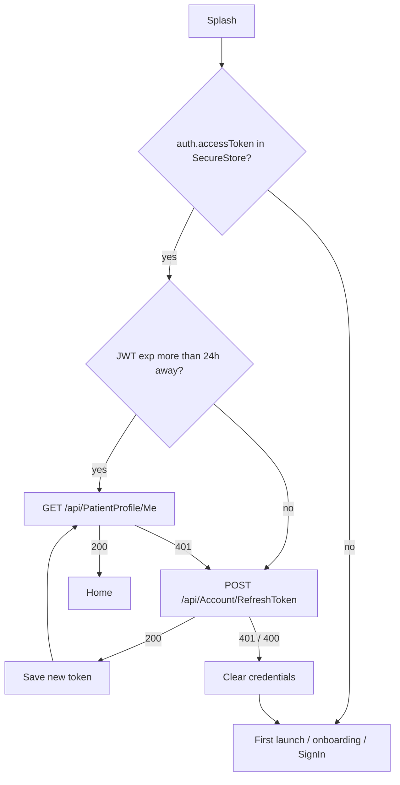
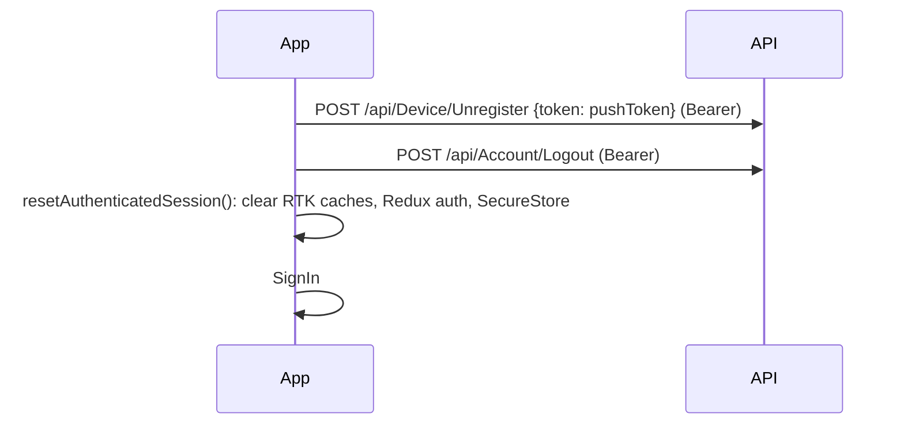
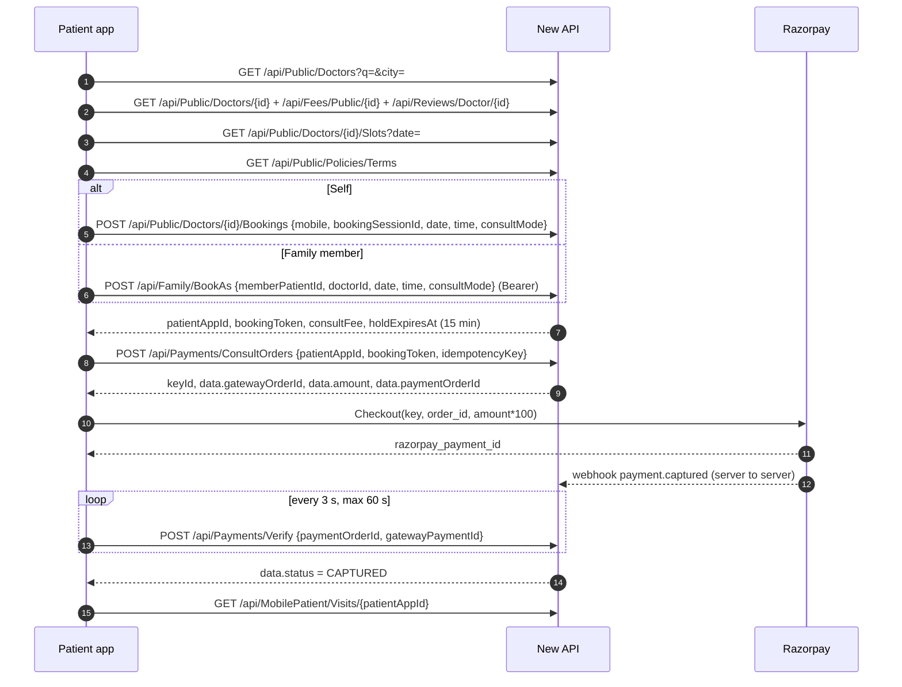
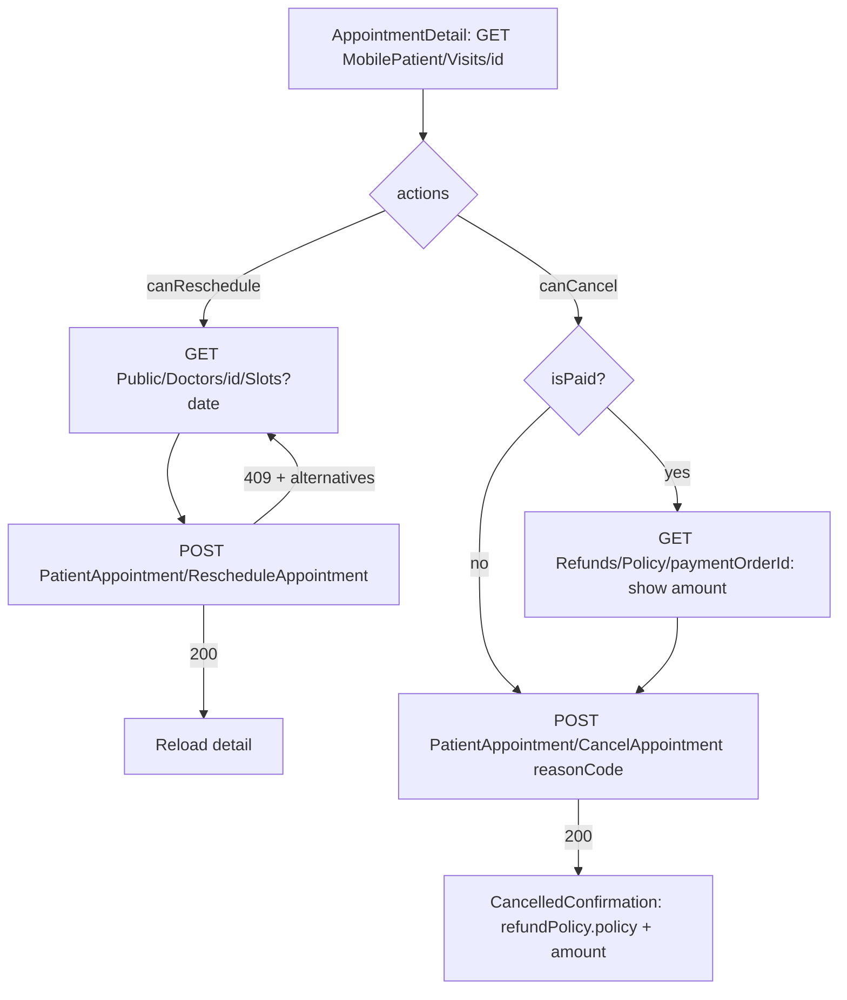
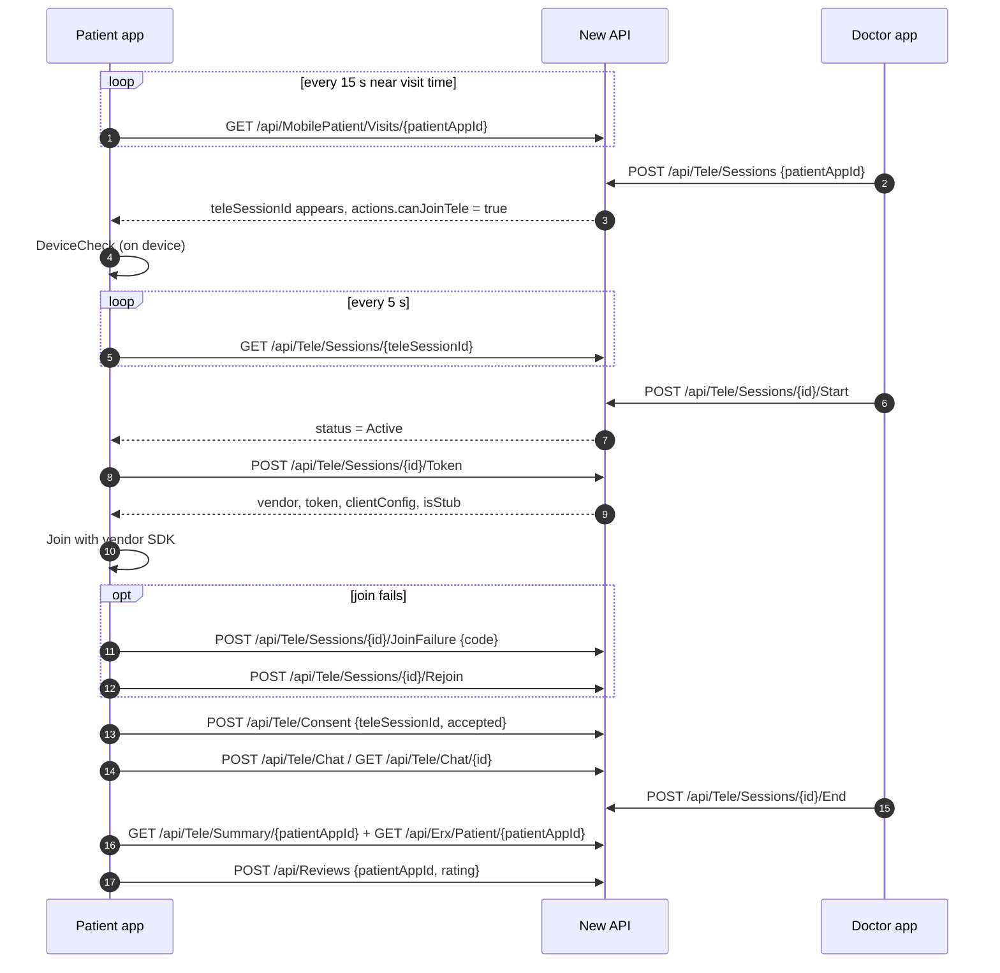
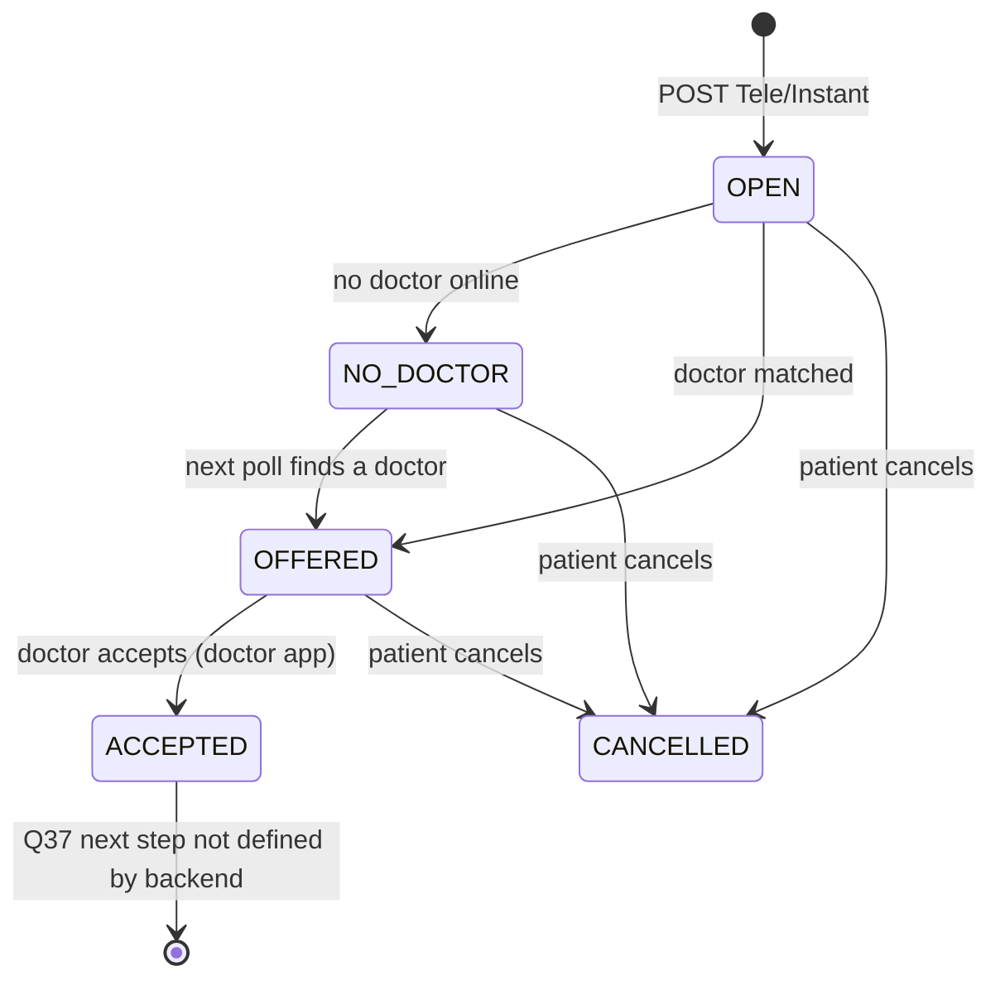
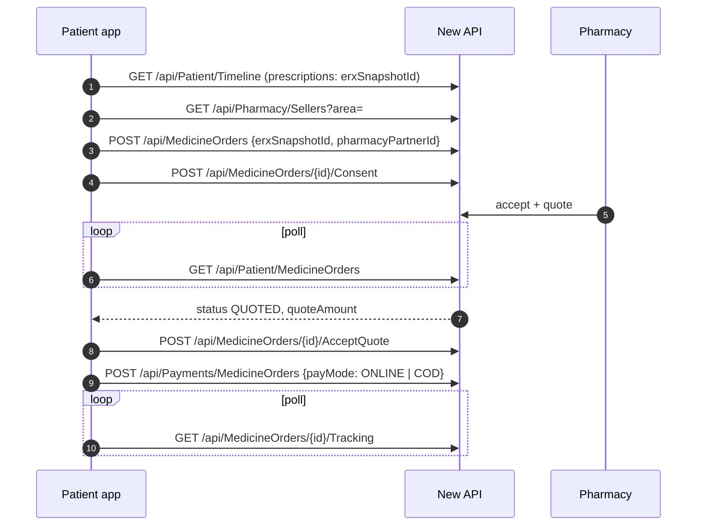
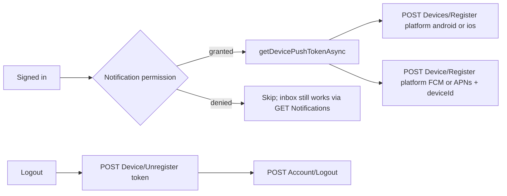

# Patient Mobile App — API Integration Guide

> **Audience: the Patient Mobile App developer only.**
> This guide covers the patient app (`NIGA_PatientApp`) and nothing else. The Doctor Mobile App has its own, separate guide (`DoctorMobile_API_Integration_Guide.md`). The two integrations are independent: different screens, different sign-in, different tokens. Do not copy endpoints from the doctor guide into the patient app.

---

## 0. Read this first

### 0.1 What this document is

This is the complete, self-contained contract between the patient app and the backend. It is written so you can hand it to Cursor (or any coding assistant) as the single source of truth for binding the patient app screens to the API.

It was produced by reading the backend source, the patient app source, and by calling the API. **No mobile code was changed while producing it.**

### 0.2 Instructions for the developer and for Cursor

When you use this guide to implement the integration:

Do not change the backend. Every route, field name and error message below is what the server does today. If something here does not fit the app, raise it with the backend team (see §13 "Open questions").

Use only the New API. The patient app needs nothing from the Old API. Every route below is called on the New API base URL ([https://devmaigrationapi.homeocentrum.com/](https://devmaigrationapi.homeocentrum.com/) — see §3).

Follow the app's existing pattern. The app already uses RTK Query: src/store/api/new/newBaseApi.ts plus feature files that call newBaseApi.injectEndpoints, and controller hooks in src/controllers/use*Controller.ts. Add new endpoints the same way. Keep views free of fetch logic.

Bind one screen at a time, in the order of the prioritized checklist (§11). Replace the static or mock data source of that screen with the API call, then tick the screen off in the acceptance checklist (§12).

Field names are camelCase exactly as shown. Do not rename them in request bodies.

Never log tokens, OTP codes or full request bodies containing personal data in release builds.

Where this guide says "Backend confirmation required", do not guess. Implement the screen with the documented fallback and leave a TODO(backend) comment that names the open question number.

### 0.3 How to read an API card

Every endpoint in §8 is described with the same fields, in this order:

| Field | Meaning |
|---|---|
| Screen · trigger | The patient app screen and the user action (or lifecycle event) that calls it |
| Call order | Where the call sits in its flow (for example "2 of 3 in sign-in") |
| Purpose | What the call does for the user |
| Method · route | HTTP method and path. Append the path to the base URL in §3 |
| Auth · token | `Anonymous` or `Bearer (patient)`; which token to send |
| Headers | Headers to send. All JSON calls send `Content-Type: application/json` and `Accept: application/json` |
| Params | Path and query parameters |
| Request example and field table | Body to send, with type, whether required, and rules |
| Response example and field table | What comes back on success |
| Status codes · errors | Every documented status with the exact message |
| Mobile handling | What the screen should do with each outcome |
| 401 handling | What to do when the token is missing or expired |
| Dependencies | Calls that must happen first |
| Current app status | What the app does today (file and function) |
| Action | **Retain**, **Update**, **Replace**, or **Add new** |
| Old endpoint | The route the app used before, if any |
| Audit status | One of the status labels in §1.4 |
| Verification | How the contract was checked |

Where a value is shown as **"Requires verification"**, the source did not prove it. Do not treat it as guaranteed.

---

## 1. Document control

### 1.1 Sources analysed

| Source | Location | State analysed |
|---|---|---|
| Patient Mobile App | `NIGA_PatientApp` (Expo SDK 57, React Native 0.86, TypeScript, Redux Toolkit + RTK Query) | Commit `1efb723` (05-Oct-2026), working tree clean |
| New API | `NIGA_NewAPI` (.NET 10; `Homeocentrum.Niga.API` + `Homeocentrum.Niga.API.Domain`) | Current source on 10-Oct-2026 |
| Old API | No source on disk. Route inventory: `Documents/OldAPI_Usage_For_Migration_07-Oct-2026.xlsx` (344 routes) | Used only to confirm the patient app needs no Old API route |
| Existing product docs | `Documents/MobileApp_MD/PATIENT_APP_MASTER.md`, `MASTER_APP_FLOW.md`, `Documents/Mobile/NIGA_App_Update_Brief.md` | Context only |

### 1.2 How the contracts were verified

| Evidence | What it means |
|---|---|
| **Source** | Read from the controller, DTO and service code. File references are given where useful. |
| **Local run** | The current New API source was built and run locally (Development settings, local test database) on 10-Oct-2026. A test patient signed in through the real OTP flow and the endpoint was called. Response shapes in this guide come from those calls, with every value replaced by fictitious data. |
| **devapi2 check** | An anonymous or empty request was sent to `https://devapi2.homeocentrum.com` on 10-Oct-2026 to confirm the route is deployed there (for example a `401` or a validation `400` proves the route exists). |

No call was made from a phone. "Working" in the audit means the route is deployed and the contract matches the app; it does not mean the screen was tested on a device.

### 1.3 Sample data

All names, mobile numbers, emails, IDs and tokens in examples are **fictitious**. Real IDs differ per environment (for example, the state list on `devapi2` uses different IDs from a local database). **Never hard-code IDs**; always use the IDs returned by the lists.

### 1.4 Audit status labels

| Label | Meaning |
|---|---|
| **Working — verified from available evidence** | Route is deployed, the app calls it correctly, and the response matches what the app expects |
| **Existing — requires runtime verification** | The app calls it and the contract looks right, but it has not been proven on the target server |
| **Needs endpoint update** | The app calls a wrong, deprecated or non-existent route |
| **Needs request-model update** | Route is right; the request the app sends must change |
| **Needs response-model update** | Route is right; the app's response type or handling must change |
| **Needs authentication update** | Token or auth handling must change |
| **Needs new integration** | The screen uses static or mock data; the API exists and must be bound |
| **Removed or replaced endpoint** | The route the app used is gone or superseded |
| **Backend confirmation required** | The backend does not clearly support the screen, or behaviour is ambiguous |

---

## 2. Summary of findings

The patient app today calls **9 endpoints**. Everything else, roughly 60 screens, shows static seed data from `src/config/*` or local state. The backend already has endpoints for almost every screen.

| # | Finding | Impact | Where |
|---|---|---|---|
| 1 | **The sign-in token is never stored.** `VerifyOtp` returns a 7-day JWT (`token`) and a `user` object for registered patients, but the app's response type has neither, and it never calls `saveAccessToken`. No authenticated call can work. | Blocker | `otpVerificationApi.ts`, `useOtpVerificationController.ts` |
| 2 | The `VerifyOtp` response field is `isUserAlreadyRegistered`. The app reads `isUserRegistered`, which only exists on `RequestOtp`. | Wrong routing after OTP | `otpVerificationApi.ts` |
| 3 | **Push registration calls a route that does not exist** (`POST {api1}/api/notifications/register-device`, without a token). The backend routes are `POST /api/Devices/Register` (used by the push sender) and `POST /api/Device/Register` (device list). See §8.M and open question Q1. | Push never works | `services/notifications/deviceTokenApi.ts` |
| 4 | **New-patient registration is not saved.** CompleteProfile, Consent, PhoneSetup and FamilyMembers only navigate. The backend flow is `POST /api/patient` with `entityType: "PatientMobile"`, then sign in again by OTP. | New patients are never created | `useCompleteProfileController.ts` |
| 5 | No session restore, no 401 handling, no refresh and no server logout. Every cold start goes through onboarding and sign-in. | Poor UX; stale sessions | `AppNavigator.tsx`, `store/session.ts` |
| 6 | Push registration runs **before login**, because `SlideStrip` mounts the Home route immediately and passes `authenticated: true`. | Must move after sign-in | `AppNavigator.tsx` |
| 7 | `RequestOtp` sends the mobile number twice (in the JSON body and as `?mobile=` in the query). | Minor; remove `params` | `signInApi.ts` |
| 8 | The dedicated mobile routes `/api/MobilePatient/*` are **not yet deployed on `devapi2`** (404 on 10-Oct-2026). Their deprecated aliases do work there. | Use aliases until redeploy | §3.2 |
| 9 | Booking, payment, appointments, tele-consult, records, medicines, family, consent, notifications: **all need new integration**. | Bulk of the work | §8 |
| 10 | `VerifyOtp` → `user.patientId` can differ from `PatientProfile/Me` → `patientId` when several patient records share one mobile number. | Use `PatientProfile/Me` | Q4 |
| 11 | Payment is never marked paid by the app. Only the Razorpay webhook (or the clinic) marks it paid; the app must poll. | Payment status design | §8.G |
| 12 | `RequestOtp` returns the real OTP in `devCode` on every environment today. | Security; never show in release builds | Q2 |

---

## 3. Environments and base URLs

### 3.1 Hosts

| Environment | Base URL | Verified identity (10-Oct-2026) | Use for the patient app |
|---|---|---|---|
| Development (New API) | `https://devapi2.homeocentrum.com` | `GET /health` → `{"success":true,"status":"Healthy","api":"New API"}` | **Yes, for development.** See §3.2 for what is deployed |
| Development (Old API) | `https://devapi1.homeocentrum.com` | `GET /health` → `{"api":"Old API"}` | **No.** The patient app needs no Old API route. `legacyBaseApi` has no endpoints and can stay unused |
| `api1` | `https://api1.homeocentrum.com` | `/health` 404; `/api/PatientAuth/*`, `/api/Public/*`, `/api/notifications/register-device` all 404 | **No.** Older deployment. The app's push client and `app.json → extra.apiBaseUrl` point here and must be changed |
| Staging | `https://stageapi1.homeocentrum.com` (listed in the web UI configuration) | Not checked | Not verified — backend/deployment team must provide the correct value |
| Production | — | — | Not verified — backend/deployment team must provide the correct value |
| Local backend | `http://<developer-PC-LAN-IP>:5002` | — | For backend developers only. A phone cannot reach `localhost`; use the PC's LAN IP. Not verified — backend team must confirm the port per machine |

If the API is published behind the IIS reverse proxy, the base URL gains a `/new-api` prefix (for example `http://<host>/new-api`, then `/api/...`). Not verified for mobile use — backend/deployment team must confirm.

### 3.2 What is deployed on `devapi2` today

| Route family | `devapi2` status | What to do |
|---|---|---|
| `/api/PatientAuth/*`, `/api/UserAddressLocation/*`, `/api/mastersAPI/GetLanguages`, `/api/Public/*`, `/api/Help`, `/api/patient`, `/api/PatientProfile/Me`, `/api/Patient/*`, `/api/Payments/*`, `/api/Device/*` | Deployed (200, or 401/400 proving the route exists) | Call normally |
| `/api/MobilePatient/Welcome`, `/Home`, `/Visits/{id}`, `/Waitlist/Offers` | **404** (build predates these routes) | Until `devapi2` is redeployed, call the deprecated aliases, which run the same code: `/api/Welcome/Patient`, `/api/PatientPortal/Home`, `/api/Patient/Visits/{id}`, `/api/Waitlist/Offers`. Switch to `/api/MobilePatient/*` once Q3 is closed |
| `/api/notifications/register-device` | Not an API route | Do not call (see §8.M) |

### 3.3 Recommended configuration (recommendation, not current behaviour)

Today the app has three host constants: `API_CONFIG.new.baseUrl` (devapi2), `API_CONFIG.legacy.baseUrl` (devapi1, unused) and `AppConfig.apiBaseUrl` / `app.json → extra.apiBaseUrl` (api1, used only for push). Recommended:

1. Keep **one** API host for the patient app: `API_CONFIG.new.baseUrl`.
2. Choose it per build profile (development, staging, production) through `app.json`/`eas.json` `extra` values, not hard-coded strings. The staging and production values must come from the deployment team.
3. Route push registration through the same RTK `newBaseApi` (so it carries the Bearer token), and stop using `services/api/client.ts` for API calls.
4. Add a request timeout to `newBaseApi` (the fetch client uses 20 s; RTK has none today).

### 3.4 Swagger

| Item | Value |
|---|---|
| Swagger UI | `{API_BASE}/swagger` (requires a Swagger sign-in; credentials come from the backend team and must not be stored in the app) |
| Patient app document | `{API_BASE}/swagger/mobile-patient/swagger.json` |
| Shared endpoints | `{API_BASE}/swagger/common/swagger.json` |
| Everything | `{API_BASE}/swagger/v1/swagger.json` |
| Caveat | Swagger lists request bodies but almost no response schemas. **This guide is the response reference.** Some endpoints the patient app needs are tagged "Web" in Swagger (for example `POST /api/patient`, `POST /api/Reviews`, `/api/Support/*`, `/api/Patient/Payments`). They work with a patient token; see Q5. |

---

## 4. API conventions

### 4.1 JSON and types

| Topic | Rule |
|---|---|
| Field names | camelCase in requests and responses |
| Nulls | Null fields are **included** in responses (`"email": null`); do not assume a missing key |
| Empty strings | For nullable numbers, booleans and dates, `""` is read as `null`. For strings, `""` stays `""` (for example `PUT /api/Family/{id}` with `"email": ""` clears the email) |
| Lenient input | A JSON number is accepted for a string field (`"mobile": 9876500011` works); booleans accept `true`, `"true"`, `1` |
| Dates | ISO-8601. The offset varies: values the server creates with UTC end in `Z` (for example OTP `expiresAt`, booking `holdExpiresAt`); values from the database have no offset; some use the server's local offset (`devapi2` returned `-07:00`, a local run returned `+05:30`). **Use only the date part of appointment dates**, and treat `holdExpiresAt`/`expiresAt` as UTC |
| Times | Appointment times are strings: `"HH:mm:ss"` in most responses, `"HH:mm"` in visit lists and visit detail. Send times as `"HH:mm"` (`"10:30"`); `"10:30:00"` and `"10:30 AM"` are also accepted |
| Money | Decimal rupees (`700.0`), currency `"INR"` unless stated |
| IDs | Integers. Never hard-code; IDs differ per environment |
| Gender | Integer: `0` Male, `1` Female, `2` Other |

### 4.2 Response envelopes

Most endpoints wrap results as `{ "success": true, "data": ... }`. **Exceptions you must handle:**

| Endpoint | Shape |
|---|---|
| `GET /api/mastersAPI/GetLanguages` | Bare JSON array (no `success`, no `data`) |
| `POST /api/PatientAuth/RequestOtp`, `VerifyOtp` | Flat object (`success`, `otpChallengeId`, …; no `data`) |
| `POST /api/patient` | The saved patient object itself (no `success`) |
| `POST /api/PatientAppointment/RescheduleAppointment`, `CancelAppointment` | `{ statusCode, message, appointment, alternatives, notification, waitlistOffer, refundPolicy }` — **no `success` field**; use the HTTP status |
| `GET /api/Reviews/Doctor/{doctorId}` | `{ success, data: [...], averageRating, reviewCount }` |
| `GET /api/Family` | `{ success, ownerPatientId, ownerPatientName, isActingAsCaregiver, data: [...] }` |
| `POST /api/Account/RefreshToken` | Token is at top level `token` (not inside `data`) |

### 4.3 Error shapes

The server returns several error shapes. Handle all of them with one parser that reads `message` first, then the first entry of `errors`.

| Shape | When | Example |
|---|---|---|
| **Validation** | A field fails model validation (runs before the endpoint code) | `{"success":false,"message":"Please check the highlighted fields.","traceId":"0HN…:0001","errors":{"Mobile":["The Mobile field is required."]}}` — keys in `errors` are C# property names (PascalCase) |
| **Simple** | Business rule failure | `{"success":false,"message":"OTP expired."}` |
| **Coded** | Newer services | `{"success":false,"code":"FORBIDDEN","message":"A patient profile is required."}` — codes: `VALIDATION`, `FORBIDDEN`, `NOT_FOUND`, `CONFLICT`, `UNAUTHORIZED`, `SERVER`, `SCHEMA`, `GATEWAY`, plus specific ones listed per endpoint |
| **Plain text** | A few older endpoints (`POST /api/patient` on save failure) | `"Patient not found for update"` (a JSON string, not an object) |
| **Empty 401** | Missing, malformed, expired or signed-out token on a protected route | HTTP 401, **empty body**, header `WWW-Authenticate: Bearer` (or `Bearer error="invalid_token"`) |
| **Empty 403** | A few endpoints use a framework "forbid" | HTTP 403, empty body |
| **Server error** | Unexpected failure | `{"success":false,"status":500,"message":"Something went wrong on our side. Please try again. If it keeps happening, contact support with the error id.","errorId":"E261010-1A2B3C4D","traceId":"…"}` — show the message and `errorId` |

### 4.4 Global statuses

| Status | Meaning | App behaviour |
|---|---|---|
| 400 | Validation or business rule | Show `message` (or the field message) next to the input |
| 401 | Not signed in / token invalid | See §5.6 |
| 403 | Signed in but not allowed (wrong patient, wrong role) | Show the message; do not retry; do not sign out |
| 404 | Not found | Show an empty or "not found" state |
| 409 | Conflict (slot taken, already done) | Show the message; refresh the data |
| 413 / 415 / 422 | Upload too large / wrong file type / virus scan failed | Show the message; let the user pick another file |
| 429 | Too many requests (global limit; OTP limits) | Show "Please wait a moment and try again."; back off; do not auto-retry in a loop |
| 500 / 502 / 503 | Server, payment gateway or maintenance | Show the message and `errorId` if present; offer retry. 503 may carry `Retry-After` |

Global rate limit: 1000 requests per 60 seconds per signed-in user (or per IP when anonymous), as configured in the committed `appsettings.json`. The deployed value may differ.

### 4.5 Headers

| Header | When |
|---|---|
| `Content-Type: application/json` | Every JSON body |
| `Accept: application/json` | Every call |
| `Authorization: Bearer <token>` | Every protected call. Sending it to anonymous routes is harmless |
| `X-Correlation-Id` | Optional. Letters, digits, `-`, `_`, up to 80 chars. The server echoes it; useful for support |

Do **not** send cookies. A POST, PUT, PATCH or DELETE that carries a `Cookie` header and no Bearer token is refused with 403 "This browser call needs a Bearer token. Cookie-only changes are refused."

### 4.6 File uploads

Multipart uploads go through a server-side scanner before the endpoint runs. Any one bad file rejects the whole request:

| Status | Message |
|---|---|
| 400 | `The file is empty.` |
| 413 | `The upload is too large or malformed.` |
| 415 | `The file content does not match its extension.` / `This file type is not allowed.` / `Executable or script content is not allowed.` / `The file name is not valid.` |
| 422 | `The file failed the virus scan and was not saved.` |
| 503 | `{"success":false,"code":"UPLOAD_SCAN_UNAVAILABLE","message":"File scanning is not available right now. Please try again later."}` |

React Native: send real file parts (`{ uri, name, type }` in `FormData`). If you use `expo/fetch`, it rejects `{uri,name,type}` parts; the doctor app works around this with `expo-file-system` `File` objects. Use plain `fetch` or follow the same approach.

---

## 5. Authentication, session and security

### 5.1 Existing behaviour in the app (as of commit `1efb723`)

| Area | Today |
|---|---|
| Sign-in | Mobile number → `RequestOtp` → `VerifyOtp`. Only `bookingSessionId` and `mobile` are kept, in Redux, not persisted |
| Token storage | `src/services/secureStorage.ts` has `auth.accessToken` / `auth.refreshToken` keys and save/get/delete helpers, but **nothing ever saves a token** |
| Token attach | `src/store/api/prepareAuthHeaders.ts` adds `Authorization: Bearer` when a token exists (it never does) |
| Session restore | None. Every launch: splash → language → onboarding → sign-in |
| 401 handling | None |
| Refresh | None |
| Logout | Navigates to sign-in only. `resetAuthenticatedSession()` in `store/session.ts` exists but is never called |
| Identity in state | No `userId` or `patientId` in Redux |

### 5.2 Backend facts

| Item | Value |
|---|---|
| Token type | JWT, HMAC-SHA512, issuer `Homeocentrum.Niga.API`, audience `Homeocentrum.Niga.Client` |
| Lifetime | **7 days** (from `VerifyOtp` and from `RefreshToken`). Clock skew tolerance 2 minutes |
| Claims | `nameid` = user id, `unique_name` = login name, `role` / `RoleName` = `Patient`, `RoleId`, `jti`. **No `patientId` claim** — the server looks up the patient for each request |
| Refresh | `POST /api/Account/RefreshToken` swaps a token that is still valid, or expired **less than 7 days ago**, for a new 7-day token. The old token is revoked. No separate refresh token exists |
| Logout | `POST /api/Account/Logout` revokes the current token. The revocation list is held in server memory: it is lost on API restart, so a revoked token can work again after a restart until it expires |
| OTP | 6 digits, valid 10 minutes, max 3 requests per mobile per minute, 5 wrong attempts lock for 15 minutes |
| `devCode` | `RequestOtp` returns the actual OTP in `devCode` on every environment today (SMS sending is not wired). See Q2 |

### 5.3 How the server decides "which patient" (important for family and caregivers)

The token identifies a **login**, not a patient. For each request the server resolves the patient:

| Endpoint group | Resolution |
|---|---|
| `PatientProfile/Me` | The login's **primary** linked patient |
| Most patient endpoints (`/api/Patient/*`, `/api/Erx/*`, `/api/MedicineOrders/*`, `/api/Payments/*`, `MobilePatient/Home`, `/api/Family`) | **If the login has an active caregiver grant for someone, the oldest granted patient wins**; otherwise the login's own patient (primary first) |
| `RescheduleAppointment`, `CancelAppointment`, `Tele/*` sessions | Any patient directly linked to the login; caregiver grants are **not** considered |
| Booking for a family member | Explicit `memberPatientId` in `POST /api/Family/BookAs` |

There is no header or parameter to switch the "acting as" patient. If a patient is also someone's caregiver, most screens show the cared-for patient. See Q6.

### 5.4 Required sign-in flow (recommendation built on the existing backend)

```mermaid
sequenceDiagram
  autonumber
  participant App as Patient app
  participant API as New API
  App->>API: POST /api/PatientAuth/RequestOtp {mobile}
  API-->>App: 200 {otpChallengeId, expiresAt, destinationMasked, devCode, isUserRegistered}
  App->>API: POST /api/PatientAuth/VerifyOtp {mobile, code}
  alt isUserAlreadyRegistered = true
    API-->>App: 200 {bookingSessionId, token, user{userId, patientId, ...}}
    App->>App: SecureStore auth.accessToken = token; Redux user; bookingSessionId
    App->>API: GET /api/PatientProfile/Me (Bearer)
    App->>API: GET /api/Consent/PrivacyStatus (Bearer)
    App->>API: POST /api/Devices/Register + /api/Device/Register (Bearer)
    App->>App: Home
  else isUserAlreadyRegistered = false
    API-->>App: 200 {bookingSessionId, mobile, isUserAlreadyRegistered:false}
    App->>App: CompleteProfile form
    App->>API: POST /api/patient {entityType:"PatientMobile", patientID:0, ...}
    API-->>App: 200 saved patient (no token)
    App->>API: POST /api/PatientAuth/RequestOtp {mobile}
    App->>API: POST /api/PatientAuth/VerifyOtp {mobile, code}
    API-->>App: 200 {token, user}
    App->>App: store token, then Consent, then Home
  end
```

### 5.5 Session restore at launch (recommendation)



Persist an "onboarding seen" flag (AsyncStorage) so returning users skip language and onboarding. `PUT /api/PatientProfile/Me` can also store `welcomeVersionSeen` and `preferredLanguageId` on the server.

### 5.6 Handling 401 (recommendation)

Wrap `newBaseApi`'s base query:

1. On **401** from any protected call, call `POST /api/Account/RefreshToken` once (send the current token in the Authorization header or `{ "token": "<current>" }`), using a single shared in-flight promise so parallel calls do not refresh several times.
2. If refresh returns 200: save `token`, retry the original request once.
3. If refresh returns 401 (`TOKEN_INVALID`, `SESSION_EXPIRED`, `SIGNED_OUT`, `ACCOUNT_INACTIVE`) or 400 `TOKEN_REQUIRED`: call `resetAuthenticatedSession()`, unregister the push token if you can, and go to SignIn with the message "Your session has ended. Please sign in again."
4. Never refresh on 403. A 403 means "signed in but not allowed".
5. Refresh proactively when the token is within 24 hours of expiry (decode `exp` from the JWT payload; no signature check is needed on the device).

### 5.7 Logout (recommendation)



Ignore network errors from the two server calls; always clear local state.

### 5.8 Security recommendations

These are recommendations. They do not describe current behaviour.

1. Store the token only in SecureStore (already available). Never in AsyncStorage, Redux persistence or logs.
2. Show `devCode` only in development builds (`__DEV__`), never in release builds, even if the server returns it.
3. Do not log request or response bodies in release builds.
4. Remove the hard-coded seed identity (`'Pranav Kulkarni'`, `'9028898963'`, `'pranav@example.com'`) once screens are bound.
5. Use HTTPS hosts only; disallow cleartext traffic in release builds.
6. Wire `setCrashUserId` (Crashlytics) with the user id only, not the mobile number or name.
7. Treat the `bookingToken` returned by bookings as a secret: anyone holding it can read that booking.

---

## 6. Old-to-new migration mapping

The patient app has **never called the Old API**: `legacyBaseApi` has no endpoints, and none of the 9 routes the app calls exist only in the Old API. The table therefore maps every call the app makes today, and every deprecated alias it may meet, to the route it must use.

| Feature / screen | Old (current app) method + endpoint | New method + endpoint | Request changes | Response changes | Auth changes | Required mobile action | Status / verification |
|---|---|---|---|---|---|---|---|
| FirstLaunch language list | `GET api/mastersAPI/GetLanguages` (devapi2) | Same | None | None (bare array) | None (anonymous) | Retain | Working — verified from available evidence (devapi2 200) |
| SignIn send OTP | `POST api/PatientAuth/RequestOtp` with body **and** `?mobile=` | `POST /api/PatientAuth/RequestOtp` | Remove `params: body`; body `{mobile}` only | None | None | Update request | Needs request-model update |
| OTP verify | `POST api/PatientAuth/VerifyOtp` | Same | None | Add `isUserAlreadyRegistered`, `token`, `user` to the type; stop reading `isUserRegistered` | **Store `token`**; attach Bearer to later calls | Update response type and controller | Needs response-model update + Needs authentication update |
| SignIn / CompleteProfile location lists | `GET api/UserAddressLocation/Countries`, `States/ByCountry/{id}`, `Districts/ByState/{id}`, `Cities/ByDistrict/{id}` | Same; add `PinCodes/ByCity/{cityId}` if a PIN picker is wanted | None | None | None | Retain | Working — verified from available evidence (devapi2 200) |
| Push register | `POST https://api1.homeocentrum.com/api/notifications/register-device` `{pushToken, platform:'android'|'ios'}`, no token | `POST /api/Devices/Register` `{platform:'android'|'ios', token}` and `POST /api/Device/Register` `{platform:'FCM'|'APNs', token, deviceId}` — see §8.M and Q1 | Field `pushToken` → `token`; platform values differ per route | Different | **Bearer required** | Replace | Removed or replaced endpoint (api1 404) |
| Push unregister | `DELETE {api1}/api/notifications/unregister-device` | `POST /api/Device/Unregister` `{token}` or `{devicePushTokenId}` | Method DELETE → POST | `{success, message}` | Bearer | Replace | Removed or replaced endpoint |
| Onboarding slides | Static `ONBOARDING_SLIDES` | `GET /api/MobilePatient/Welcome` (alias `GET /api/Welcome/Patient` until devapi2 redeploy) | — | — | Anonymous | Add new | Needs new integration |
| Home dashboard | Static | `GET /api/MobilePatient/Home` (alias `GET /api/PatientPortal/Home`) | — | — | Bearer | Add new | Needs new integration |
| Visit detail | Static / local | `GET /api/MobilePatient/Visits/{patientAppId}` (alias `GET /api/Patient/Visits/{patientAppId}`) | — | — | Bearer | Add new | Needs new integration |
| Waitlist offers | None | `GET /api/MobilePatient/Waitlist/Offers` (alias `GET /api/Waitlist/Offers`) | — | — | Anonymous | Add new | Needs new integration |
| Profile save on signup | None | `POST /api/patient` (`entityType:"PatientMobile"`) | — | — | Anonymous for create | Add new | Needs new integration; Backend confirmation required (Q5, Swagger tags it Web) |
| Session | None | `POST /api/Account/RefreshToken`, `POST /api/Account/Logout` | — | — | Bearer | Add new | Needs authentication update |

Old API routes that also exist in the New API (`Account/Login`, `Account/Logout`, `Account/SubscriptionStatus`, `mastersAPI/GetPackages`, `POST api/patient`) are reached on the New API only. The patient app must not call `devapi1`.

---

## 7. Screen inventory and navigation

### 7.1 Navigation model (current)

There is no react-navigation. `src/navigation/AppNavigator.tsx` is a step machine: `splash → firstLaunch → onboarding → signIn → otp → completeProfile → consent → phoneSetup → familyMembers → home`. Inside `home`, `HomeRoute` shows one overlay at a time (appointment detail, booking, consult now, records, and so on) and four tabs: Home, Doctors (bookings), Records, Medicines, Account.

`SlideStrip` renders every step at once and only slides between them. As a result every route, Home included, mounts right after the splash, and all their effects and queries run before sign-in. **When binding authenticated queries, add `skip: !isAuthenticated`** (or move Home out of `SlideStrip`) so protected calls do not fire before the token exists.

### 7.2 Screen → API map

"Today" is the current data source. "Bind to" lists the endpoints in §8 (card IDs in brackets).

| Screen (view / controller) | Today | Bind to | Status |
|---|---|---|---|
| Splash (`useSplashController`) | 2.8 s timer | Session restore: `Account/RefreshToken`, `PatientProfile/Me` [A3, C4] | Needs authentication update |
| FirstLaunch (`useFirstLaunchController`) | `GetLanguages` + fallback | `GetLanguages` [A2]; save choice later via `PUT PatientProfile/Me` [C5] | Working — verified from available evidence |
| Onboarding (`useOnboardingController`) | Static slides | `MobilePatient/Welcome` [A1] | Needs new integration |
| SignIn (`useSignInController`) | `Countries`, `RequestOtp` | [B1], [B3] | Needs request-model update |
| OtpVerification (`useOtpVerificationController`) | `VerifyOtp`, `RequestOtp` | [B2], [B1] | Needs response-model update; Needs authentication update |
| CompleteProfile, onboarding mode (`useCompleteProfileController`) | Location lists; no save | `POST /api/patient` [C1]; location lists [C2]; for a signed-in user `PUT PatientProfile/Me` [C5] | Needs new integration |
| CompleteProfile, edit mode | Static seed | `GET/PUT PatientProfile/Me` [C4, C5]; `GET/PUT Patient/Profile` [C6, C7] | Needs new integration |
| Consent (`useConsentController`) | Local toggles | `Consent/PrivacyStatus` [D1], `Consent/GrantPrivacy` [D2], `Patient/Consents` [D3], type grant [D4] | Needs new integration |
| PhoneSetup (`usePhoneSetupController`) | Device permissions | After permission: push register [M1, M2] | Needs new integration |
| FamilyMembers (onboarding + account) | Static seed | `Family` CRUD + Relations [E1–E7] | Needs new integration |
| Home (`useHomeController`) | Static + local | `MobilePatient/Home` [F1], `PatientPortal/CareCategories` [F2], `Public/Articles` [F3], `Notifications` [M4] | Needs new integration |
| Bookings tab / MyAppointments | Local list | `Patient/Visits` [H1] | Needs new integration |
| Account (`useAccountController`) | Static | `PatientProfile/Me` [C4], `Account/Logout` [A4], `Patient/DataRequests` [D6] | Needs new integration |
| SearchDoctors / SearchResults | Static | `Public/Doctors` [G1] | Needs new integration |
| DoctorProfile + Credentials tab | Static | `Public/Doctors/{id}` [G2], `Ranking` [G3], `Fees/Public` [G5], `Reviews/Doctor` [G6], `Tele/Availability/{id}` [G7], `Profile/Photo` [G8] | Needs new integration |
| BookAppointment | Synthetic slots | `Public/Doctors/{id}/Slots` [G4], `Waitlist/Join` [G15], `Family` [E1] | Needs new integration |
| BookingReview | Local | `Public/Policies/Terms` [G11], `Public/Doctors/{id}/Bookings` [G9] or `Family/BookAs` [E8], `Tele/Consent` (tele only, after session) | Needs new integration |
| BookingPayment | Simulated | `Payments/ConsultOrders` [G12] + Razorpay Checkout | Needs new integration |
| PaymentStatus | Simulated timer | `Payments/Verify` [G13], `Payments/Appointments/{id}` [G14], `Public/Bookings/{token}` [G10] | Needs new integration |
| AppointmentDetail / ClinicAppointment / CancelledConfirmation | Local | `MobilePatient/Visits/{id}` [H2], `ChangeLog` [H3], `CancelAppointment` [H5], `Refunds/Policy` [H6] | Needs new integration |
| RescheduleAppointment | Local | `Slots` [G4] + `RescheduleAppointment` [H4] | Needs new integration |
| ClinicCheckIn | Local | No patient check-in endpoint | Backend confirmation required (Q7) |
| DeviceCheck | Mock | `Tele/DeviceCheck` [I4] (static) + on-device checks | Needs new integration |
| WaitingRoom | Timers | `Tele/Sessions/{id}` poll [I5] | Needs new integration |
| VideoCall | Simulated | `Tele/Sessions/{id}/Token` [I6], `Rejoin` [I7], `Tele/Consent` [I9]; video SDK | Needs new integration; Backend confirmation required (Q8, vendor) |
| JoinFailed | Mock | `Tele/Sessions/{id}/JoinFailure` [I8] | Needs new integration |
| ConsultationChat | Static | `Tele/Chat` [I10, I11] | Needs new integration |
| ConsultationComplete | Static | `Tele/Summary/{id}` [I12], `Erx/Patient/{id}` [J3] | Needs new integration |
| RateConsultation | Local | `POST /api/Reviews` [L1] | Needs new integration |
| ConsultNow / Searching / Unavailable | Static offers | `Tele/Instant` [I1], status poll [I2], cancel [I3], `Support/AssistanceRequest` for callback [L6] | Needs new integration |
| HealthRecords + ConsultationRecord + Prescription + UploadDocument | Static | `Patient/Timeline` [J1], `Consultations/{id}/Note` [J2], `Erx/Patient/{id}` [J3], `Erx/{id}/Pdf` [J4], `Patient/Documents` [J5–J8] | Needs new integration |
| Medicines tab | Static | `Patient/MedicineOrders` [K1], `Erx/Refills` [K9, K10], `Patient/Timeline` prescriptions [J1] | Needs new integration |
| OrderMedicines / ChoosePharmacy / ReviewOrder / MedicineCheckout | Static | `MedicineOrders` [K2], `Pharmacy/Sellers` [K3], `Consent` [K4], `AcceptQuote` [K5], `Payments/MedicineOrders` [K6] | Needs new integration |
| OrderTracking / OrderDetails | Static | `MedicineOrders/{id}/Tracking` [K7], refill [K8–K10] | Needs new integration |
| FollowUpPlan | Static | `Patient/FollowUps` [J9, J10] | Needs new integration |
| SymptomDiary (+ entry) | Static | `Patient/Diary` [J11–J14] | Needs new integration |
| CliniSightProgress / HealthInsights | Static | `Patient/Progress` [J15] (partial) | Needs new integration; Backend confirmation required for extra metrics (Q9) |
| RemindersCentre | Static | No patient reminder endpoint | Backend confirmation required (Q10); keep local |
| Payments (account) | Static | `Patient/Payments` [G16], `Refunds/Policy` [H6] | Needs new integration |
| ConsentCentre | Local toggles | `Patient/Consents` [D3], type grant [D4], withdraw [D5], data requests [D6] | Needs new integration |
| MyReviews / AppealReview | Static / local | No patient "my reviews" list; appeals are doctor-only | Backend confirmation required (Q11) |
| HelpCentre | Static | `Help` [L4], `Help/{slug}` [L5] | Needs new integration |
| RaiseTicket | Local | `Support/Tickets` [L2], `Mine` [L3], messages [L3b, L3c] | Needs new integration |
| BookWithHelp | Static | `Support/AssistanceRequest` [L6] | Needs new integration |
| LegalDocument | Static | `Public/Policies/{type}` [G11] | Needs new integration; Backend confirmation required for types other than `Terms` (Q12) |
| Notifications inbox | Static | `Notifications` [M4], `PATCH Notifications/{id}` [M5] | Needs new integration |
| NotificationSettings | Local | No preferences endpoint | Backend confirmation required (Q13); keep local |
| HealthTipArticle | Static | `Public/Articles/{id}` [F4] | Needs new integration |
| Offline | NetInfo | None | No backend needed |

---

## 8. Screen-by-screen API reference

`{API_BASE}` is the New API host from §3 (for development: `https://devapi2.homeocentrum.com`). All routes start with `/api/`. In the app's RTK files, paths are written without the leading slash (`api/PatientAuth/RequestOtp`) because `newBaseApi` ends with `/`.

"Standard headers" means `Accept: application/json`, plus `Content-Type: application/json` when there is a JSON body, plus `Authorization: Bearer <token>` when Auth is Bearer.

Sample token used in examples: `eyJhbGciOiJIUzUxMiIsInR5cCI6IkpXVCJ9.<payload>.<signature>` (not a real token).

---

### A. Launch and session

#### A1 · Onboarding slides — `GET /api/MobilePatient/Welcome`

| Item | Value |
|---|---|
| Screen · trigger | Onboarding (`OnboardingSlideView` / `useOnboardingController`) · on mount |
| Call order | Independent; can be prefetched during splash |
| Purpose | Server-managed welcome slides (falls back to three built-in slides when none are configured) |
| Method · route | `GET /api/MobilePatient/Welcome` — **until `devapi2` is redeployed use `GET /api/Welcome/Patient`** (same code) |
| Base URL | `{API_BASE}` |
| Auth · token | Anonymous · none |
| Headers | Standard |
| Params | None |
| Status codes | 200, 500 |
| 401 handling | Not applicable |
| Dependencies | None |
| Current app status | Static `ONBOARDING_SLIDES` in `useOnboardingController.ts` |
| Action | **Add new** (keep the static slides as offline fallback) |
| Old endpoint | None |
| Audit status | Needs new integration |
| Verification | Source; local run 200; `devapi2`: `/api/Welcome/Patient` 200, `/api/MobilePatient/Welcome` 404 |

Request: no body.

Response 200:

```json
{
  "success": true,
  "data": {
    "version": "1",
    "audience": "Patient",
    "slides": [
      { "welcomeSlideId": 1, "sortOrder": 1, "title": "Welcome to Homeocentrum", "body": "Book trusted homeopathy doctors near you.", "version": "1" },
      { "welcomeSlideId": 2, "sortOrder": 2, "title": "Family first", "body": "Manage visits for your whole family.", "version": "1" }
    ]
  }
}
```

| Field | Type | Description |
|---|---|---|
| `data.version` | string | Always `"1"` today |
| `data.slides[].welcomeSlideId` | number | Slide id (0 or small numbers for built-in slides) |
| `data.slides[].sortOrder` | number | Display order (already sorted) |
| `data.slides[].title`, `body` | string | Slide text. **The `devapi2` data contained garbled characters (encoding issue) on 10-Oct-2026**; see Q14 |
| `data.slides[].version` | string | Slide version; store the highest seen in `welcomeVersionSeen` (C5) |

Mobile handling: render slides in `sortOrder`. On error, use the static slides. No images are returned; keep local illustrations by index.

---

#### A2 · Language list — `GET /api/mastersAPI/GetLanguages`

| Item | Value |
|---|---|
| Screen · trigger | FirstLaunch (`useFirstLaunchController`, `useGetLanguagesQuery`) · on mount |
| Call order | 1st call after splash |
| Purpose | Languages the patient can choose |
| Method · route | `GET /api/mastersAPI/GetLanguages` |
| Base URL | `{API_BASE}` |
| Auth · token | Anonymous · none |
| Headers | Standard |
| Params | None |
| Status codes | 200, 500 |
| 401 handling | Not applicable |
| Dependencies | None |
| Current app status | Implemented in `store/api/new/firstLaunchApi.ts`; fallback list English/Marathi |
| Action | **Retain**. Add: persist the choice locally and, after sign-in, send it as `preferredLanguageId` (C5) |
| Old endpoint | Same route |
| Audit status | Working — verified from available evidence |
| Verification | Source; local run 200; `devapi2` 200 |

Response 200 (**bare array**, no `success` wrapper):

```json
[
  { "languageId": 1, "languageName": "English", "description": "English", "isDeleted": false },
  { "languageId": 2, "languageName": "Marathi", "description": "मराठी", "isDeleted": false }
]
```

| Field | Type | Description |
|---|---|---|
| `languageId` | number | Send as `preferredLanguageId` |
| `languageName` | string | Display name |
| `description` | string | Native-script name |
| `isDeleted` | boolean \| null | Always false/null in this list |

Mobile handling: map `languageName` to the app's i18n locale (`en`, `mr`, `hi`). An empty array is a valid 200; use the fallback.

---

#### A3 · Refresh session — `POST /api/Account/RefreshToken`

| Item | Value |
|---|---|
| Screen · trigger | Splash (session restore), and the 401 wrapper (§5.6) |
| Call order | Splash: before `PatientProfile/Me` when the stored token is near or past expiry |
| Purpose | Exchange the current token (valid, or expired less than 7 days ago) for a new 7-day token |
| Method · route | `POST /api/Account/RefreshToken` |
| Base URL | `{API_BASE}` |
| Auth · token | Anonymous route; send the **current** token either in the body or as `Authorization: Bearer` |
| Headers | Standard |
| Params | None |
| Status codes | 200, 400, 401, 404, 500 |
| 401 handling | A 401 from this call means "sign in again": clear credentials, go to SignIn. Never retry refresh |
| Dependencies | A stored token from B2 |
| Current app status | Not implemented |
| Action | **Add new** |
| Old endpoint | None |
| Audit status | Needs authentication update |
| Verification | Source; local run 200 with a patient token |

Request:

```json
{ "token": "eyJhbGciOiJIUzUxMiIsInR5cCI6IkpXVCJ9.<payload>.<signature>" }
```

| Field | Type | Required | Rules |
|---|---|---|---|
| `token` | string | Optional if the Authorization header carries the token | The current JWT |

Response 200:

```json
{
  "success": true,
  "message": "Session refreshed.",
  "token": "eyJhbGciOiJIUzUxMiIsInR5cCI6IkpXVCJ9.<new-payload>.<signature>",
  "expiresAt": "2026-10-17T10:15:00+05:30",
  "user": { "userId": 20451, "userName": "9876500011", "firstName": "Asha", "lastName": "Kulkarni", "role": "Patient", "roleId": 4, "doctorId": null }
}
```

| Field | Type | Description |
|---|---|---|
| `token` | string | New token. **Replace** the stored token; the old one is revoked immediately |
| `expiresAt` | string | Approximate expiry in server local time. Prefer the JWT `exp` claim |
| `user` | object | Login identity. No `patientId` here; call C4 |

Errors:

| Status | Body |
|---|---|
| 400 | `{"success":false,"code":"TOKEN_REQUIRED","message":"Send the current token in the body or the Authorization header."}` |
| 401 | `{"success":false,"code":"TOKEN_INVALID","message":"This token is not valid. Sign in again."}` |
| 401 | `{"success":false,"code":"SESSION_EXPIRED","message":"The session expired more than 7 days ago. Sign in again."}` |
| 401 | `{"success":false,"code":"SIGNED_OUT","message":"This session was signed out. Sign in again."}` |
| 401 | `{"success":false,"code":"ACCOUNT_INACTIVE","message":"Account is deactivated. Please contact administrator."}` |
| 404 | `{"success":false,"code":"REFRESH_DISABLED","message":"Token refresh is turned off. Please sign in again."}` |

Mobile handling: on 200 save the token in SecureStore before retrying any request. On any error, sign out locally.

---

#### A4 · Sign out — `POST /api/Account/Logout`

| Item | Value |
|---|---|
| Screen · trigger | Account → Log out |
| Call order | After M3 (device unregister); before clearing local state |
| Purpose | Revoke the current token on the server |
| Method · route | `POST /api/Account/Logout` |
| Base URL | `{API_BASE}` |
| Auth · token | Bearer (patient) |
| Headers | Standard + Bearer |
| Params | None; no body |
| Status codes | 200, 401, 500 |
| 401 handling | Ignore; the token is already unusable. Continue local sign-out |
| Dependencies | Signed in |
| Current app status | `onLogOut` only navigates to SignIn |
| Action | **Add new**; also call `resetAuthenticatedSession()` (exists in `store/session.ts`, never called) |
| Old endpoint | None |
| Audit status | Needs authentication update |
| Verification | Source; `devapi2` 401 without token (route deployed) |

Response 200: `{"success":true,"message":"Logged out successfully"}`

Mobile handling: always clear SecureStore, Redux auth, RTK caches and in-memory user, whatever the server returns. The server-side revocation is lost if the API restarts (§5.2), so local clearing is what really signs the user out.

---

### B. Sign-in

#### B1 · Send OTP — `POST /api/PatientAuth/RequestOtp`

| Item | Value |
|---|---|
| Screen · trigger | SignIn → "Send OTP"; OtpVerification → "Resend" (after the 45 s countdown) |
| Call order | Sign-in step 1 of 2 |
| Purpose | Create a 6-digit OTP for the mobile number; tells the app whether a patient login exists |
| Method · route | `POST /api/PatientAuth/RequestOtp` |
| Base URL | `{API_BASE}` |
| Auth · token | Anonymous · none |
| Headers | Standard |
| Params | **None.** Remove `params: body` from `signInApi.ts` (today the mobile also goes in the query string) |
| Status codes | 200, 400, 429, 500 |
| 401 handling | Not applicable |
| Dependencies | None |
| Current app status | Implemented in `store/api/new/signInApi.ts`, called by `useSignInController` and the OTP resend |
| Action | **Update** (request cleanup) |
| Old endpoint | Same route |
| Audit status | Needs request-model update |
| Verification | Source; local run 200; `devapi2` 400 validation on empty body (route deployed) |

Request:

```json
{ "mobile": "9876500011" }
```

| Field | Type | Required | Rules |
|---|---|---|---|
| `mobile` | string | Yes | At least 8 digits after removing non-digits; a leading `91` (12 digits) or `0` (11 digits) is stripped. The app's own rule `/^[6-9]\d{9}$/` is stricter and can stay |

Response 200:

```json
{
  "success": true,
  "otpChallengeId": 418822,
  "expiresAt": "2026-10-10T05:10:00Z",
  "destinationMasked": "******0011",
  "devCode": "123456",
  "isUserRegistered": true
}
```

| Field | Type | Description |
|---|---|---|
| `otpChallengeId` | number | Challenge id. Not needed by VerifyOtp (the server uses the latest challenge for the mobile) |
| `expiresAt` | string (UTC) | 10 minutes from now |
| `destinationMasked` | string | Show "OTP sent to ******0011" |
| `devCode` | string | The real OTP. **Show only in `__DEV__` builds** (Q2) |
| `isUserRegistered` | boolean | A login with role Patient exists for this mobile. **Hint only.** Use `isUserAlreadyRegistered` from B2 to route |

Errors:

| Status | Body |
|---|---|
| 400 | `{"success":false,"message":"Please check the highlighted fields.","traceId":"…","errors":{"Mobile":["The Mobile field is required."]}}` |
| 400 | `{"success":false,"message":"Destination must be a valid mobile number."}` |
| 429 | `{"success":false,"message":"Too many OTP requests."}` (more than 3 per mobile per minute) |

Mobile handling: on 429 disable "Resend" for 60 s. Country code and the WhatsApp consent checkbox are not sent; the server has no field for them (Q15).

---

#### B2 · Verify OTP and sign in — `POST /api/PatientAuth/VerifyOtp`

| Item | Value |
|---|---|
| Screen · trigger | OtpVerification → "Verify" (6 digits entered) |
| Call order | Sign-in step 2 of 2 |
| Purpose | Check the OTP; for an existing patient, return the session token |
| Method · route | `POST /api/PatientAuth/VerifyOtp` |
| Base URL | `{API_BASE}` |
| Auth · token | Anonymous · none |
| Headers | Standard |
| Params | None |
| Status codes | 200, 400, 429, 500 |
| 401 handling | Not applicable |
| Dependencies | B1 within the last 10 minutes |
| Current app status | Implemented in `otpVerificationApi.ts`; type lacks `token`, `user`, `isUserAlreadyRegistered`; the token is never saved |
| Action | **Update**: response type, store token, route on `isUserAlreadyRegistered` |
| Old endpoint | Same route |
| Audit status | Needs response-model update; Needs authentication update |
| Verification | Source; local run 200 for a registered and an unregistered mobile; `devapi2` 400 on empty body |

Request:

```json
{ "mobile": "9876500011", "code": "123456" }
```

| Field | Type | Required | Rules |
|---|---|---|---|
| `mobile` | string | Yes | Same number as B1 |
| `code` | string | Yes | The 6 digits; spaces trimmed |

Response 200 — registered patient:

```json
{
  "success": true,
  "bookingSessionId": 418822,
  "mobile": "9876500011",
  "isUserAlreadyRegistered": true,
  "token": "eyJhbGciOiJIUzUxMiIsInR5cCI6IkpXVCJ9.<payload>.<signature>",
  "user": {
    "userId": 20451,
    "userName": "9876500011",
    "firstName": "Asha",
    "lastName": "Kulkarni",
    "email": "asha.k@example.com",
    "mobileNo": "9876500011",
    "role": "Patient",
    "roleId": 4,
    "patientId": 5012,
    "patientName": "Asha Kulkarni"
  }
}
```

Response 200 — new patient (no `token`, no `user`):

```json
{ "success": true, "bookingSessionId": 418823, "mobile": "9876500011", "isUserAlreadyRegistered": false }
```

| Field | Type | Description |
|---|---|---|
| `bookingSessionId` | number | The verified OTP challenge id. Keep it: anonymous booking (G9) can use it. Not a session token |
| `mobile` | string | Normalised digits |
| `isUserAlreadyRegistered` | boolean | **Route on this.** `true` → Home; `false` → CompleteProfile |
| `token` | string | 7-day JWT. Present only when registered. Save to SecureStore `auth.accessToken` |
| `user.userId` | number | Login id |
| `user.role` | string | Normally `"Patient"`. If it is another role (a doctor or staff login with the same mobile), see Q16 |
| `user.patientId` | number | First patient record with this mobile. **Can differ from `PatientProfile/Me`**; use C4 as the source of truth (Q4) |
| `user.patientName`, `firstName`, `lastName`, `email`, `mobileNo` | string \| null | Display data |

Errors:

| Status | Body |
|---|---|
| 400 | `{"success":false,"message":"No pending PatientAuth OTP."}` (no unverified OTP for this mobile; ask to resend) |
| 400 | `{"success":false,"message":"OTP expired."}` |
| 400 | `{"success":false,"message":"Invalid OTP."}` (5 wrong attempts lock for 15 minutes) |
| 429 | `{"success":false,"message":"OTP locked. Try later."}` |

Mobile handling:

1. Save `token` (SecureStore) and `user` (Redux) **before** navigating.
2. Call C4 to get the authoritative `patientId`, then D1 for the privacy consent state.
3. An OTP can be verified once. Do not call VerifyOtp twice for the same code.
4. Type change for `otpVerificationApi.ts`:

```ts
export type VerifyOtpSuccessResponse = {
  success: true;
  bookingSessionId: number;
  mobile: string;
  isUserAlreadyRegistered: boolean;
  token?: string;
  user?: {
    userId: number; userName: string | null; firstName: string | null; lastName: string | null;
    email: string | null; mobileNo: string; role: string; roleId: number | null;
    patientId: number; patientName: string | null;
  };
};
```

---

#### B3 · Country list — `GET /api/UserAddressLocation/Countries`

| Item | Value |
|---|---|
| Screen · trigger | SignIn (country-code picker) and CompleteProfile · on mount |
| Call order | Independent |
| Purpose | Countries with dialling code |
| Method · route | `GET /api/UserAddressLocation/Countries` |
| Base URL | `{API_BASE}` |
| Auth · token | Anonymous (all `UserAddressLocation` routes are anonymous) |
| Headers | Standard |
| Params | None |
| Status codes | 200, 500 |
| 401 handling | Not applicable |
| Dependencies | None |
| Current app status | Implemented (`completeProfileApi.ts`) |
| Action | **Retain** |
| Old endpoint | Same route |
| Audit status | Working — verified from available evidence |
| Verification | Source; local run 200; `devapi2` 200 |

Response 200:

```json
{ "success": true, "data": [ { "countryId": 1, "countryName": "India", "countryCode": "+91", "iso2Code": "IN", "iso3Code": "IND" } ] }
```

| Field | Type | Description |
|---|---|---|
| `countryId` | number | Send as `countryId` in C1 |
| `countryName` | string | Display |
| `countryCode` | string \| null | Dialling code |
| `iso2Code`, `iso3Code` | string \| null | Match device locale |

Entries named "Other" are sorted last.

---

### C. Registration and profile

#### C2 · Location lists (States, Districts, Cities, PIN codes)

One card for four routes with the same behaviour.

| Item | Value |
|---|---|
| Screen · trigger | CompleteProfile (both modes) · when the parent value is selected |
| Call order | Country → State → District → City → PIN code |
| Purpose | Cascading address pickers |
| Method · route | `GET /api/UserAddressLocation/States/ByCountry/{countryId}` · `GET /api/UserAddressLocation/Districts/ByState/{stateId}` · `GET /api/UserAddressLocation/Cities/ByDistrict/{districtId}` · `GET /api/UserAddressLocation/PinCodes/ByCity/{cityId}` |
| Base URL | `{API_BASE}` |
| Auth · token | Anonymous |
| Headers | Standard |
| Params | Path id (integer) from the parent list |
| Status codes | 200, 404, 500 |
| 401 handling | Not applicable |
| Dependencies | Parent selection |
| Current app status | States, Districts, Cities implemented; PIN codes not used (free-text `pincode`) |
| Action | **Retain**. Optional: add PinCodes and send `pinCodeId` |
| Old endpoint | Same routes |
| Audit status | Working — verified from available evidence |
| Verification | Source; local run 200; `devapi2` 200 (IDs differ from local, e.g. Maharashtra) |

Responses 200:

```json
{ "success": true, "data": [ { "stateId": 21, "stateName": "Maharashtra", "countryId": 1 } ] }
{ "success": true, "data": [ { "districtId": 345, "districtName": "Pune", "stateId": 21 } ] }
{ "success": true, "data": [ { "cityId": 4410, "cityName": "Pune", "districtId": 345 } ] }
{ "success": true, "data": [ { "pinCodeId": 90311, "pinCode": "411038", "cityId": 4410 } ] }
```

Errors: 404 `{"success":false,"message":"Country not found."}` (and `"State not found."`, `"District not found."`, `"City not found."`).

Mobile handling: reset child selections when a parent changes. Never hard-code IDs.

---

#### C1 · Create new patient — `POST /api/patient`

| Item | Value |
|---|---|
| Screen · trigger | CompleteProfile (onboarding mode) → "Continue", when B2 returned `isUserAlreadyRegistered: false` |
| Call order | New-patient flow step 1; then B1 + B2 again to get a token (§5.4) |
| Purpose | Create the patient record and the patient login in one call |
| Method · route | `POST /api/patient` (lower-case `patient`) |
| Base URL | `{API_BASE}` |
| Auth · token | **Anonymous** for create (requires `entityType: "PatientMobile"` and `patientID: 0`) |
| Headers | Standard |
| Params | None |
| Status codes | 200, 400, 401, 403, 500 |
| 401 handling | 401 "Login required." means `entityType` was missing or not `PatientMobile` |
| Dependencies | B2 with `isUserAlreadyRegistered: false`; C2 lists |
| Current app status | `onContinue` only navigates; nothing is saved |
| Action | **Add new** |
| Old endpoint | Old API had `POST api/patient` (web), never used by this app |
| Audit status | Needs new integration; Backend confirmation required (Q5: Swagger tags it "Web") |
| Verification | Source; `devapi2` route deployed. Not called on `devapi2` to avoid creating data |

Request:

```json
{
  "patientID": 0,
  "entityType": "PatientMobile",
  "patientName": "Asha Kulkarni",
  "mobileNo": "9876500011",
  "email": "asha.k@example.com",
  "dateOfBirth": "1992-03-14",
  "gender": 1,
  "addressLine1": "Flat 4, Sai Residency, Kothrud",
  "countryId": 1,
  "stateId": 21,
  "districtId": 345,
  "cityId": 4410,
  "pinCodeId": 90311,
  "refBy": "Friend",
  "isWhatsAppOptIn": true
}
```

| Field | Type | Required | Rules |
|---|---|---|---|
| `patientID` | number | Yes | Must be `0` |
| `entityType` | string | Yes | `"PatientMobile"` exactly (case-insensitive) |
| `patientName` | string | Yes | Full name. Server splits on the first space into first/last name |
| `mobileNo` | string | Yes (for the login to be created) | The verified mobile from B2; at least 8 digits |
| `email` | string | No | Stored on the patient and the login (login keeps the first 50 chars) |
| `dateOfBirth` | string (date) | No | Server computes `age` |
| `gender` | number | No | 0 Male, 1 Female, 2 Other |
| `addressLine1`, `addressLine2`, `landmark` | string | No | |
| `countryId`, `stateId`, `districtId`, `cityId`, `pinCodeId` | number | No | IDs from B3/C2 |
| `refBy` | string | No | "Referred by" |
| `isWhatsAppOptIn` | boolean | No | Default false |
| `doctorID` | number | No | Leave out (0). Linking to a doctor happens at booking |

Fields the CompleteProfile form has but the API does not accept: `preferredLanguage` (send later with C5), `cityTaluka` (use `addressLine2`), accessibility flags `preferAudio`, `needLargeText`, `needCallAssistance` (no backend field; keep local, Q17). Free-text `pincode` has no field; use `pinCodeId` from C2.

Response 200 (the saved patient echoed back; no `success` field, **no token**):

```json
{
  "doctorID": 0,
  "patientID": 5012,
  "patientName": "Asha Kulkarni",
  "mobileNo": "9876500011",
  "email": "asha.k@example.com",
  "dateOfBirth": "1992-03-14T00:00:00",
  "gender": 1,
  "userId": 20451,
  "message": "Patient Saved Successfully",
  "isUserAlreadyRegistered": false,
  "entityType": "PatientMobile",
  "isWhatsAppOptIn": true,
  "whatsAppOptInDate": "2026-10-10T10:45:12"
}
```

| Field | Type | Description |
|---|---|---|
| `patientID` | number | New patient id |
| `userId` | number | New login id (present when the login was created) |
| `message` | string | `"Patient Saved Successfully"` on success |
| `isUserAlreadyRegistered` | boolean | `true` means **another** patient record with this mobile already has an active login: do not continue registration; send the user to sign in |
| Other fields | | Echo of the request |

Errors:

| Status | Body |
|---|---|
| 400 | `{"success":false,"message":"Patient name is required."}` |
| 400 | Plain string, for example `"The patient could not be saved. Error id: E261010-…"` |
| 401 | `{"success":false,"message":"Login required."}` (missing `entityType`) |
| 401 | `{"success":false,"message":"Login required to update a patient."}` (`patientID` not 0 without token) |

Mobile handling:

1. On 200 with `isUserAlreadyRegistered: false`: call B1 then B2 automatically (or ask the user for the new OTP), store the token, then continue to Consent.
2. On 200 with `isUserAlreadyRegistered: true`: show "This number already has an account. Please sign in." and go to SignIn.
3. Do not call C1 twice: a second call creates a second patient record with the same mobile (no duplicate check). Disable the button while the call runs.

---

#### C4 · My profile — `GET /api/PatientProfile/Me`

| Item | Value |
|---|---|
| Screen · trigger | After sign-in; Splash (session restore); Account tab; CompleteProfile (edit mode) on open |
| Call order | Right after B2/A3 |
| Purpose | The signed-in login and its **primary** patient record; language and welcome preferences |
| Method · route | `GET /api/PatientProfile/Me` |
| Base URL | `{API_BASE}` |
| Auth · token | Bearer (patient) |
| Headers | Standard + Bearer |
| Params | None |
| Status codes | 200, 401, 403, 404, 500 |
| 401 handling | §5.6 |
| Dependencies | Token |
| Current app status | Not called; Account and edit profile show seed data |
| Action | **Add new** |
| Old endpoint | None |
| Audit status | Needs new integration |
| Verification | Source; local run 200; `devapi2` 401 without token |

Response 200:

```json
{
  "success": true,
  "data": {
    "userId": 20451,
    "firstName": "Asha",
    "lastName": "Kulkarni",
    "email": "asha.k@example.com",
    "mobileNo": "9876500011",
    "patientId": 5012,
    "patientName": "Asha Kulkarni",
    "dateOfBirth": "1992-03-14T00:00:00",
    "gender": 1,
    "age": 34,
    "preferredLanguageId": 2,
    "welcomeVersionSeen": "1"
  }
}
```

| Field | Type | Description |
|---|---|---|
| `userId` | number | Login id |
| `patientId` | number \| null | **Use this as the patient id everywhere in the app.** `null` means no primary patient is linked (show CompleteProfile) |
| `patientName`, `dateOfBirth`, `gender`, `age` | | Primary patient |
| `firstName`, `lastName`, `email`, `mobileNo` | string \| null | Login details |
| `preferredLanguageId` | number \| null | Apply to i18n if set |
| `welcomeVersionSeen` | string \| null | Skip onboarding if it matches the current slide version |

Errors: 404 `{"success":false,"message":"User not found."}` → sign out.

Address fields are not returned here. If edit mode must show the address, see Q18.

---

#### C5 · Update my profile — `PUT /api/PatientProfile/Me`

| Item | Value |
|---|---|
| Screen · trigger | CompleteProfile (edit mode) → Save; FirstLaunch language choice after sign-in; Onboarding finished |
| Call order | Any time after sign-in |
| Purpose | Update name, DOB, gender, mobile, email, preferred language, welcome version |
| Method · route | `PUT /api/PatientProfile/Me` |
| Base URL | `{API_BASE}` |
| Auth · token | Bearer (patient) |
| Headers | Standard + Bearer |
| Params | None |
| Status codes | 200, 400, 401, 403, 404, 500 |
| 401 handling | §5.6 |
| Dependencies | C4 loaded |
| Current app status | Save only closes the screen |
| Action | **Add new** |
| Old endpoint | None |
| Audit status | Needs new integration |
| Verification | Source; local run 200 |

Request (send only fields that changed; blank strings are ignored):

```json
{
  "patientName": "Asha Kulkarni",
  "dateOfBirth": "1992-03-14",
  "gender": 1,
  "email": "asha.k@example.com",
  "preferredLanguageId": 2,
  "welcomeVersionSeen": "1"
}
```

| Field | Type | Required | Rules |
|---|---|---|---|
| `firstName`, `lastName` | string | No | Max 100 |
| `patientName` | string | No | Max 200 |
| `dateOfBirth` | string (date) | No | Not in the future |
| `gender` | number | No | 0, 1, 2 |
| `age` | number | No | Overrides the computed age |
| `mobileNo` | string | No | 10–15 digits. Changing the mobile changes the sign-in number; Requires verification of whether an OTP should be required first (Q19) |
| `email` | string | No | Must look like an email |
| `preferredLanguageId` | number | No | From A2 |
| `welcomeVersionSeen` | string | No | Max 20 |
| `patientId` | number | No | **Do not send.** Only for linking a patient when none is linked |

Response 200: same body as C4 (re-read after save).

Errors: 400 `{"success":false,"message":"Enter a valid mobile number."}`, `"Enter a valid email address."`, `"Date of birth cannot be in the future."`; validation 400 for over-long fields.

Address is not saved by this route. To save address fields for an existing patient, see Q18.

---

#### C6 · Health basics — `GET /api/Patient/Profile`

| Item | Value |
|---|---|
| Screen · trigger | CompleteProfile (edit mode) health section, or Account → Health profile · on open |
| Call order | Independent |
| Purpose | Blood group, allergies, chronic conditions, emergency contact |
| Method · route | `GET /api/Patient/Profile` |
| Base URL | `{API_BASE}` |
| Auth · token | Bearer (patient) |
| Headers | Standard + Bearer |
| Params | None |
| Status codes | 200, 401, 403, 500 |
| 401 handling | §5.6 |
| Dependencies | Token |
| Current app status | No such screen fields today |
| Action | **Add new** (optional screen section) |
| Old endpoint | None |
| Audit status | Needs new integration |
| Verification | Source; local run 200 |

Response 200 (`data` is `null` when nothing is saved yet):

```json
{
  "success": true,
  "data": {
    "patientId": 5012,
    "bloodGroup": "B+",
    "allergies": "Dust",
    "chronicConditions": null,
    "emergencyContactName": "Rahul Kulkarni",
    "emergencyContactMobile": "9876500022"
  }
}
```

Errors: 403 `{"success":false,"code":"FORBIDDEN","message":"A patient profile is required."}`.

Note: a caregiver login reads the cared-for patient's record here (§5.3).

---

#### C7 · Save health basics — `PUT /api/Patient/Profile`

| Item | Value |
|---|---|
| Screen · trigger | Health section → Save |
| Call order | After C6 |
| Purpose | Save blood group, allergies, conditions, emergency contact |
| Method · route | `PUT /api/Patient/Profile` |
| Base URL | `{API_BASE}` |
| Auth · token | Bearer (patient) |
| Headers | Standard + Bearer |
| Params | None |
| Status codes | 200, 400, 401, 403, 500 |
| 401 handling | §5.6 |
| Dependencies | C6 |
| Current app status | Not present |
| Action | **Add new** |
| Old endpoint | None |
| Audit status | Needs new integration |
| Verification | Source |

Request (**full replace**: a missing field is saved as empty, so always send all five):

```json
{ "bloodGroup": "B+", "allergies": "Dust", "chronicConditions": "", "emergencyContactName": "Rahul Kulkarni", "emergencyContactMobile": "9876500022" }
```

| Field | Type | Rules |
|---|---|---|
| `bloodGroup` | string | One of `O+`, `O-`, `A+`, `A-`, `B+`, `B-`, `AB+`, `AB-`, `Unknown` (case-sensitive) |
| `allergies`, `chronicConditions` | string | Max 500 |
| `emergencyContactName` | string | Max 120 |
| `emergencyContactMobile` | string | 8–15 digits |

Response 200: same as C6. Errors: 400 `{"success":false,"code":"VALIDATION","message":"Blood group must be one of O+, O-, A+, A-, B+, B-, AB+, AB-, Unknown."}`, `"Emergency mobile must be 8 to 15 digits."`.

---

### D. Consent and data rights

#### D1 · Privacy consent status — `GET /api/Consent/PrivacyStatus`

| Item | Value |
|---|---|
| Screen · trigger | After sign-in (decides whether to show the Consent screen); ConsentCentre |
| Call order | After C4 |
| Purpose | Whether the patient has a valid privacy consent for the current notice |
| Method · route | `GET /api/Consent/PrivacyStatus` |
| Base URL | `{API_BASE}` |
| Auth · token | Bearer (patient) |
| Headers | Standard + Bearer |
| Params | Query `patientId` (optional) — a family member's patient id; omit for self |
| Status codes | 200, 401, 403, 500 |
| 401 handling | §5.6 |
| Dependencies | Token |
| Current app status | Consent screen uses local toggles; nothing read or saved |
| Action | **Add new** |
| Old endpoint | None |
| Audit status | Needs new integration |
| Verification | Source; local run 200 |

Response 200:

```json
{
  "success": true,
  "data": {
    "required": true,
    "granted": false,
    "status": "None",
    "patientId": 5012,
    "isMinor": false,
    "guardianRequired": false,
    "reconsentRequired": false,
    "grantedForMinor": false,
    "guardianName": null,
    "consentRecordId": null,
    "grantedAt": null,
    "withdrawnAt": null,
    "grantedNoticeVersion": null,
    "currentNoticeVersion": "1.0"
  }
}
```

| Field | Type | Description |
|---|---|---|
| `granted` | boolean | `true` → skip the Consent screen |
| `status` | string | `Valid`, `None`, `Withdrawn`, `NoticeChanged`, `GuardianRequired`, `MajorityReached` |
| `reconsentRequired` | boolean | Notice changed or patient turned 18: show Consent again |
| `isMinor`, `guardianRequired` | boolean | Under 18: the app cannot grant (D2 returns 403). Show "A parent or guardian must consent" |
| `currentNoticeVersion` | string \| null | Send as `noticeVersion` in D2 |
| `missingType` | boolean | Present only when privacy consent is not configured on the server; treat as granted and report (Q20) |

Errors: 403 with empty body when `patientId` is someone the login cannot access.

---

#### D1b · Consent notice text — `GET /api/Consent/Notice/{consentTypeCode}`

| Item | Value |
|---|---|
| Screen · trigger | Consent screen and ConsentCentre → "Read notice" |
| Call order | Before D2 |
| Purpose | The exact notice text the patient agrees to |
| Method · route | `GET /api/Consent/Notice/Privacy?language=en` (other codes: `Booking`, `TeleRecording`, `PharmacyShare`, `Marketing`) |
| Base URL | `{API_BASE}` |
| Auth · token | Bearer (patient) |
| Headers | Standard + Bearer |
| Params | Path `consentTypeCode`; query `language` (`en`, `mr`, …; falls back to `en`) |
| Status codes | 200, 401, 404 |
| 401 handling | §5.6 |
| Dependencies | Token |
| Current app status | Static i18n text |
| Action | **Add new** |
| Old endpoint | None |
| Audit status | Needs new integration |
| Verification | Source |

Response 200:

```json
{
  "success": true,
  "data": {
    "consentNoticeId": 3,
    "consentTypeCode": "Privacy",
    "version": "1.0",
    "language": "en",
    "title": "Privacy notice",
    "body": "We use your health information to provide care…",
    "bodySha256": "9c1e…",
    "effectiveFrom": "2026-09-01T00:00:00",
    "requiresReconsent": false,
    "isCurrent": true
  }
}
```

Errors: 404 `{"success":false,"message":"Unknown or inactive consent type."}`; 404 `{"success":false,"code":"NOTICE_NOT_PUBLISHED","message":"No notice is published for this consent type."}`.

---

#### D2 · Give privacy consent — `POST /api/Consent/GrantPrivacy`

| Item | Value |
|---|---|
| Screen · trigger | Consent → "I agree" |
| Call order | After D1 shows `granted: false` |
| Purpose | Record the patient's privacy consent against the current notice version |
| Method · route | `POST /api/Consent/GrantPrivacy` |
| Base URL | `{API_BASE}` |
| Auth · token | Bearer (patient). **A new patient must finish C1 → B1 → B2 first**, because this needs a token |
| Headers | Standard + Bearer |
| Params | None |
| Status codes | 200, 400, 401, 403, 409, 500 |
| 401 handling | §5.6 |
| Dependencies | Token; D1/D1b for `noticeVersion` |
| Current app status | Agree only navigates |
| Action | **Add new** |
| Old endpoint | None |
| Audit status | Needs new integration |
| Verification | Source; local run 200 |

Request (body optional):

```json
{ "noticeVersion": "1.0", "noticeLanguage": "en" }
```

| Field | Type | Required | Rules |
|---|---|---|---|
| `noticeVersion` | string | No (recommended) | Must equal the current version, else 409 |
| `noticeLanguage` | string | No | Default `en` |

Response 200:

```json
{
  "success": true,
  "data": {
    "consentRecordId": 7781,
    "consentTypeCode": "Privacy",
    "consentTypeName": null,
    "subjectType": "User",
    "subjectId": 20451,
    "grantedAt": "2026-10-10T05:20:00Z",
    "withdrawnAt": null,
    "isActive": true,
    "noticeVersion": "1.0",
    "noticeLanguage": "en",
    "noticeSha256": "9c1e…",
    "grantedForMinor": false,
    "guardianName": null,
    "guardianRelationship": null,
    "guardianVerificationMethod": null,
    "guardianMobileMasked": null
  }
}
```

If already granted, the body also contains `"alreadyGranted": true`. Treat it as success.

Errors:

| Status | Body |
|---|---|
| 403 | `{"success":false,"code":"GUARDIAN_CONSENT_REQUIRED","message":"This patient is under 18. A parent or legal guardian must give consent."}` |
| 409 | `{"success":false,"code":"NOTICE_OUTDATED","message":"The notice has changed. Read the current version and consent again.","currentVersion":"1.1"}` → reload D1b and ask again |
| 409 | `{"success":false,"code":"NOTICE_NOT_PUBLISHED","message":"No notice is published for this consent type."}` |
| 400 | `{"success":false,"message":"Unknown or inactive consent type."}` |

The three toggles on the Consent screen (`shareHealthRecords`, `medicineFulfilment`, `updatesAndTips`) map to D4 consent types (`Booking`/`PharmacyShare`/`Marketing`). The exact mapping Requires verification (Q21).

---

#### D3 · Consent centre list — `GET /api/Patient/Consents`

| Item | Value |
|---|---|
| Screen · trigger | ConsentCentre · on open |
| Call order | Independent |
| Purpose | Every consent type with the patient's current state |
| Method · route | `GET /api/Patient/Consents` |
| Base URL | `{API_BASE}` |
| Auth · token | Bearer (patient) |
| Headers | Standard + Bearer |
| Params | None |
| Status codes | 200, 401, 403, 500 |
| 401 handling | §5.6 |
| Dependencies | Token |
| Current app status | Local toggles |
| Action | **Add new** |
| Old endpoint | None |
| Audit status | Needs new integration |
| Verification | Source; local run 200 |

Response 200:

```json
{
  "success": true,
  "isMinor": false,
  "data": [
    {
      "consentTypeId": 1,
      "code": "Privacy",
      "title": "Privacy notice",
      "description": "How we use your health information.",
      "consentRecordId": 7781,
      "granted": true,
      "status": "Valid",
      "grantedAt": "2026-10-10T05:20:00Z",
      "withdrawnAt": null,
      "grantedNoticeVersion": "1.0",
      "currentNoticeVersion": "1.0",
      "noticeText": "We use your health information…",
      "grantedForMinor": false,
      "guardianName": null,
      "guardianRequired": false,
      "manageLink": null
    },
    {
      "consentTypeId": 6,
      "code": "Caregiver",
      "title": "Caregiver access",
      "description": "Let someone book on your behalf.",
      "consentRecordId": null,
      "granted": false,
      "status": "None",
      "grantedAt": null,
      "withdrawnAt": null,
      "grantedNoticeVersion": null,
      "currentNoticeVersion": null,
      "noticeText": null,
      "grantedForMinor": false,
      "guardianName": null,
      "guardianRequired": false,
      "manageLink": "/caregiver"
    }
  ]
}
```

| Field | Type | Description |
|---|---|---|
| `consentTypeId` | number | Use in D4 |
| `code` | string | `Privacy`, `Booking`, `TeleRecording`, `PharmacyShare`, `Marketing`, `Caregiver` |
| `consentRecordId` | number \| null | Use in D5 to withdraw |
| `granted` | boolean | Toggle state |
| `manageLink` | string \| null | `"/caregiver"` → open the caregiver screen (E9–E13) instead of toggling |
| `guardianRequired` | boolean | Toggle disabled; show guardian message |

---

#### D4 · Grant one consent — `POST /api/Patient/Consents/Types/{consentTypeId}/Grant`

| Item | Value |
|---|---|
| Screen · trigger | ConsentCentre → toggle on |
| Call order | After D3 |
| Purpose | Grant a consent type for the patient |
| Method · route | `POST /api/Patient/Consents/Types/{consentTypeId}/Grant` |
| Base URL | `{API_BASE}` |
| Auth · token | Bearer (patient) |
| Headers | Standard + Bearer |
| Params | Path `consentTypeId` (from D3); no body |
| Status codes | 200, 401, 403, 404, 409, 500 |
| 401 handling | §5.6 |
| Dependencies | D3 |
| Current app status | Local toggle |
| Action | **Add new** |
| Old endpoint | None |
| Audit status | Needs new integration |
| Verification | Source |

Response 200: `{"success":true,"data":{"consentRecordId":7790,"grantedAt":"2026-10-10T05:25:00Z"}}` — or with `"alreadyGranted": true`.

Errors: 403 `{"success":false,"code":"GUARDIAN_CONSENT_REQUIRED","message":"This patient is under 18. A parent or guardian must give consent from their family account or at the clinic."}`; 404 `{"success":false,"code":"NOT_FOUND","message":"Consent type not found."}`; 409 `{"success":false,"code":"CONFLICT","message":"Caregiver access is granted from the Caregiver page."}`.

---

#### D5 · Withdraw one consent — `POST /api/Patient/Consents/{consentRecordId}/Withdraw`

| Item | Value |
|---|---|
| Screen · trigger | ConsentCentre → toggle off (confirm dialog first) |
| Call order | After D3 |
| Purpose | Withdraw a granted consent |
| Method · route | `POST /api/Patient/Consents/{consentRecordId}/Withdraw` |
| Base URL | `{API_BASE}` |
| Auth · token | Bearer (patient) |
| Headers | Standard + Bearer |
| Params | Path `consentRecordId` (from D3); no body |
| Status codes | 200, 401, 403, 404, 409, 500 |
| 401 handling | §5.6 |
| Dependencies | D3 |
| Current app status | Local toggle |
| Action | **Add new** |
| Old endpoint | None |
| Audit status | Needs new integration |
| Verification | Source |

Response 200: `{"success":true,"message":"Consent withdrawn."}`

Errors: 404 `{"success":false,"code":"NOT_FOUND","message":"Consent record not found."}`; 403 `"This consent belongs to another patient."`; 409 `"This consent is already withdrawn."`.

Withdrawing **Privacy** consent: the server does not block other features afterwards. What the app should do (sign out, limit features) Requires verification (Q22).

---

#### D6 · Data export or deletion request — `POST /api/Patient/DataRequests`

| Item | Value |
|---|---|
| Screen · trigger | Account → "Download my data" / "Delete my account"; ConsentCentre → data rights |
| Call order | Independent |
| Purpose | Record a request for data export or deletion. **It is not executed automatically**; staff process it |
| Method · route | `POST /api/Patient/DataRequests` |
| Base URL | `{API_BASE}` |
| Auth · token | Bearer (patient) |
| Headers | Standard + Bearer |
| Params | None |
| Status codes | 200, 400, 401, 403, 409, 500 |
| 401 handling | §5.6 |
| Dependencies | Token |
| Current app status | `onDeleteAccount` and the data-request rows do nothing |
| Action | **Add new** |
| Old endpoint | None |
| Audit status | Needs new integration |
| Verification | Source |

Request:

```json
{ "requestType": "EXPORT" }
```

| Field | Type | Required | Rules |
|---|---|---|---|
| `requestType` | string | Yes | `EXPORT` or `DELETE` (case-insensitive) |

Response 200: `{"success":true,"message":"Request recorded. It is not executed automatically.","data":{"type":"EXPORT","status":"OPEN"}}`

Errors: 400 `{"success":false,"code":"VALIDATION","message":"RequestType must be EXPORT or DELETE."}`; 409 `{"success":false,"code":"CONFLICT","message":"An open request of this type already exists."}`.

There is no endpoint to list past requests or to delete the account immediately (Q23).

---

### E. Family members and caregivers

Common to E1–E8: Bearer (patient); 401 → §5.6; Account and Pharmacy roles get 403 `"Account and Pharmacy roles cannot access patient personal data."`. Calling any Family route for a login without a patient record **creates** one (server behaviour).

`FamilyMember` object used below:

| Field | Type | Description |
|---|---|---|
| `familyMemberId` | number | Id for E3–E5 |
| `ownerPatientId` | number | The account holder's patient id |
| `memberPatientId` | number | The member's own patient id. **Use this to book (E8) and to read records** |
| `relationId` | number \| null | From E6 |
| `relation` | string | `""` if unknown |
| `patientName` | string | |
| `mobileNo`, `email` | string | Falls back to the **owner's** mobile/email when the member has none |
| `dateOfBirth` | string \| null | |
| `gender` | number \| null | 0 Male, 1 Female, 2 Other |
| `genderName` | string | `Male`, `Female`, `Other`, `Not specified` |
| `age` | number \| null | |
| `isMinor` | boolean \| null | Under 18; null when age unknown |

#### E1 · List family — `GET /api/Family`

| Item | Value |
|---|---|
| Screen · trigger | FamilyMembers (onboarding and account); BookAppointment member picker; HealthRecords member switcher |
| Call order | After sign-in |
| Purpose | Members the account can book for |
| Method · route | `GET /api/Family` |
| Base URL | `{API_BASE}` |
| Auth · token | Bearer (patient) |
| Headers | Standard + Bearer |
| Params | None |
| Status codes | 200, 401, 403, 500 |
| 401 handling | §5.6 (also 401 `{"success":false,"message":"Not signed in."}`) |
| Dependencies | Token |
| Current app status | Static `SEED_SELF` / `SEED_MEMBERS`; `BOOKING_MEMBERS` |
| Action | **Add new** |
| Old endpoint | None |
| Audit status | Needs new integration |
| Verification | Source; local run 200 |

Response 200:

```json
{
  "success": true,
  "ownerPatientId": 5012,
  "ownerPatientName": "Asha Kulkarni",
  "isActingAsCaregiver": false,
  "data": [
    {
      "familyMemberId": 301, "ownerPatientId": 5012, "memberPatientId": 5013,
      "relationId": 3, "relation": "Son", "patientName": "Aarav Kulkarni",
      "mobileNo": "9876500011", "email": "asha.k@example.com",
      "dateOfBirth": "2019-06-02T00:00:00", "gender": 0, "genderName": "Male", "age": 7, "isMinor": true
    }
  ]
}
```

The owner ("Self") is **not** in `data`. Build the member picker as `[Self (ownerPatientId), ...data]`. `isActingAsCaregiver: true` means this login is someone's caregiver and the list belongs to that patient (§5.3).

The app's "invitation status" (pending / authorised) and "authorised to manage" flags have no backend equivalent (Q24).

#### E2 · Add member — `POST /api/Family`

| Item | Value |
|---|---|
| Screen · trigger | FamilyMembers → Add → Save |
| Call order | After E6 (relations) |
| Purpose | Create a family member (and their patient record) |
| Method · route | `POST /api/Family` |
| Base URL / Auth / Headers | `{API_BASE}` · Bearer (patient) · Standard + Bearer |
| Params | None |
| Status codes | 200, 400, 401, 403, 500 |
| 401 handling | §5.6 |
| Dependencies | E6 |
| Current app status | `onSubmitMember` is local |
| Action | **Add new** |
| Old endpoint | None |
| Audit status | Needs new integration |
| Verification | Source; local run 200 |

Request:

```json
{ "relationId": 3, "patientName": "Aarav Kulkarni", "dateOfBirth": "2019-06-02", "gender": 0, "mobileNo": "", "email": "" }
```

| Field | Type | Required | Rules |
|---|---|---|---|
| `relationId` | number | One of `relationId` / `relation` | From E6 |
| `relation` | string | One of `relationId` / `relation` | Max 50. An unknown name is **added** to the master list |
| `patientName` | string | Yes | Max 200 |
| `dateOfBirth` | string (date) | No | |
| `gender` | number | No | 0, 1, 2 |
| `age` | number | No | When DOB unknown |
| `mobileNo`, `email` | string | No | The app requires mobile for adults; the server does not |

Response 200: `{"success":true,"data":{ …FamilyMember }}`

Errors: 400 `"Relation is required."`; 400 `"Gender must be 0 (Male), 1 (Female) or 2 (Other)."`; 403 `"No patient record is linked to this login."`; validation 400 when `patientName` is missing.

#### E3 / E4 / E5 · Get, edit, remove a member

| Item | Value |
|---|---|
| Screen · trigger | FamilyMembers → member row → Edit / Save / Remove |
| Method · route | `GET /api/Family/{familyMemberId}` · `PUT /api/Family/{familyMemberId}` (PATCH also accepted) · `DELETE /api/Family/{familyMemberId}` |
| Base URL / Auth / Headers | `{API_BASE}` · Bearer (patient) · Standard + Bearer |
| Params | Path `familyMemberId` (from E1) |
| Status codes | 200, 400, 401, 403, 404, 500 |
| 401 handling | §5.6 |
| Dependencies | E1 |
| Current app status | Local edit and remove |
| Action | **Add new** |
| Old endpoint | None |
| Audit status | Needs new integration |
| Verification | Source; local run (GET) 200 |

PUT request (partial: only sent fields change; `""` clears `mobileNo`/`email`):

```json
{ "relationId": 3, "patientName": "Aarav Kulkarni", "dateOfBirth": "2019-06-02", "gender": 0 }
```

Responses 200: GET `{"success":true,"data":{…}}` · PUT `{"success":true,"message":"Updated.","data":{…}}` · DELETE `{"success":true,"message":"Deleted."}`

Errors: 404 `"Family member not found."`; 403 `"Access denied."`; 400 `"Date of birth cannot be in the future."`, `"Age must be between 0 and 130."`.

Delete removes the link only; the member's patient record and visits remain.

#### E6 · Relations list — `GET /api/Family/Relations` (and `POST` to add)

| Item | Value |
|---|---|
| Screen · trigger | FamilyMembers add/edit form → relation picker |
| Method · route | `GET /api/Family/Relations`; optional `POST /api/Family/Relations` `{ "relationName": "Grandmother" }` |
| Base URL / Auth / Headers | `{API_BASE}` · Bearer (patient) · Standard + Bearer |
| Params | None |
| Status codes | 200, 400, 401, 403, 500 |
| 401 handling | §5.6 |
| Dependencies | Token |
| Current app status | Hard-coded relationship options |
| Action | **Add new** |
| Old endpoint | None |
| Audit status | Needs new integration |
| Verification | Source; local run 200 |

Response 200: `{"success":true,"data":[{"relationId":3,"relationName":"Son","sortOrder":30}]}`

Prefer sending `relationId`. Avoid POST unless the user types a new relation (it changes a global list).

#### E8 · Book for a family member — `POST /api/Family/BookAs`

| Item | Value |
|---|---|
| Screen · trigger | BookingReview → "Proceed to pay", when the selected member is **not** Self |
| Call order | Booking step 3 (instead of G9); then G12 payment |
| Purpose | Hold a slot for a family member (15-minute hold) |
| Method · route | `POST /api/Family/BookAs` |
| Base URL / Auth / Headers | `{API_BASE}` · Bearer (patient) · Standard + Bearer |
| Params | None |
| Status codes | 200, 400, 401, 403, 404, 409, 500 |
| 401 handling | §5.6 |
| Dependencies | E1 (`memberPatientId`), G4 (an `available` slot) |
| Current app status | Booking is local |
| Action | **Add new** |
| Old endpoint | None |
| Audit status | Needs new integration |
| Verification | Source |

Request:

```json
{ "memberPatientId": 5013, "doctorId": 104, "appointmentDate": "2026-10-14", "appointmentTime": "10:30", "consultMode": "Tele" }
```

| Field | Type | Required | Rules |
|---|---|---|---|
| `memberPatientId` | number | Yes | From E1 (or the owner's id for Self) |
| `doctorId` | number | Yes | |
| `appointmentDate` | string (date) | Yes | |
| `appointmentTime` | string | Yes | `"HH:mm"`, max 8 chars |
| `consultMode` | string | No | `Tele` or `InClinic` (also accepts `Online`, `E-Consult`, `Clinic`). Default `InClinic` |

Response 200:

```json
{
  "success": true,
  "reason": "family",
  "data": {
    "patientAppId": 88121, "patientId": 5013, "patientName": "Aarav Kulkarni",
    "doctorId": 104, "appointmentDate": "2026-10-14T00:00:00", "appointmentTime": "10:30",
    "bookingToken": "3f9c0d2a7b6e4c1d9a8b7c6d5e4f3a21", "status": "NOT ARRIVED",
    "consultMode": "Tele", "consultFee": 600.0
  }
}
```

| Field | Description |
|---|---|
| `reason` | Why booking was allowed: `self`, `family`, `caregiver`, `admin` |
| `patientAppId` | Appointment id → G12 |
| `bookingToken` | Secret for G10/G12; keep in memory |
| `appointmentTime` | Format depends on server culture (`"10:30"` or `"10:30 AM"`); Requires verification |
| `consultFee` | Rupees; 0 when the doctor has no fee configured |

Errors: 409 `{"success":false,"message":"That slot is already booked."}` → reload G4; 403 `"Not authorised to book as this patient."`; 404 `"Doctor not found."` / `"Family member patient not found."`; 400 `"AppointmentTime must be HH:mm."`.

**Difference from G9:** BookAs does **not** check the doctor's schedule, slot grid, breaks or past times. It only rejects an exact-time clash. Only offer times returned by G4 as `available`. See Q25.

#### E9–E13 · Caregiver access

Caregiver = another Homeocentrum login that may act for this patient. Grant needs an OTP sent to the patient.

| Card | Method · route | Purpose | Body / params | Response 200 |
|---|---|---|---|---|
| E9 | `GET /api/Caregiver/Me` | Owner patient and where the OTP goes | — | `{"success":true,"data":{"ownerPatientId":5012,"ownerPatientName":"Asha Kulkarni","otpDestination":"asha.k@example.com","linked":true,"isActingAsCaregiver":false}}` |
| E10 | `GET /api/Caregiver/Lookup?contact=9876500033` | Check the caregiver has a login | query `contact` (mobile, email or user name) | `{"success":true,"data":{"caregiverUserId":20777,"displayName":"Rahul Kulkarni","contact":"rahul.k@example.com"}}` |
| E11a | `POST /api/Otp/RequestOtp` | OTP for the grant | `{"action":"GrantCaregiver","entityType":"Patient","entityId":"5012","destination":"asha.k@example.com"}` | `{"success":true,"data":{"otpChallengeId":91002,"destinationMasked":"as***@example.com","expiresAt":"…","channel":"…","delivered":false,"devCode":"482913","message":"…"}}` |
| E11b | `POST /api/Caregiver/Grant` | Grant access | `{"caregiverContact":"9876500033","scope":"booking","otpChallengeId":91002,"otpCode":"482913"}` | `{"success":true,"data":CaregiverAuthorization}` (or `"message":"Already granted."`) |
| E12 | `POST /api/Caregiver/Revoke` | Remove access | `{"caregiverAuthorizationId":55}` | `{"success":true,"message":"Revoked.","data":CaregiverAuthorization}` |
| E13 | `GET /api/Caregiver/ListMine` · `GET /api/Caregiver/ListActingFor` | People who can act for me · people I act for | — | `{"success":true,"data":[CaregiverAuthorization]}` (includes revoked, `isActive:false`) |

`CaregiverAuthorization`: `caregiverAuthorizationId`, `patientId`, `patientName`, `caregiverUserId`, `caregiverName`, `caregiverContact`, `grantedAt`, `revokedAt`, `scope` (default `"booking"`), `isActive`.

Shared rows for E9–E13: Base URL `{API_BASE}`; Auth Bearer (patient); headers Standard + Bearer; 401 → §5.6; screen: FamilyMembers "authorised to manage" and ConsentCentre "Caregiver" (`manageLink: "/caregiver"`); current app status: not present (local flag only); action **Add new**; old endpoint none; audit **Needs new integration**; verification: source only.

Grant errors: 404 `"No Homeocentrum login found for that mobile or email. They must register first."`; 400 `"You cannot grant caregiver access to your own login."`; 400 `"OTP is required to grant caregiver access. Request OTP first (Action=GrantCaregiver)."`; 400 `"OTP expired or already used."`; 400 `"Invalid OTP."`; 423 `"OTP locked due to too many attempts."`; 403 `"Only the patient account linked to this record may grant caregiver access."`. Grant validation: `scope` must not be `null` or `""` (omit it to use the default).

**Important side effect:** once granted, the caregiver's login acts for this patient on most screens (§5.3). Warn the user in the UI before granting (Q6).

---

### F. Home

#### F1 · Home dashboard — `GET /api/MobilePatient/Home`

| Item | Value |
|---|---|
| Screen · trigger | Home tab · on focus and pull-to-refresh |
| Call order | After sign-in |
| Purpose | Patient name, family and caregiver counts, next 5 appointments |
| Method · route | `GET /api/MobilePatient/Home` — **until `devapi2` is redeployed use `GET /api/PatientPortal/Home`** |
| Base URL | `{API_BASE}` |
| Auth · token | Bearer (patient) |
| Headers | Standard + Bearer |
| Params | None |
| Status codes | 200, 401, 500 |
| 401 handling | §5.6 |
| Dependencies | Token. **Add `skip: !isAuthenticated`** (the Home route mounts before sign-in, §7.1) |
| Current app status | Static `PATIENT_FIRST_NAME`, local appointments |
| Action | **Add new** |
| Old endpoint | None |
| Audit status | Needs new integration |
| Verification | Source; local run 200; `devapi2` alias 401 without token, new route 404 |

Response 200:

```json
{
  "success": true,
  "data": {
    "patientId": 5012,
    "patientName": "Asha Kulkarni",
    "familyCount": 1,
    "caregiverCount": 0,
    "upcomingAppointments": 1,
    "nextAppointments": [
      {
        "patientAppId": 88120, "patientId": 5012, "patientName": "Asha Kulkarni",
        "appointmentDate": "2026-10-14T00:00:00", "appointmentTime": "10:30:00",
        "status": "NOT ARRIVED", "doctorId": 104, "doctorName": "Meera Joshi",
        "visitType": "Tele", "consultMode": "Tele", "isTele": true,
        "paymentStatus": "PAID", "paymentMethod": "ONLINE", "payAtClinicAllowed": true,
        "bookingToken": "3f9c0d2a7b6e4c1d9a8b7c6d5e4f3a21", "queuePosition": null,
        "cancelReasonCode": null, "bookingChannel": null
      }
    ]
  }
}
```

| Field | Description |
|---|---|
| `patientId` | `null` if no patient is linked; counts are 0 |
| `nextAppointments` | Up to 5 from today, sorted by date and time. **Cancelled appointments are included**: filter `status !== "CANCELLED"` for the "upcoming" card |
| `doctorName` | First and last name, **without** "Dr." |
| `appointmentTime` | `"HH:mm:ss"` |
| Other appointment fields | Also present: `mobileNo`, `email`, `address`, `age`, `gender`, `dateOfBirth`, `caseId`, `calledAt`, `queueOrder`, `waitMinutes`, `consultFee` (always null here) |

Appointment `status` values used by the server: `NOT ARRIVED` (booked), `WAITING`, `WALK-IN`, `E-CONSULT` (in tele queue), `REMAINING`, `COMPLETED`, `CANCELLED`. Map them to the app's `waiting_acceptance` / `confirmed` / … states (Q26).

#### F2 · Care categories — `GET /api/PatientPortal/CareCategories`

| Item | Value |
|---|---|
| Screen · trigger | Home → care categories row; SearchDoctors "care needs" |
| Method · route | `GET /api/PatientPortal/CareCategories` |
| Base URL / Auth / Headers | `{API_BASE}` · Anonymous · Standard |
| Params | None |
| Status codes | 200, 500 |
| 401 handling | Not applicable |
| Dependencies | None |
| Current app status | Static `CARE_CATEGORIES` (no `onPress`) |
| Action | **Add new** |
| Old endpoint | None |
| Audit status | Needs new integration |
| Verification | Source; `devapi2` deployed |

Response 200: `{"success":true,"data":[{"id":7,"name":"Skin & Hair","description":"Eczema, acne, hair fall"}]}`

Tapping a category: no doctor filter by category exists in G1. Use the name as the search text `q`, or Requires verification (Q27).

#### F3 / F4 · Health tips — `GET /api/Public/Articles` and `GET /api/Public/Articles/{id}`

| Item | Value |
|---|---|
| Screen · trigger | Home health tips carousel · on mount; HealthTipArticle · on open |
| Method · route | `GET /api/Public/Articles?pageNumber=1&pageSize=10` · `GET /api/Public/Articles/{blogId}` |
| Base URL / Auth / Headers | `{API_BASE}` · Anonymous · Standard |
| Params | `pageNumber` (default 1), `pageSize` (default 20, max 50) |
| Status codes | 200, 404, 500 |
| 401 handling | Not applicable |
| Dependencies | None |
| Current app status | Static `config/healthTips` |
| Action | **Add new** |
| Old endpoint | None |
| Audit status | Needs new integration |
| Verification | Source; `devapi2` 200 |

List response 200:

```json
{
  "success": true, "pageNumber": 1, "pageSize": 10, "totalRecords": 12,
  "data": [ { "blogId": 31, "blogHead": "Eczema in children", "blogSubHead": "Gentle care at home", "blogDate": "2026-09-20T00:00:00", "blogImage1": "blog/31-a.jpg", "bodyUrl": "/api/Public/Articles/31" } ]
}
```

Detail response 200: `{"success":true,"data":{"blogId":31,"blogHead":"…","blogSubHead":"…","blogDate":"…","blogImage1":"blog/31-a.jpg","blogImage2":null,"body":"<p>…</p>"}}` — `body` is HTML as stored. Error 404 `{"success":false,"message":"Article not found."}`.

`blogImage1/2` are stored paths, not full URLs. How to turn them into image URLs Requires verification (Q28). Save, "helpful" and report remain local.

---

### G. Doctor discovery, booking and payment

#### G1 · Search doctors — `GET /api/Public/Doctors`

| Item | Value |
|---|---|
| Screen · trigger | SearchDoctors → search; SearchResults · on open and on filter change |
| Call order | Booking step 1 |
| Purpose | Verified, directory-visible doctors with filters |
| Method · route | `GET /api/Public/Doctors` |
| Base URL / Auth / Headers | `{API_BASE}` · Anonymous · Standard |
| Params | `q`, `city`, `isOnline` (true only), `teleOnly` (true only), `minFee`, `maxFee`, `pageNumber` (default 1), `pageSize` (default 20, **max 50**; larger values silently become 20) |
| Status codes | 200, 400, 500 |
| 401 handling | Not applicable |
| Dependencies | None |
| Current app status | Static `DOCTORS` / `RESULTS`, client-side filtering and fake delay |
| Action | **Add new** |
| Old endpoint | None |
| Audit status | Needs new integration |
| Verification | Source; local run 200; `devapi2` 200 |

Request example: `GET /api/Public/Doctors?q=joshi&city=Pune&teleOnly=true&pageNumber=1&pageSize=20`

Response 200:

```json
{
  "success": true, "pageNumber": 1, "pageSize": 20, "totalRecords": 1,
  "data": [
    {
      "doctorId": 104,
      "displayName": "Meera S Joshi",
      "qualification": "BHMS",
      "city": "Pune",
      "clinicName": "Joshi Homoeo Care",
      "consultFeeInClinic": 500.0,
      "consultFeeTele": 600.0,
      "isOnline": true,
      "verified": true,
      "isVerified": true,
      "photoPath": "DoctorPhotos/104.jpg",
      "rankingSummary": "Verified credentials · BHMS · Currently online",
      "rankingReasons": ["Platform verification completed (directory eligible).", "Qualification: BHMS", "Published consultation fees.", "Doctor is online now."],
      "averageRating": 4.6,
      "reviewCount": 18
    }
  ]
}
```

| Field | Description |
|---|---|
| `displayName` | No "Dr." prefix; add it in the UI |
| `consultFeeInClinic`, `consultFeeTele` | Profile fees (may be null). The fee actually charged comes from G5 |
| `isOnline` | Available for instant consult |
| `photoPath` | Raw path. **Use `{API_BASE}/api/Profile/Photo/{doctorId}` (G8) as the image URL** |
| `averageRating` | null when there are no reviews |

Sorting: online first, then last name. The app's sort, language and availability filters have no server equivalent (Q27).

#### G2 / G3 · Doctor profile and ranking

| Item | Value |
|---|---|
| Screen · trigger | DoctorProfile (and Credentials tab) · on open |
| Method · route | `GET /api/Public/Doctors/{doctorId}` · `GET /api/Public/Doctors/{doctorId}/Ranking` |
| Base URL / Auth / Headers | `{API_BASE}` · Anonymous · Standard |
| Params | Path `doctorId` |
| Status codes | 200, 404, 500 |
| 401 handling | Not applicable |
| Dependencies | G1 |
| Current app status | Static `getDoctorProfile`, default id `'anjali'` |
| Action | **Add new** |
| Old endpoint | None |
| Audit status | Needs new integration |
| Verification | Source; local run 200; `devapi2` 200 |

G2 response 200: every G1 card field, plus `"workingHoursNote": "Mon–Sat 10:00–14:00"` and `"verificationStatus": "Verified"`, inside `{"success":true,"data":{…}}`. Error 404 `{"success":false,"message":"Doctor not found or not verified for directory."}`.

G3 response 200: `{"success":true,"data":{"doctorId":104,"summary":"Verified credentials · BHMS","reasons":["…"]}}`.

Experience, languages spoken, registration number and education details shown on the Credentials tab are not returned (Q29). Favourites have no backend (keep local).

#### G4 · Available slots — `GET /api/Public/Doctors/{doctorId}/Slots`

| Item | Value |
|---|---|
| Screen · trigger | BookAppointment and RescheduleAppointment → date selected |
| Call order | Booking step 2 |
| Purpose | Real slot grid for a date |
| Method · route | `GET /api/Public/Doctors/{doctorId}/Slots?date=2026-10-14` |
| Base URL / Auth / Headers | `{API_BASE}` · Anonymous · Standard |
| Params | Path `doctorId`; query `date` (`yyyy-MM-dd`; default today) |
| Status codes | 200, 400, 404, 500 |
| 401 handling | Not applicable |
| Dependencies | G2 |
| Current app status | Synthetic `buildDaysForMonth` |
| Action | **Add new** |
| Old endpoint | None |
| Audit status | Needs new integration |
| Verification | Source; local run 200; `devapi2` 200 |

Response 200:

```json
{
  "success": true,
  "data": {
    "doctorId": 104,
    "appointmentDate": "2026-10-14T00:00:00",
    "hasSchedule": true,
    "intervalMinutes": 15,
    "slots": [
      { "time": "10:00:00", "label": "10:00 AM", "status": "booked" },
      { "time": "10:15:00", "label": "10:15 AM", "status": "available" },
      { "time": "13:00:00", "label": "01:00 PM", "status": "break" }
    ]
  }
}
```

| Field | Description |
|---|---|
| `hasSchedule` | `false` → "Doctor is not available on this day" (`slots` is empty) |
| `slots[].time` | Send its first 5 chars (`"10:15"`) as `appointmentTime` in G9 / E8 / H4 |
| `slots[].status` | `available` (selectable), `booked`, `break`, `past` |

Error 404 `{"success":false,"message":"Doctor not found or not verified."}`.

To show a month calendar, call one date at a time when the user opens a date (there is no month endpoint). The same slot grid is used for in-clinic and tele.

#### G5 · Consultation fee — `GET /api/Fees/Public/{doctorId}`

| Item | Value |
|---|---|
| Screen · trigger | DoctorProfile, BookAppointment, BookingReview (fee breakdown) |
| Method · route | `GET /api/Fees/Public/{doctorId}` |
| Base URL / Auth / Headers | `{API_BASE}` · Anonymous · Standard |
| Status codes | 200, 400, 404, 500 |
| 401 handling | Not applicable |
| Dependencies | G2 |
| Current app status | Static `CONSULT_FEE_RUPEES`, platform fee 90, tax 0 |
| Action | **Add new** |
| Old endpoint | None |
| Audit status | Needs new integration |
| Verification | Source; local run 200 |

Response 200:

```json
{ "success": true, "data": { "doctorId": 104, "inClinicFee": 500.0, "teleFee": 600.0, "instantSurcharge": 100.0, "currency": "INR", "payAtClinicEnabled": true, "isVerified": true, "source": "config" } }
```

The server charges exactly `inClinicFee` or `teleFee` (+ `instantSurcharge` for instant consults). **There is no platform fee or tax on the server**; remove the app's 90-rupee platform fee or confirm with the business (Q30).

#### G6 · Doctor reviews — `GET /api/Reviews/Doctor/{doctorId}`

| Item | Value |
|---|---|
| Screen · trigger | DoctorProfile → reviews section |
| Method · route | `GET /api/Reviews/Doctor/{doctorId}` |
| Base URL / Auth / Headers | `{API_BASE}` · Anonymous · Standard |
| Status codes | 200, 400, 500 |
| 401 handling | Not applicable |
| Current app status / Action | Static · **Add new** |
| Old endpoint / Audit | None · Needs new integration |
| Verification | Source; `devapi2` 200 |

Response 200 (no paging): `{"success":true,"data":[{"reviewId":901,"rating":5,"text":"Very patient and clear.","at":"2026-09-30T11:00:00"}],"averageRating":4.6,"reviewCount":18}` — reviewer names are not returned.

#### G7 · Is the doctor online — `GET /api/Tele/Availability/{doctorId}`

| Item | Value |
|---|---|
| Screen · trigger | DoctorProfile "Consult now" badge |
| Method · route | `GET /api/Tele/Availability/{doctorId}` |
| Base URL / Auth / Headers | `{API_BASE}` · Anonymous · Standard |
| Status codes | 200, 500 |
| Current app status / Action | Static · **Add new** |
| Old endpoint / Audit | None · Needs new integration |
| Verification | Source |

Response 200: `{"success":true,"data":{"doctorId":104,"isOnline":true,"lastHeartbeat":"2026-10-10T10:58:30"}}`. A doctor is offline when their app has not sent a heartbeat in 2 minutes.

#### G8 · Doctor photo — `GET /api/Profile/Photo/{doctorId}`

| Item | Value |
|---|---|
| Screen · trigger | Every doctor avatar (G1, G2, visit detail) |
| Method · route | `GET /api/Profile/Photo/{doctorId}` — returns the **image file** |
| Base URL / Auth / Headers | `{API_BASE}` · Anonymous · none needed |
| Status codes | 200 (image), 404 `{"success":false,"message":"No photo."}` |
| Current app status / Action | Initials only · **Add new** |
| Old endpoint / Audit | None · Needs new integration |
| Verification | Source; local run 200 |

Use as `<Image source={{ uri: `${API_BASE}/api/Profile/Photo/${doctorId}` }} />` with initials as the fallback on error. Visit detail (H2) already returns `doctorPhotoUrl` as this relative path, or null when the doctor has no photo.

#### G9 · Book a slot (self) — `POST /api/Public/Doctors/{doctorId}/Bookings`

| Item | Value |
|---|---|
| Screen · trigger | BookingReview → "Proceed to pay", member = Self |
| Call order | Booking step 3; then G12 |
| Purpose | Create the appointment with a 15-minute payment hold |
| Method · route | `POST /api/Public/Doctors/{doctorId}/Bookings` |
| Base URL | `{API_BASE}` |
| Auth · token | Anonymous; proof of identity is `bookingSessionId` from B2. Sending the Bearer token is harmless |
| Headers | Standard. **Do not send cookies** (§4.5) |
| Params | Path `doctorId` |
| Status codes | 200, 400, 403, 404, 409, 500 |
| 401 handling | Not applicable |
| Dependencies | B2 `bookingSessionId` (keep it in Redux for the session), G4, G11 |
| Current app status | Local `onProceedPay` |
| Action | **Add new** |
| Old endpoint | None |
| Audit status | Needs new integration; Backend confirmation required (Q31: `bookingSessionId` after a restored session) |
| Verification | Source; local run 200 |

Request:

```json
{
  "mobile": "9876500011",
  "patientName": "Asha Kulkarni",
  "email": "asha.k@example.com",
  "appointmentDate": "2026-10-14",
  "appointmentTime": "10:15",
  "consultMode": "Tele",
  "visitType": "Tele",
  "bookingSessionId": 418822,
  "consentPolicyVersion": "2026.1",
  "payAtClinic": false
}
```

| Field | Type | Required | Rules |
|---|---|---|---|
| `mobile` | string | Yes | Same mobile that passed B2 |
| `patientName` | string | Yes | Used only if no patient exists for this mobile |
| `email` | string | No | |
| `appointmentDate` | string (date) | Yes | |
| `appointmentTime` | string | Yes | Must be an `available` slot from G4 |
| `consultMode` | string | Yes (send it) | `Tele` or `InClinic`. **If omitted the server uses `InClinic` even if `visitType` is `Tele`** |
| `visitType` | string | Yes (send same as `consultMode`) | Must not be null or empty |
| `bookingSessionId` | number | Yes | From B2 |
| `consentPolicyVersion` | string | No | `version` from G11 (Terms) |
| `payAtClinic` | boolean | No | `true` only if G5 `payAtClinicEnabled` |

Response 200:

```json
{
  "success": true,
  "data": {
    "patientAppId": 88120,
    "bookingToken": "3f9c0d2a7b6e4c1d9a8b7c6d5e4f3a21",
    "paymentStatus": "PENDING",
    "holdExpiresAt": "2026-10-10T05:45:00Z",
    "consentPolicyVersion": "2026.1",
    "consultMode": "Tele",
    "consultFee": 600.0,
    "payAtClinicAllowed": false,
    "payAtClinicEnabled": true
  }
}
```

| Field | Description |
|---|---|
| `patientAppId` | Appointment id |
| `bookingToken` | Needed for G12 and G10. Keep in memory |
| `holdExpiresAt` | UTC. Drive the payment countdown from this (replaces the app's fixed 10-minute timer) |
| `consultFee` | Amount to pay (rupees) |

Errors:

| Status | Body |
|---|---|
| 403 | `{"success":false,"message":"Verify PatientAuth OTP before booking."}` → re-run B1/B2 |
| 409 | `{"success":false,"message":"That slot is already booked."}` → reload G4 |
| 400 | `"Daily appointment schedule is not configured for this date."`, `"Selected time is not a valid appointment slot."`, `"Selected time is past."`, `"Selected time is break."`, `"AppointmentTime must be HH:mm."`, `"Valid mobile is required."` |
| 400 | `{"success":false,"code":"PAY_AT_CLINIC_DISABLED","message":"This doctor does not accept pay at clinic."}` |
| 404 | `{"success":false,"message":"Doctor not found or not verified."}` |

The booking is attached to the **first patient record with this mobile**, which may not be the primary profile (Q4). Reason for visit, attachments, "share records" and reminder toggles on BookingReview have no field here; upload attachments with J6 after booking (Q32).

#### G10 · Booking by token — `GET /api/Public/Bookings/{bookingToken}`

| Item | Value |
|---|---|
| Screen · trigger | PaymentStatus (anonymous fallback) |
| Method · route | `GET /api/Public/Bookings/{bookingToken}` |
| Base URL / Auth / Headers | `{API_BASE}` · Anonymous (token is the credential) · Standard |
| Status codes | 200, 400, 404 |
| Current app status / Action | Simulated · **Add new** |
| Old endpoint / Audit | None · Needs new integration |
| Verification | Source |

Response 200: `{"success":true,"data":{"patientAppId":88120,"doctorId":104,"patientId":5012,"appointmentDate":"2026-10-14T00:00:00","appointmentTime":"10:15","status":"NOT ARRIVED","visitType":"Tele","consultMode":"Tele","paymentStatus":"PAID","isTele":true,"bookingToken":"3f9c…3a21","holdExpiresAt":"2026-10-10T05:45:00Z","consentPolicyVersion":"2026.1","consultFee":600.0,"payAtClinicEnabled":true}}`. Error 404 `"Booking not found."`.

Prefer G14 when signed in.

#### G11 · Terms and policies — `GET /api/Public/Policies/{policyType}`

| Item | Value |
|---|---|
| Screen · trigger | BookingReview "terms" link; LegalDocument |
| Method · route | `GET /api/Public/Policies/Terms` |
| Base URL / Auth / Headers | `{API_BASE}` · Anonymous · Standard |
| Status codes | 200, 404 |
| Current app status / Action | Static i18n · **Add new** |
| Old endpoint / Audit | None · Needs new integration; Backend confirmation required for types other than `Terms` (Q12) |
| Verification | Source |

Response 200: `{"success":true,"data":{"policyType":"Terms","version":"2026.1","title":"Terms of use","bodyHtml":"<p>…</p>","effectiveAt":"2026-09-01T00:00:00"}}`. Error 404 `"Policy not found."`.

#### G12 · Start payment — `POST /api/Payments/ConsultOrders`

| Item | Value |
|---|---|
| Screen · trigger | BookingPayment → "Pay" (and ConsultNow payment) |
| Call order | Booking step 4; then Razorpay Checkout; then G13/G14 |
| Purpose | Create the payment order (Razorpay order) or record pay-at-clinic |
| Method · route | `POST /api/Payments/ConsultOrders` |
| Base URL | `{API_BASE}` |
| Auth · token | Anonymous allowed with `bookingToken`; **if you send a patient token, the appointment must belong to that patient** (the token is then checked instead of `bookingToken`) |
| Headers | Standard (+ Bearer when signed in) |
| Params | None |
| Status codes | 200, 400, 401, 403, 404, 409, 500, 502 |
| 401 handling | 401 `{"success":false,"code":"UNAUTHORIZED","message":"Sign in, or send the booking token from the hold."}` → resend with `bookingToken` |
| Dependencies | G9 or E8 |
| Current app status | Simulated payment; no gateway SDK |
| Action | **Add new** (+ add Razorpay React Native SDK) |
| Old endpoint | None |
| Audit status | Needs new integration |
| Verification | Source; local run 200 (`gatewayReady` false locally: no Razorpay keys) |

Request:

```json
{ "patientAppId": 88120, "bookingToken": "3f9c0d2a7b6e4c1d9a8b7c6d5e4f3a21", "payAtClinic": false, "idempotencyKey": "pa-88120-1728537600" }
```

| Field | Type | Required | Rules |
|---|---|---|---|
| `patientAppId` | number | Yes | |
| `bookingToken` | string | When not signed in | From G9/E8 |
| `payAtClinic` | boolean | No | `true` records pay-at-clinic, no gateway |
| `idempotencyKey` | string | Recommended | Max 80, no spaces. **Must be globally unique** (the server reuses any order with the same key, even for another appointment). Use `pa-{patientAppId}-{timestamp}` and reuse it only for retries of the same attempt |
| `amount` | number | No | Leave out. If sent, it must equal the server quote |

Response 200 (online):

```json
{
  "success": true,
  "message": "Consult order created. Payment is confirmed only by the webhook.",
  "gatewayReady": true,
  "keyId": "rzp_test_XXXXXXXXXXXX",
  "checkoutMethods": ["card", "upi", "netbanking", "wallet"],
  "data": {
    "paymentOrderId": 7731, "stream": "CONSULT", "patientAppId": 88120, "medicineOrderId": null,
    "doctorId": 104, "patientId": 5012, "amount": 600.0, "currency": "INR",
    "status": "PENDING", "method": null, "gatewayOrderId": "order_FICTIONAL0001",
    "gatewayPaymentId": null, "idempotencyKey": "pa-88120-1728537600",
    "correlationId": "c0ffee00-0000-4000-8000-000000000001", "createdAt": "2026-10-10T11:01:00"
  }
}
```

| Field | Description |
|---|---|
| `gatewayReady` | `false` → server has no Razorpay keys; show "Online payment unavailable" and offer pay-at-clinic |
| `keyId` | Razorpay key for Checkout (`key`) |
| `data.gatewayOrderId` | Razorpay `order_id` |
| `data.amount` | Rupees. Razorpay amount = `amount × 100` paise |
| `data.paymentOrderId` | Keep for G13 and H6 |
| `data.status` | `PENDING`, `AWAITING_GATEWAY`, `PAY_AT_CLINIC`, later `CAPTURED` / `FAILED` |

Pay-at-clinic response 200: `{"success":true,"message":"Pay at clinic recorded. The visit stays unpaid until reception collection.","data":{…"status":"PAY_AT_CLINIC","method":"PAY_AT_CLINIC"…}}`.

Errors: 409 `"A cancelled appointment cannot be paid."`, `"This appointment is already paid."`; 403 `{"success":false,"code":"DOCTOR_UNVERIFIED",…}`; 400 `FEE_NOT_CONFIGURED`, `AMOUNT_MISMATCH`, `PAY_AT_CLINIC_DISABLED`, `VALIDATION`; 502 `{"success":false,"code":"GATEWAY","message":"The payment gateway did not return an order id."}`.

Razorpay Checkout options: `key = keyId`, `order_id = gatewayOrderId`, `amount = amount*100`, `currency`, `prefill.contact`/`email` from C4. On Checkout success you receive `razorpay_payment_id`, `razorpay_order_id`, `razorpay_signature`; only `razorpay_payment_id` is used (G13).

#### G13 · Payment status — `POST /api/Payments/Verify`

| Item | Value |
|---|---|
| Screen · trigger | PaymentStatus · after Razorpay Checkout returns, then poll |
| Call order | Booking step 5 |
| Purpose | Read the server ledger status. **It does not mark anything paid** — only the Razorpay webhook does |
| Method · route | `POST /api/Payments/Verify` |
| Base URL / Auth / Headers | `{API_BASE}` · **Bearer (patient) required** · Standard + Bearer |
| Status codes | 200, 400, 401, 403, 404, 409 |
| 401 handling | §5.6 |
| Dependencies | G12 |
| Current app status | Simulated 2.5 s success |
| Action | **Add new** |
| Old endpoint | None |
| Audit status | Needs new integration |
| Verification | Source |

Request: `{ "paymentOrderId": 7731, "gatewayPaymentId": "pay_FICTIONAL0001" }` (`gatewayPaymentId` optional; the Razorpay signature is not accepted).

Response 200: `{"success":true,"message":"Status is read from the ledger order. This call does not mark a payment paid.","data":{ …PaymentOrder, "status":"CAPTURED", "gatewayPaymentId":"pay_FICTIONAL0001" }}`

Errors: 409 `{"success":false,"code":"NOT_CAPTURED","message":"That gateway payment is not recorded. Client success is not accepted."}` — the webhook has not arrived yet: **keep polling**, it is not a failure.

Mobile handling: poll every 3 s for up to 60 s (recommendation). `CAPTURED` → success screen; `FAILED` → failure screen with retry (G12 with a new key); still pending after 60 s → "Payment is being confirmed" and offer refresh from appointment detail (H2 `isPaid`).

#### G14 · Appointment payment summary — `GET /api/Payments/Appointments/{patientAppId}`

| Item | Value |
|---|---|
| Screen · trigger | PaymentStatus poll alternative; AppointmentDetail receipt section |
| Method · route | `GET /api/Payments/Appointments/{patientAppId}` |
| Base URL / Auth / Headers | `{API_BASE}` · Bearer (patient) · Standard + Bearer |
| Status codes | 200, 400, 401, 403, 404 |
| Current app status / Action | Simulated · **Add new** |
| Old endpoint / Audit | None · Needs new integration |
| Verification | Source |

Response 200: `{"success":true,"data":{"patientAppId":88120,"paymentStatus":"PAID","paymentMethod":"ONLINE","orders":[ PaymentOrder ]}}`. Appointment `paymentStatus` values: `PENDING`, `UNPAID`, `PAID`, `FAILED`, `REFUND_PENDING`, `REFUNDED`.

There is no receipt PDF endpoint; build the receipt screen from this data (Q33).

#### G15 · Join waitlist — `POST /api/Waitlist/Join` and G17 · `GET /api/MobilePatient/Waitlist/Offers`

| Item | Value |
|---|---|
| Screen · trigger | BookAppointment → "Join waitlist" (day full); Home banner for offers |
| Method · route | `POST /api/Waitlist/Join` · `GET /api/MobilePatient/Waitlist/Offers?contactMobile=9876500011` (**use `GET /api/Waitlist/Offers` until `devapi2` is redeployed**) |
| Base URL / Auth / Headers | `{API_BASE}` · Anonymous · Standard |
| Status codes | 200, 400, 500 |
| Current app status / Action | `onJoinWaitlist` does nothing · **Add new** |
| Old endpoint / Audit | None · Needs new integration |
| Verification | Source |

Join request: `{ "doctorId": 104, "patientId": 5012, "requestedDate": "2026-10-14", "consultMode": "InClinic", "contactName": "Asha Kulkarni", "contactMobile": "9876500011" }` (`doctorId`, `contactMobile` required).

Join response 200: `{"success":true,"bookingWaitlistId":77,"status":"JOINED","message":"Joined the waitlist. The slot is not reserved and no offer is sent."}`

Offers response 200: `{"success":true,"hasOffer":true,"data":[{"bookingWaitlistId":77,"doctorId":104,"patientId":5012,"requestedDate":"2026-10-14T00:00:00","consultMode":"InClinic","contactName":"Asha Kulkarni","contactMobile":"9876500011","status":"OFFERED","createdAt":"…"}]}`

An `OFFERED` row means a slot was freed for that date; it is **not** reserved. Send the user to G4 to book. No duplicate check on join; disable the button after success.

#### G16 · Payment history — `GET /api/Patient/Payments`

| Item | Value |
|---|---|
| Screen · trigger | Account → Payments |
| Method · route | `GET /api/Patient/Payments` |
| Base URL / Auth / Headers | `{API_BASE}` · Bearer (patient) · Standard + Bearer |
| Status codes | 200, 401, 403 |
| Current app status / Action | Static `PAYMENTS` · **Add new** |
| Old endpoint / Audit | None · Needs new integration |
| Verification | Source |

Response 200: `{"success":true,"data":[ PaymentOrder, … ]}` (all streams: `CONSULT`, `MEDICINE`; newest first; no paging). Refund steps: use H6 per order. Refund status per appointment is in G14 `paymentStatus`.

---

### H. My appointments

#### H1 · Visit list — `GET /api/Patient/Visits`

| Item | Value |
|---|---|
| Screen · trigger | Bookings tab / MyAppointments · on focus, pull-to-refresh |
| Call order | Independent |
| Purpose | Up to 100 visits, newest first (upcoming and past, including cancelled) |
| Method · route | `GET /api/Patient/Visits` |
| Base URL / Auth / Headers | `{API_BASE}` · Bearer (patient) · Standard + Bearer |
| Params | `patientId` (optional; only your own id is accepted for a patient token) |
| Status codes | 200, 401, 403, 500 |
| 401 handling | §5.6 |
| Dependencies | Token |
| Current app status | Local in-memory `appointments` |
| Action | **Add new** |
| Old endpoint | None |
| Audit status | Needs new integration |
| Verification | Source; local run 200 |

Response 200:

```json
{
  "success": true,
  "data": [
    {
      "patientAppId": 88120, "appointmentDate": "2026-10-14T00:00:00", "appointmentTime": "10:15",
      "status": "NOT ARRIVED", "consultMode": "Tele", "isTele": true,
      "doctorId": 104, "doctorName": "Dr. Meera Joshi",
      "teleSessionId": null, "sessionStatus": null, "chatCount": 0, "hasSummary": false
    }
  ]
}
```

Split into "Upcoming" (date ≥ today and status not `CANCELLED`/`COMPLETED`) and "Past" on the device. Family members' visits are **not** included for the account holder; a patient token can only read its own patient (Q34).

Errors: 403 `{"success":false,"code":"FORBIDDEN","message":"You can read only your own record."}`.

#### H2 · Visit detail — `GET /api/MobilePatient/Visits/{patientAppId}`

| Item | Value |
|---|---|
| Screen · trigger | AppointmentDetail / ClinicAppointment / ClinicCheckIn · on open and every 15 s while a tele visit is "about to start" |
| Call order | After H1 or a notification tap |
| Purpose | Everything the detail screen needs, including which actions are allowed |
| Method · route | `GET /api/MobilePatient/Visits/{patientAppId}` — **until `devapi2` is redeployed use `GET /api/Patient/Visits/{patientAppId}`** |
| Base URL / Auth / Headers | `{API_BASE}` · Bearer (patient) · Standard + Bearer |
| Params | Path `patientAppId` |
| Status codes | 200, 400, 401, 403, 404, 500 |
| 401 handling | §5.6 |
| Dependencies | H1 / F1 |
| Current app status | Local `BookedAppointment`; static clinic info |
| Action | **Add new** |
| Old endpoint | None |
| Audit status | Needs new integration |
| Verification | Source; local run 200; `devapi2` alias deployed |

Response 200:

```json
{
  "success": true,
  "data": {
    "patientAppId": 88120,
    "appointmentDate": "2026-10-14T00:00:00",
    "appointmentTime": "10:15",
    "status": "NOT ARRIVED",
    "consultMode": "Tele",
    "isTele": true,
    "visitType": "Tele",
    "queuePosition": null,
    "doctorId": 104,
    "doctorName": "Dr. Meera Joshi",
    "clinicName": "Joshi Homoeo Care",
    "clinicCity": "Pune",
    "clinicMapLink": "https://maps.example.com/?q=Joshi+Homoeo+Care",
    "doctorPhotoUrl": "/api/Profile/Photo/104",
    "paymentStatus": "PAID",
    "paymentMethod": "ONLINE",
    "isPaid": true,
    "payAtClinicAllowed": false,
    "cancelReason": null,
    "cancelledAt": null,
    "teleSessionId": 615,
    "sessionStatus": "Waiting",
    "chatCount": 2,
    "hasSummary": false,
    "erxSnapshotId": null,
    "erxSigned": false,
    "actions": { "canPay": false, "canReschedule": true, "canCancel": true, "canJoinTele": true, "canChat": true, "canReview": false }
  }
}
```

| Field | Description |
|---|---|
| `actions.*` | **Drive the buttons from these flags** instead of local rules |
| `teleSessionId` | Set once the doctor creates the call; needed for I5–I11 |
| `sessionStatus` | `Waiting`, `Active`, `Ended` |
| `doctorPhotoUrl` | Relative; prefix with `{API_BASE}` |
| `clinicMapLink` | Doctor's map link; replaces the hard-coded Google Maps URL |
| `erxSnapshotId` | Present only when the prescription is signed → J3/J4 |
| `queuePosition` | Clinic queue position when the clinic has set it |

Errors: 403 `{"success":false,"code":"FORBIDDEN","message":"This appointment belongs to another patient."}` (also for a family member's visit, Q34); 404 `"Appointment not found."`.

Clinic phone number is not returned (Q35). Clinic check-in, "I'm running late" and "switch to online" have no endpoint (Q7).

#### H3 · Change history — `GET /api/PatientAppointment/ChangeLog/{patientAppId}`

| Item | Value |
|---|---|
| Screen · trigger | AppointmentDetail → "History" section |
| Method · route | `GET /api/PatientAppointment/ChangeLog/{patientAppId}` |
| Base URL / Auth / Headers | `{API_BASE}` · Bearer (patient) · Standard + Bearer |
| Status codes | 200, 401, 403, 404 |
| Current app status / Action | Not present · **Add new** (optional) |
| Old endpoint / Audit | None · Needs new integration |
| Verification | Source |

Response 200: `{"success":true,"data":[{"appointmentChangeLogId":12,"patientAppId":88120,"action":"Reschedule","oldValue":"2026-10-13 10:00:00","newValue":"2026-10-14 10:15:00","byUserId":20451,"byRole":"Patient","reason":"Travel","at":"2026-10-10T11:20:00"}]}`

Errors (this controller uses older shapes): 404 `{"success":false,"message":"Appointment not found"}`; 403 `{"success":false,"message":"Access denied for this doctor resource."}`.

#### H4 · Reschedule — `POST /api/PatientAppointment/RescheduleAppointment`

| Item | Value |
|---|---|
| Screen · trigger | RescheduleAppointment → pick a new slot (G4) → Confirm |
| Call order | After G4 |
| Purpose | Move the appointment to another valid slot |
| Method · route | `POST /api/PatientAppointment/RescheduleAppointment` |
| Base URL / Auth / Headers | `{API_BASE}` · Bearer (patient) · Standard + Bearer |
| Params | None |
| Status codes | 200, 400, 401, 403, 404, 409, 500 |
| 401 handling | §5.6 |
| Dependencies | H2 `actions.canReschedule`; G4 |
| Current app status | Local `onUpdateAppointment` |
| Action | **Add new** |
| Old endpoint | None |
| Audit status | Needs new integration |
| Verification | Source |

Request:

```json
{ "patientAppId": 88120, "appointmentDate": "2026-10-15", "appointmentTime": "11:00", "reason": "Travel" }
```

| Field | Type | Required | Rules |
|---|---|---|---|
| `patientAppId` | number | Yes | |
| `appointmentDate` | string (date) | Yes | Not in the past |
| `appointmentTime` | string | Yes | `"HH:mm"`; must be a valid slot |
| `reason` | string | No | Saved in the change log |

Response 200 (**no `success` field** — use the HTTP status):

```json
{
  "statusCode": 200,
  "message": "Appointment rescheduled.",
  "appointment": { "patientAppId": 88120, "appointmentDate": "2026-10-15T00:00:00", "appointmentTime": "11:00:00", "status": "NOT ARRIVED", "doctorName": null },
  "alternatives": [],
  "notification": { "sms": "logged", "whatsApp": "skipped", "push": "later", "message": null, "detail": null },
  "waitlistOffer": { "offered": false, "bookingWaitlistId": null, "contactName": null, "slotDate": null, "slotTime": null, "sms": "skipped", "whatsApp": "skipped", "push": "later", "detail": "SMS/WhatsApp via configured providers. No auto-booking." },
  "refundPolicy": { "queued": false, "policy": "NONE", "amount": 0, "refundId": null, "detail": "No refund was sent." }
}
```

`message` may end with " The patient notice was logged and was not sent." — show only the first sentence.

Errors (same shape, with `statusCode`):

| Status | `message` |
|---|---|
| 409 | `This time slot is already booked. Please select another time.` — `alternatives` holds up to 3 free slots (`time`, `label`); offer them |
| 409 | `This patient is already booked at that time.` |
| 409 | `A cancelled appointment cannot be rescheduled.` / `A completed appointment cannot be rescheduled.` |
| 400 | `Appointment date cannot be in the past.`, `Daily appointment schedule is not configured for this date.`, `Selected time is outside working hours.`, `Selected time does not match the configured slot interval.`, `Selected time falls in the break.`, `Past time slots cannot be booked.` |
| 400 | `{"success":false,"message":"PatientAppId is required."}` |
| 403 | `{"success":false,"message":"Access denied for this doctor resource."}` (not your appointment; also for caregiver logins) |

The server has **no cut-off time and no reschedule limit**. If the app needs one (for example "not within 2 hours"), it is a business decision (Q36). Payment is kept as is.

#### H5 · Cancel — `POST /api/PatientAppointment/CancelAppointment`

| Item | Value |
|---|---|
| Screen · trigger | AppointmentDetail → Cancel → reason → Confirm |
| Call order | Then H6 (refund preview) is optional before confirming |
| Purpose | Cancel; free the slot; queue a refund request if paid |
| Method · route | `POST /api/PatientAppointment/CancelAppointment` |
| Base URL / Auth / Headers | `{API_BASE}` · Bearer (patient) · Standard + Bearer |
| Status codes | 200, 400, 401, 403, 404, 409, 500 |
| 401 handling | §5.6 |
| Dependencies | H2 `actions.canCancel` |
| Current app status | Local removal; local refund rule (100% if >4 h, 50% otherwise) |
| Action | **Add new**; replace the local refund rule with the server's (24 h) |
| Old endpoint | None |
| Audit status | Needs new integration |
| Verification | Source |

Request:

```json
{ "patientAppId": 88120, "reasonCode": "PatientRequest", "reasonText": "Feeling better" }
```

| Field | Type | Required | Rules |
|---|---|---|---|
| `patientAppId` | number | Yes | |
| `reasonCode` | string | Yes | `PatientRequest`, `DoctorUnavailable`, `Duplicate`, `Other` |
| `reasonText` | string | When `reasonCode` = `Other` | Free text |

Response 200 (no `success` field):

```json
{
  "statusCode": 200,
  "message": "Appointment cancelled. The slot is free. Refund policy queued. No refund was sent to the gateway.",
  "appointment": { "patientAppId": 88120, "status": "CANCELLED", "cancelReasonCode": "PatientRequest" },
  "alternatives": [],
  "notification": { "sms": "logged", "whatsApp": "skipped", "push": "later", "message": null, "detail": null },
  "waitlistOffer": { "offered": false, "bookingWaitlistId": null, "contactName": null, "slotDate": null, "slotTime": null, "sms": "skipped", "whatsApp": "skipped", "push": "later", "detail": "SMS/WhatsApp via configured providers. No auto-booking." },
  "refundPolicy": { "queued": true, "policy": "FULL", "amount": 600.0, "refundId": null, "detail": "Refund policy queued. Razorpay was not called. No refund was sent to the gateway." }
}
```

| Field | Description |
|---|---|
| `refundPolicy.queued` | `true` only when the visit was paid |
| `refundPolicy.policy` | `FULL` (more than 24 h before), `PARTIAL` (50%, within 24 h), `NONE` (visit time passed) |
| `refundPolicy.amount` | Rupees to be refunded. The refund is processed later by staff |

Errors: 409 `Appointment is already cancelled.` / `A completed appointment cannot be cancelled.`; 400 `ReasonCode must be PatientRequest, DoctorUnavailable, Duplicate, or Other.` / `ReasonText is required when ReasonCode is Other.`; 403 `{"success":false,"message":"Access denied for this doctor resource."}`.

#### H6 · Refund preview — `GET /api/Refunds/Policy/{paymentOrderId}`

| Item | Value |
|---|---|
| Screen · trigger | Cancel confirmation sheet ("You will get ₹600 back"); Payments → refund |
| Method · route | `GET /api/Refunds/Policy/{paymentOrderId}` |
| Base URL / Auth / Headers | `{API_BASE}` · Bearer (patient) · Standard + Bearer |
| Params | Path `paymentOrderId` (from G14 `orders[0].paymentOrderId`) |
| Status codes | 200, 400, 401, 403, 404 |
| Current app status / Action | Local rule · **Add new** |
| Old endpoint / Audit | None · Needs new integration |
| Verification | Source |

Response 200: `{"success":true,"data":{"policy":"FULL","amount":600.0,"reason":"More than 24 hours before the visit, the full amount can be refunded."}}`. It is a preview only. Refund progress after cancellation is visible through G14 `paymentStatus` (`REFUND_PENDING`, `REFUNDED`).

---

### I. Tele-consultation

Tele uses **polling** (no sockets). Video: the server issues a token for the configured vendor (`TeleVideo:Vendor`). On the committed configuration the vendor is 100ms without keys, so the token is a **stub** (`isStub: true`) and no real call can connect. The video SDK to embed and the deployed vendor Require backend confirmation (Q8).

#### I1 / I2 / I3 · Consult now (instant)

| Item | Value |
|---|---|
| Screen · trigger | ConsultNow → "Find a doctor" (I1); ConsultNowSearching polls (I2) every 5 s; Cancel (I3) |
| Call order | I1 → I2 (poll) → payment (G12) → I5 |
| Purpose | Request the first online doctor |
| Method · route | `POST /api/Tele/Instant` · `GET /api/Tele/Instant/{instantConsultRequestId}` · `POST /api/Tele/Instant/{instantConsultRequestId}/Cancel` |
| Base URL / Auth / Headers | `{API_BASE}` · Bearer (patient) · Standard + Bearer |
| Status codes | 200, 400, 401, 403, 404, 409 |
| 401 handling | §5.6 |
| Dependencies | Token; family member id from E1 if not self |
| Current app status | Static `CONSULT_NOW_OFFERS`, client-side matching |
| Action | **Add new** |
| Old endpoint | None |
| Audit status | Needs new integration; Backend confirmation required (Q37: accepting does not create an appointment or call) |
| Verification | Source |

I1 request: `{ "patientId": 5012, "contactName": "Asha Kulkarni", "contactMobile": "9876500011" }` (`contactMobile` required; `patientId` optional, defaults to your first linked patient).

I1 response 200: `{"success":true,"instantConsultRequestId":340,"queuePosition":2,"status":"OFFERED","doctorId":104}` or `{"success":true,"instantConsultRequestId":340,"queuePosition":2,"status":"NO_DOCTOR","message":"No doctor is online."}`

I2 response 200:

```json
{
  "success": true,
  "data": {
    "instantConsultRequestId": 340, "status": "OFFERED", "queuePosition": 2,
    "contactName": "Asha Kulkarni", "createdAt": "2026-10-10T11:30:00",
    "doctorId": 104, "doctorName": "Dr. Meera Joshi", "offerStatus": "OFFERED", "offeredAt": "2026-10-10T11:30:02",
    "canCancel": true,
    "message": "A doctor has your request. Waiting for the doctor to accept."
  }
}
```

`status`: `OPEN`, `NO_DOCTOR` (each poll retries matching), `OFFERED`, `ACCEPTED`, `CANCELLED`. Show `message` as is.

I3 response 200: `{"success":true,"instantConsultRequestId":340,"status":"CANCELLED","message":"Instant request cancelled."}`. Errors: 409 `"A request in status ACCEPTED cannot be cancelled."`; 404 `"Instant consult request not found."`.

The app's "decline offer" (max 2 declines, 108 s countdown) has no server equivalent: the **doctor** accepts, not the patient. After `ACCEPTED` there is no link to an appointment, payment or call (Q37). Until then, after `ACCEPTED`, tell the patient the doctor will call, and fall back to "Book with help" (L6) for `NO_DOCTOR`.

#### I4 · Device check — `GET /api/Tele/DeviceCheck`

Anonymous, static: `{"success":true,"camera":"client","microphone":"client","speaker":"client","connection":"client","vendor":"stub"}`. The checks are done **on the device**; the call adds nothing. Keep the on-device checks; calling it is optional. Audit: Needs new integration (optional). Verification: source.

#### I5 · Waiting room — `GET /api/Tele/Sessions/{teleSessionId}`

| Item | Value |
|---|---|
| Screen · trigger | WaitingRoom · poll every 5 s |
| Call order | After H2 shows `teleSessionId` |
| Purpose | Wait until the doctor starts the call (`status` becomes `Active`) |
| Method · route | `GET /api/Tele/Sessions/{teleSessionId}` |
| Base URL / Auth / Headers | `{API_BASE}` · Bearer (patient) · Standard + Bearer |
| Status codes | 200, 401, 403, 404 |
| 401 handling | §5.6 |
| Dependencies | H2 |
| Current app status | Fake timers (4 s to VideoCall) |
| Action | **Add new** |
| Old endpoint | None |
| Audit status | Needs new integration |
| Verification | Source |

Response 200: `{"success":true,"data":{"teleSessionId":615,"patientAppId":88120,"doctorId":104,"patientId":5012,"roomId":"room-615","status":"Waiting","recordAllowed":false}}`

When `status` = `Active` → call I6 and open VideoCall. `Ended` → ConsultationComplete. Errors: 403 `{"success":false,"message":"Not allowed on this session."}` (caregiver logins and family members are not allowed: only the patient linked to the login); 404 `"Session not found."`.

Queue position and doctor-readiness details shown in the WaitingRoom design are not returned beyond `status`.

#### I6 / I7 · Video token and rejoin

| Item | Value |
|---|---|
| Screen · trigger | VideoCall · on open (I6); "Rejoin" after a drop (I7) |
| Method · route | `POST /api/Tele/Sessions/{teleSessionId}/Token` · `POST /api/Tele/Sessions/{teleSessionId}/Rejoin` |
| Base URL / Auth / Headers | `{API_BASE}` · Bearer (patient) · Standard + Bearer; no body |
| Status codes | 200, 401, 403, 404, 409 |
| 401 handling | §5.6 |
| Dependencies | I5 `Active` |
| Current app status | Simulated, no media SDK |
| Action | **Add new** (+ vendor SDK) |
| Old endpoint | None |
| Audit status | Needs new integration; Backend confirmation required (Q8) |
| Verification | Source; local run returned a stub token |

Response 200:

```json
{
  "success": true,
  "vendor": "100ms",
  "isStub": false,
  "clients": ["web", "mobile"],
  "teleSessionId": 615,
  "roomId": "room-615",
  "token": "<vendor-token-redacted>",
  "expiresAt": "2026-10-10T07:05:00Z",
  "clientConfig": { "vendor": "100ms", "roomId": "<vendor-room-id>", "role": "guest", "userId": "patient-20451", "subdomain": "<subdomain>", "ready": "true" },
  "recordAllowed": false,
  "status": "Active"
}
```

| Field | Description |
|---|---|
| `isStub` | `true` → no real video; show "Video is not available" and offer chat (I10) |
| `vendor` | `stub`, `100ms`, `agora`, `twilio`, `daily` |
| `token` | Vendor auth token, valid 60 minutes |
| `clientConfig` | Vendor-specific join parameters (strings). For 100ms: `roomId`, `role`, `userId`, `subdomain`, `ready` |

Errors: 409 `"Session has ended."`; I7 409 `"Rejoin is only available while the session is Active."`.

#### I8 · Report a join failure — `POST /api/Tele/Sessions/{teleSessionId}/JoinFailure`

Request: `{ "code": "DEVICE_DENIED" }` (`DEVICE_DENIED`, `NETWORK_ERROR`, `TOKEN_FAILED`, `VENDOR_ERROR`, `BROWSER_UNSUPPORTED`, `JOIN_FAILED`; aliases such as `CAMERA_DENIED`, `OFFLINE` are accepted).

Response **200 with `success:false`** (this is normal): `{"success":false,"code":"DEVICE_DENIED","message":"Camera or microphone was denied. Allow access and retry.","retry":true,"rejoin":true,"supportPath":"/support","allowedCodes":["DEVICE_DENIED","NETWORK_ERROR","TOKEN_FAILED","VENDOR_ERROR","BROWSER_UNSUPPORTED","JOIN_FAILED"]}`

Use it on JoinFailed: show `message`; show "Retry" when `retry`, "Rejoin" (I7) when `rejoin`. Bearer (patient). Replaces the mock `attemptJoinWaitingRoom`. Audit: Needs new integration. Verification: source.

#### I9 · Recording consent — `POST /api/Tele/Consent`

Request: `{ "teleSessionId": 615, "accepted": true }`. Response 200: `{"success":true,"teleSessionId":615,"accepted":true,"byRole":"Patient","recordAllowed":false}` — `recordAllowed` becomes true only when both doctor and patient accepted. Errors: 409 `"Session has ended."`, 403, 404. Screen: VideoCall recording-consent prompt (today a timer). Bearer (patient). Audit: Needs new integration.

#### I10 / I11 · Consultation chat

| Item | Value |
|---|---|
| Screen · trigger | ConsultationChat and in-call chat · send (I10); poll every 5 s while open (I11) |
| Method · route | `POST /api/Tele/Chat` · `GET /api/Tele/Chat/{teleSessionId}` |
| Base URL / Auth / Headers | `{API_BASE}` · Bearer (patient) · Standard + Bearer |
| Status codes | 200, 400, 401, 403, 404 |
| Dependencies | `teleSessionId` from H2 (`actions.canChat`) |
| Current app status / Action | Static seed messages, local send · **Add new** |
| Old endpoint / Audit | None · Needs new integration |
| Verification | Source |

I10 request: `{ "sessionId": 615, "body": "I have had a mild fever since yesterday." }` → `{"success":true}`. Error 400 `"Body is required."`.

I11 response 200: `{"success":true,"data":[{"teleChatMessageId":1201,"sessionId":615,"patientAppId":88120,"senderRole":"Patient","body":"I have had a mild fever since yesterday.","at":"2026-10-10T11:40:00"}]}` (oldest first, no paging). `senderRole` = `Patient` or `Doctor`.

Attachments in chat are not supported (Q38). The chat stays open after the call ends (the server does not close it).

#### I12 · Consultation summary — `GET /api/Tele/Summary/{patientAppId}`

Response 200: `{"success":true,"data":[{"consultationSummaryId":51,"patientAppId":88120,"doctorId":104,"text":"Continue remedy for 7 days. Review next week.","at":"2026-10-10T12:05:00"}]}` (all versions, newest first; empty when none). Screen: ConsultationComplete (with J3 for the prescription). Bearer (patient). Errors: 403 `"Not allowed to read this summary."`, 404 `"Appointment not found."`. Audit: Needs new integration.

---

### J. Health records

Common to J1–J15: Bearer (patient), standard headers, 401 → §5.6. A patient token reads only its own patient (or the cared-for patient when acting as caregiver). Family members' records are **not** readable from the parent's login (Q34).

#### J1 · Timeline — `GET /api/Patient/Timeline`

Screen: HealthRecords (Records tab) and Medicines tab (active prescriptions). Current: static `SELF_ITEMS`. Action: **Add new**. Audit: Needs new integration. Verification: source; local run 200.

```json
{
  "success": true,
  "data": {
    "appointments": [ { "kind": "appointment", "at": "2026-10-10T00:00:00", "refId": 88120, "title": "COMPLETED" } ],
    "prescriptions": [ { "erxSnapshotId": 3307, "patientAppId": 88120, "patientId": 5012, "doctorId": 104, "status": "SIGNED", "signedAt": "2026-10-10T12:06:00" } ]
  }
}
```

`appointments` = last 50; `title` is the appointment status. Use H1 for richer rows.

#### J2 · Consultation note — `GET /api/Patient/Consultations/{patientAppId}/Note`

Screen: ConsultationRecord. Response 200: `{"success":true,"data":{"text":"Continue remedy for 7 days.","at":"2026-10-10T12:05:00"}}`. Error 404 `{"success":false,"code":"NOT_FOUND","message":"No consultation note for this visit."}` → show "No notes yet". Audit: Needs new integration.

#### J3 · Prescription — `GET /api/Erx/Patient/{patientAppId}`

| Item | Value |
|---|---|
| Screen · trigger | PrescriptionView; ConsultationComplete |
| Method · route | `GET /api/Erx/Patient/{patientAppId}` (path is the **appointment** id) |
| Status codes | 200, 401, 403, 404 |
| Current app status / Action | Static `MEDICINES` · **Add new** |
| Audit | Needs new integration |
| Verification | Source |

Response 200:

```json
{
  "success": true,
  "data": {
    "erxSnapshotId": 3307, "patientAppId": 88120, "status": "SIGNED", "signedAt": "2026-10-10T12:06:00",
    "items": [ { "remedyCode": "R0001", "remedyName": "", "potencyCode": "30C", "dose": "4 pills", "frequency": "Twice a day", "duration": "7 days", "instructions": "Before food" } ],
    "notesIncluded": false
  }
}
```

**Remedy names are hidden from the patient (`remedyName: ""`)** by design; show `remedyCode` with potency and dosage. Names are revealed to the pharmacy after the patient orders (K-flow). Errors: 404 `NOT_FOUND` with messages such as `"This visit is not signed yet. Use Sign & lock to lock the prescription."` → "Prescription not ready yet".

#### J4 · Prescription PDF — `GET /api/Erx/{erxSnapshotId}/Pdf`

Returns `application/pdf` (`eRx-3307.pdf`). Download with the Authorization header (for example `expo-file-system` `downloadAsync(url, fileUri, { headers: { Authorization } })`), then share or open. Errors: 404 `"Prescription not found."`, 409 `"Only a signed prescription can be printed."`. Screen: PrescriptionView "Download". Audit: Needs new integration.

#### J5–J8 · Documents

| Card | Method · route | Purpose | Response 200 |
|---|---|---|---|
| J5 | `GET /api/Patient/Documents` | List | `{"success":true,"data":[{"documentId":9021,"fileName":"blood-report.pdf","mime":"application/pdf","createdAt":"2026-10-10T06:00:00Z","createdBy":20451,"downloadUrl":"/api/Patient/Documents/9021"}]}` |
| J6 | `POST /api/Patient/Documents` | Upload (multipart, one part named **`file`**) | `{"success":true,"data":{"documentId":9021,"path":"…","fileName":"blood-report.pdf","mime":"application/pdf","size":182344,"downloadUrl":"/api/Patient/Documents/9021"}}` |
| J7 | `GET /api/Patient/Documents/{documentId}` | Download (binary) | File bytes with the stored content type |
| J8 | `DELETE /api/Patient/Documents/{documentId}` | Delete | `{"success":true,"message":"Document deleted."}` |

Screen: HealthRecords, UploadDocument, BookingReview attachments, AppointmentDetail upload. Current: demo files with a fake progress bar. Action: **Add new**. Audit: Needs new integration. Verification: source.

Upload rules: **pdf, jpg, jpeg, png only; max 10 MB**; no other form fields (documents are not linked to an appointment; Q32). Do not set `Content-Type` manually for multipart; let `fetch` add the boundary.

```ts
const form = new FormData();
form.append('file', { uri: picked.uri, name: picked.name, type: picked.mimeType } as any);
await fetch(`${API_BASE}/api/Patient/Documents`, { method: 'POST', headers: { Authorization: `Bearer ${token}` }, body: form });
```

Upload errors: 400 `{"success":false,"code":"VALIDATION","message":"File must be 10 MB or smaller."}`, `"Allowed files are pdf, jpg, jpeg, and png."`, `"File is required."`, plus the scanner errors in §4.6 (413/415/422/503).

#### J9 / J10 · Follow-up plan

`GET /api/Patient/FollowUps` → `{"success":true,"data":[{"followUpTaskId":71,"title":"Send a photo of the rash","dueDate":"2026-10-17T00:00:00","status":"OPEN","patientId":5012,"doctorId":104}]}`

`POST /api/Patient/FollowUps/{followUpTaskId}/Complete` (no body) → `{"success":true,"data":{"taskId":71,"status":"DONE"}}`; 409 `"This task is already complete."`.

Screen: FollowUpPlan (static `INITIAL_TASKS`). Responses to tasks, photo upload and "reschedule reminder" have no endpoint (Q39). Audit: Needs new integration.

#### J11–J14 · Symptom diary

| Card | Method · route | Body | Response 200 |
|---|---|---|---|
| J11 | `GET /api/Patient/Diary` | — | `{"success":true,"data":[{"symptomDiaryId":402,"patientId":5012,"entryDate":"2026-10-09T00:00:00","severity":4,"note":"Itching reduced"}]}` |
| J12 | `POST /api/Patient/Diary` | `{"entryDate":"2026-10-10","severity":3,"note":"Slept well"}` | `{"success":true,"message":"Diary entry saved."}` (no id; reload J11) |
| J13 | `PUT /api/Patient/Diary/{symptomDiaryId}` | same as J12 | `{"success":true,"message":"Diary entry updated."}` |
| J14 | `DELETE /api/Patient/Diary/{symptomDiaryId}` | — | `{"success":true,"message":"Diary entry removed."}` |

Rules: `entryDate` required, not in the future; `severity` 0–10 (the app's scale must map to 0–10); `note` max 1000. Errors: 400 `"Entry date cannot be in the future."`, `"Severity must be from 0 to 10."`; 403 `"This entry belongs to another patient."`. Diary photos have no endpoint (Q39). Screen: SymptomDiary (+ entry). Audit: Needs new integration.

#### J15 · Progress — `GET /api/Patient/Progress`

Response 200: `{"success":true,"data":{"visitCount":6,"series":[{"date":"2026-10-01T00:00:00","severity":6},{"date":"2026-10-09T00:00:00","severity":4}]}}` — a visit count and the diary severity series. Screens: CliniSightProgress, HealthInsights. The other metrics in those designs (42 of 56, insights, PDF report) have no backend (Q9). Audit: Needs new integration; Backend confirmation required for extra metrics.

---

### K. Medicines

Medicine order statuses: `OFFERED` (created, waiting for consent and a pharmacy) → `ACCEPTED` (pharmacy) → `QUOTED` (price ready) → `QUOTED_ACCEPTED` (patient) → `PAID` or `COD_PENDING` → `READY` → `DISPATCHED` → `DELIVERED`; or `REJECTED` by the pharmacy. Poll K1/K7 for changes.

| Card | Method · route | Screen · trigger | Request | Response 200 |
|---|---|---|---|---|
| K1 | `GET /api/Patient/MedicineOrders` | Medicines tab (orders); OrderDetails | — | `{"success":true,"data":[{"medicineOrderId":1209,"erxSnapshotId":3307,"patientId":5012,"pharmacyPartnerId":12,"status":"QUOTED","consentGranted":true,"quoteAmount":340.0,"payMode":null}]}` |
| K3 | `GET /api/Pharmacy/Sellers?area=Kothrud` (anonymous) | ChoosePharmacy | query `area` optional, exact match | `{"success":true,"data":[{"pharmacyPartnerId":12,"name":"Sai Medicals","area":"Kothrud","status":"ACTIVE"}]}` |
| K2 | `POST /api/MedicineOrders` | OrderMedicines → "Place order" | `{"erxSnapshotId":3307,"pharmacyPartnerId":12}` | `{"success":true,"data":{"medicineOrderId":1209,"status":"OFFERED","namesRevealed":false}}` |
| K4 | `POST /api/MedicineOrders/{medicineOrderId}/Consent` | ReviewOrder → "Share prescription with pharmacy" | no body | `{"success":true,"message":"Consent granted for pharmacy fulfilment."}` |
| K5 | `POST /api/MedicineOrders/{medicineOrderId}/AcceptQuote` | ReviewOrder → "Accept price" (status `QUOTED`) | no body | `{"success":true,"data":{"orderId":1209,"status":"QUOTED_ACCEPTED"}}` |
| K6 | `POST /api/Payments/MedicineOrders` | MedicineCheckout → "Pay" | `{"medicineOrderId":1209,"payMode":"ONLINE","idempotencyKey":"mo-1209-1728540000"}` | ONLINE: `{"success":true,"gatewayReady":true,"message":"Medicine order created. Paid status waits for the webhook.","data":{"paymentOrderId":7790,"amount":340.0,"currency":"INR"}}` · COD: `{"success":true,"message":"COD recorded. Capture happens when the seller confirms collection.","data":{"paymentOrderId":7791,"status":"COD"}}` |
| K7 | `GET /api/MedicineOrders/{medicineOrderId}/Tracking` | OrderTracking | — | `{"success":true,"data":{"medicineOrderId":1209,"status":"DISPATCHED","items":[{"remedyCode":"R0001","remedyName":"Arnica Montana"}],"events":[{"status":"OFFERED","detail":null,"at":"…"},{"status":"DISPATCHED","detail":"Out for delivery","at":"…"}]}}` |

Shared rows for K1–K7: Base URL `{API_BASE}`; Bearer (patient) except K3; standard headers; 401 → §5.6; current app status: static `RX`, `PAST`, `PHARMACIES`, `ITEMS`, simulated checkout; action **Add new**; old endpoint none; audit **Needs new integration**; verification: source.

Key errors: K2 404 `"Signed prescription not found."`, 403 `"This prescription belongs to another patient."`; K5 409 `"There is no open quote to accept."`; K6 409 `"Accept the pharmacy quote before payment."`, 400 `"PayMode must be ONLINE or COD."`, 502 `GATEWAY`; K7 403 `"You cannot track this order."`.

Gaps: K6 ONLINE does **not** return `keyId` or `gatewayOrderId`, so the app cannot open Razorpay Checkout for medicines from this response alone (Q40). PIN-code serviceability, delivery OTP, per-item price and stock are not provided (Q41). `remedyName` is null while the order is `OFFERED`.

#### K8–K10 · Refills

| Card | Method · route | Request | Response 200 |
|---|---|---|---|
| K9 | `GET /api/Erx/Refills` | — | `{"success":true,"data":[{"refillRequestId":410,"erxSnapshotId":3307,"patientId":5012,"doctorId":104,"status":"PENDING","reason":null,"createdAt":"…","decidedAt":null,"patientName":"Asha Kulkarni","doctorName":"Dr. Meera Joshi","patientAppId":88120}]}` |
| K10 | `POST /api/Erx/Refills` | `{"erxSnapshotId":3307}` | `{"success":true,"data":{"refillRequestId":410,"status":"PENDING"}}` |
| K8 | `POST /api/MedicineOrders/Refill/{refillRequestId}` | no body (only after `APPROVED`) | Same as K2 |

Screen: OrderDetails "Send refill request", Medicines "Reorder". Errors: K10 409 `"A refill request for this prescription is already pending."`; K8 409 `"The doctor has not approved this refill."`. Bearer (patient). Audit: Needs new integration.

---

### L. Reviews, help and support

#### L1 · Rate a consultation — `POST /api/Reviews`

| Item | Value |
|---|---|
| Screen · trigger | RateConsultation → Submit (H2 `actions.canReview`) |
| Method · route | `POST /api/Reviews` |
| Base URL / Auth / Headers | `{API_BASE}` · Bearer (patient) · Standard + Bearer |
| Status codes | 200, 400, 401, 403, 404, 409 |
| Current app status / Action | Local, fixed id `RV-99271` · **Add new** |
| Old endpoint / Audit | None · Needs new integration |
| Verification | Source |

Request: `{ "patientAppId": 88120, "rating": 5, "text": "Very patient and clear." }` (`rating` 1–5; `text` max 1000).

Response 200: `{"success":true,"message":"Review saved."}` (no id). Reviews are published immediately.

Errors: 409 `"This visit already has a review."`, `"A cancelled visit cannot be reviewed."`; 403 `"You can review only your own visit."`, `"Only a patient can write a review."`.

MyReviews (list of my reviews) and AppealReview have **no patient endpoint**: `GET /api/Reviews/Mine` is for doctors and returns 403 `"Doctor context is required."` to a patient; appeals are doctor-only (Q11).

#### L2 / L3 · Support tickets

| Card | Method · route | Request | Response 200 |
|---|---|---|---|
| L2 | `POST /api/Support/Tickets` | `{"category":"booking","subject":"Payment taken twice","body":"I was charged twice for booking 88120."}` | `{"success":true,"supportTicketId":5501}` |
| L3 | `GET /api/Support/Tickets/Mine` | — | `{"success":true,"data":[{"supportTicketId":5501,"reporterUserId":20451,"reporterRole":"Patient","category":"booking","subject":"Payment taken twice","body":"…","status":"OPEN","priority":"NORMAL","assigneeUserId":null,"slaDueAt":"…","createdAt":"…","reporterName":"Asha Kulkarni","reporterEmail":"asha.k@example.com"}]}` |
| L3b | `GET /api/Support/Tickets/{supportTicketId}/Messages` | — | `{"success":true,"data":[{"supportTicketMessageId":1,"supportTicketId":5501,"authorUserId":20451,"authorRole":"Patient","body":"…","at":"…"}],"attachments":[]}` |
| L3c | `POST /api/Support/Tickets/{supportTicketId}/Messages` | `{"body":"Any update?"}` | `{"success":true,"supportTicketId":5501,"supportTicketMessageId":2,"supportTicketAttachmentId":null,"storageKey":null}` |

`category`: `billing`, `booking`, `technical`, `clinical`, `other` (anything else becomes `other`). `subject` and `body` required. Ticket `status`: `OPEN`, `IN_PROGRESS`, `RESOLVED`, `CLOSED`. Message `fileName` only records a name; no file is uploaded (Q38).

Screen: RaiseTicket (local form), Account "tickets" row. Bearer (patient). Errors: 400 `"Subject and Body are required."`; 403 `"Not allowed on this ticket."`. Audit: Needs new integration. Swagger tags these "Web" (Q5).

#### L4 / L5 · Help centre — `GET /api/Help` and `GET /api/Help/{slug}`

Anonymous. L4: `{"success":true,"data":[{"helpArticleId":3,"title":"How do I reschedule?","slug":"how-to-reschedule","body":"…","isPublished":true}]}` (full bodies, no paging). L5: same object in `data`; 404 `"Help article not found."`. Screen: HelpCentre (static `HELP_TOPICS`). Verification: source; `devapi2` 200. Audit: Needs new integration. Chat with support and helpline numbers are not provided by the API.

#### L6 · Book with help — `POST /api/Support/AssistanceRequest`

| Item | Value |
|---|---|
| Screen · trigger | BookWithHelp → "Request callback"; ConsultNowUnavailable → callback; SearchResults "book with assistance" |
| Method · route | `POST /api/Support/AssistanceRequest` |
| Base URL / Auth / Headers | `{API_BASE}` · Bearer (**role Patient only**) · Standard + Bearer |
| Status codes | 200, 400, 401, 403 |
| Current app status / Action | Local `submitted` flag · **Add new** |
| Old endpoint / Audit | None · Needs new integration |
| Verification | Source |

Request (all optional, body required — `{}` is valid): `{ "doctorId": 104, "patientId": 5013, "notes": "Need an evening slot for my son.", "preferredDate": "2026-10-15 evening", "contactMobile": "9876500011" }`

Response 200: `{"success":true,"supportTicketId":5502,"category":"AssistedRequest","status":"OPEN","nextStep":"Staff completes booking via POST /api/Support/AssistedBook"}` — the request also appears in L3.

Error 403 `{"success":false,"message":"Only a patient can request booking assistance."}`.

---

### M. Push notifications, devices and inbox

#### M1 / M2 / M3 · Register and unregister the device

The backend has **two** device registries (Q1):

| | `POST /api/Devices/Register` (M1) | `POST /api/Device/Register` (M2) |
|---|---|---|
| Used by the server's push sender | **Yes** (Android/FCM only; iOS rows are skipped) | No |
| `platform` values | `android`, `ios`, `web` (anything else becomes `web`) | `FCM` or `APNs` only; `android`/`ios` → 400 |
| Token | Native FCM registration token (8–512 chars) | FCM or APNs device token (1–512 chars) |
| `deviceId` | Ignored | Stored |
| Unregister / list | None | `POST /api/Device/Unregister` (M3), `GET /api/Device/Mine` |
| Response | `{"success":true,"platform":"android"}` | `{"success":true,"data":{"devicePushTokenId":88,"platform":"FCM","deviceId":"a1b2c3","updatedAt":"…"}}` |

| Item | Value |
|---|---|
| Screen · trigger | After sign-in (and on token refresh); PhoneSetup after permission is granted |
| Call order | After B2/A3; M3 before A4 on logout |
| Method · route | M1 `POST /api/Devices/Register` · M2 `POST /api/Device/Register` · M3 `POST /api/Device/Unregister` |
| Base URL / Auth / Headers | `{API_BASE}` · **Bearer (patient) required** · Standard + Bearer |
| Status codes | 200, 400, 401, 404, 500, 503 (M1 `SCHEMA` when the table is missing) |
| 401 handling | Retry after refresh; never register anonymously |
| Dependencies | Token; push permission |
| Current app status | `POST https://api1.homeocentrum.com/api/notifications/register-device` with an **Expo push token**, no Authorization, called before sign-in |
| Action | **Replace** |
| Old endpoint | `api1 …/notifications/register-device`, `…/notifications/unregister-device` (do not exist) |
| Audit status | Removed or replaced endpoint; Backend confirmation required (Q1) |
| Verification | Source; `devapi2` M2 401 without token (deployed); `api1` and `devapi2` `notifications/register-device` → 404/405 |

Requests:

```json
{ "platform": "android", "token": "fcm-registration-token-redacted" }
```

```json
{ "platform": "FCM", "token": "fcm-registration-token-redacted", "deviceId": "a1b2c3d4" }
```

```json
{ "token": "fcm-registration-token-redacted" }
```

Recommended until Q1 is answered:

1. Get the **native** token with `Notifications.getDevicePushTokenAsync()` (not `getExpoPushTokenAsync`). The server sends through FCM directly and cannot deliver to `ExponentPushToken[…]`.
2. Register with M1 (`android`/`ios`) so the server can send, and with M2 (`FCM`/`APNs`) so the device can be listed and unregistered.
3. Register only after sign-in: change `usePushNotificationLifecycle({ authenticated: true })` to use the real auth state.
4. On logout call M3 `{ "token": "<same token>" }`. M1 rows cannot be removed by the app.

M2/M3 errors: 400 `"Platform must be FCM or APNs."`; 404 `"Device token not found."`. M1 errors: 400 `{"success":false,"code":"VALIDATION","message":"A device token is required."}`; 401 `{"success":false,"code":"UNAUTHORIZED","message":"Sign in before registering a device."}`.

Push payload format: the app expects `data.type` values (`appointment_confirmed`, `appointment_reminder`, `consultation_ready`, …) and `appointmentId`. What the server puts in the payload Requires verification (Q42).

#### M4 / M5 · Notification inbox

| Item | Value |
|---|---|
| Screen · trigger | Notifications inbox · on open; bell badge on Home (unread count) |
| Method · route | M4 `GET /api/Notifications` · M5 `PATCH /api/Notifications/{appNotificationId}?isRead=true` |
| Base URL / Auth / Headers | `{API_BASE}` · Bearer (patient) · Standard + Bearer |
| Params | M5 query `isRead` (default `true`; send `false` to mark unread); no body |
| Status codes | 200, 401, 404, 503 |
| Current app status / Action | Static `SEED` (6 items) · **Add new** |
| Old endpoint / Audit | None · Needs new integration |
| Verification | Source; `devapi2` 401 without token |

M4 response 200 (newest 100, no paging): `{"success":true,"data":[{"appNotificationId":9911,"title":"Appointment confirmed","body":"Your visit with Dr. Meera Joshi is on 14 Oct at 10:15 AM.","isRead":false,"pushStatus":"SENT","createdAt":"2026-10-10T11:05:00"}]}`

M5 response 200: `{"success":true,"appNotificationId":9911,"isRead":true}`; 404 `{"success":false,"code":"NOT_FOUND","message":"Notification not found."}`.

Unread count = `data.filter(n => !n.isRead).length`. Delete has no endpoint (keep "delete" local or hide it). The inbox rows have no `type` or appointment id, so tapping a row cannot deep-link (Q42). NotificationSettings has no backend (Q13).

---

## 9. End-to-end flows

Sign-in, session restore and logout are in §5.4, §5.5 and §5.7.

### 9.1 Book and pay (self or family member)



### 9.2 Reschedule or cancel



### 9.3 Scheduled tele-consultation



### 9.4 Consult now (instant)



### 9.5 Order medicines from a prescription



### 9.6 Push registration



---

## 10. Integration audit

| Feature | Endpoint(s) | Audit status | What to do |
|---|---|---|---|
| Language list | `GET mastersAPI/GetLanguages` | Working — verified from available evidence | Keep; also save choice (C5) |
| Countries, States, Districts, Cities | `UserAddressLocation/*` | Working — verified from available evidence | Keep |
| Send OTP | `POST PatientAuth/RequestOtp` | Needs request-model update | Remove duplicate query params; hide `devCode` in release |
| Verify OTP | `POST PatientAuth/VerifyOtp` | Needs response-model update | Type `isUserAlreadyRegistered`, `token`, `user` |
| Session token | VerifyOtp `token`, `Account/RefreshToken`, `Account/Logout` | Needs authentication update | Store token, 401 wrapper, refresh, server logout, session restore |
| Push register / unregister | `api1 notifications/register-device` → `Devices/Register` + `Device/Register` + `Device/Unregister` | Removed or replaced endpoint; Backend confirmation required | Replace; native token; after sign-in only |
| Onboarding slides | `MobilePatient/Welcome` | Needs new integration | Alias until redeploy |
| New patient registration | `POST patient` | Needs new integration; Backend confirmation required | Save the form, then OTP again |
| Profile | `PatientProfile/Me` GET/PUT | Needs new integration | Replace seed data |
| Health basics | `Patient/Profile` GET/PUT | Needs new integration | Optional section |
| Privacy consent | `Consent/PrivacyStatus`, `Consent/Notice/Privacy`, `Consent/GrantPrivacy` | Needs new integration | Gate Consent screen on status |
| Consent centre | `Patient/Consents`, `…/Grant`, `…/Withdraw` | Needs new integration | Replace local toggles |
| Data requests / delete account | `Patient/DataRequests` | Needs new integration | Records a request only |
| Family | `Family` CRUD, `Family/Relations`, `Family/BookAs` | Needs new integration | Replace seed members |
| Caregiver | `Caregiver/*`, `Otp/RequestOtp` | Needs new integration | New screen section |
| Home | `MobilePatient/Home`, `PatientPortal/CareCategories`, `Public/Articles` | Needs new integration | Alias until redeploy |
| Doctor search and profile | `Public/Doctors*`, `Fees/Public`, `Reviews/Doctor`, `Tele/Availability/{id}`, `Profile/Photo/{id}` | Needs new integration | Replace static doctors |
| Booking | `Public/Doctors/{id}/Bookings`, `Public/Bookings/{token}`, `Public/Policies/Terms` | Needs new integration | Real slots, 15-min hold |
| Payment | `Payments/ConsultOrders`, `Payments/Verify`, `Payments/Appointments/{id}` | Needs new integration | Add Razorpay SDK; poll for webhook result |
| Waitlist | `Waitlist/Join`, `MobilePatient/Waitlist/Offers` | Needs new integration | |
| Visits | `Patient/Visits`, `MobilePatient/Visits/{id}`, `PatientAppointment/ChangeLog/{id}` | Needs new integration | Drive buttons from `actions` |
| Reschedule / cancel / refund | `PatientAppointment/RescheduleAppointment`, `CancelAppointment`, `Refunds/Policy/{id}` | Needs new integration | Server refund rule (24 h) |
| Clinic check-in, late notice, switch to online | — | Backend confirmation required | No endpoint (Q7) |
| Instant consult | `Tele/Instant*` | Needs new integration; Backend confirmation required | After ACCEPTED undefined (Q37) |
| Tele session and video | `Tele/Sessions/*`, `Tele/Consent`, `Tele/DeviceCheck` | Needs new integration; Backend confirmation required | Vendor/SDK (Q8) |
| Chat and summary | `Tele/Chat*`, `Tele/Summary/{id}` | Needs new integration | |
| Records | `Patient/Timeline`, `Patient/Consultations/{id}/Note`, `Erx/Patient/{id}`, `Erx/{id}/Pdf` | Needs new integration | Remedy names hidden by design |
| Documents | `Patient/Documents*` | Needs new integration | pdf/jpg/png, 10 MB |
| Follow-ups, diary, progress | `Patient/FollowUps*`, `Patient/Diary*`, `Patient/Progress` | Needs new integration | Photos and extra metrics: Q9, Q39 |
| Reminders | — | Backend confirmation required | Keep local (Q10) |
| Medicine orders | `Patient/MedicineOrders`, `MedicineOrders*`, `Pharmacy/Sellers`, `Payments/MedicineOrders` | Needs new integration; Backend confirmation required | Online checkout data missing (Q40) |
| Refills | `Erx/Refills`, `MedicineOrders/Refill/{id}` | Needs new integration | |
| Rate consultation | `POST Reviews` | Needs new integration | |
| My reviews, appeal review | — | Backend confirmation required | No patient endpoint (Q11) |
| Payments history | `Patient/Payments` | Needs new integration | |
| Help centre | `Help`, `Help/{slug}` | Needs new integration | |
| Support tickets | `Support/Tickets*` | Needs new integration | |
| Book with help / callback | `Support/AssistanceRequest` | Needs new integration | |
| Legal documents | `Public/Policies/{type}` | Needs new integration; Backend confirmation required | Only `Terms` confirmed (Q12) |
| Notification inbox | `Notifications`, `PATCH Notifications/{id}` | Needs new integration | No delete, no deep-link data |
| Notification settings | — | Backend confirmation required | Keep local (Q13) |
| Old API (`devapi1`) | `legacyBaseApi` (no endpoints) | Removed or replaced endpoint | Not needed by the patient app |

No item is "Existing — requires runtime verification": every route the app calls today was confirmed on `devapi2`, except push, which is replaced.

---

## 11. Prioritized implementation checklist

**P0 — foundations (nothing else works without these)**

- [ ] Configure the API base URL per build profile (§3.3); point push at the same host.
- [ ] B2: update the VerifyOtp type; save `token` to SecureStore; route on `isUserAlreadyRegistered`.
- [ ] B1: remove `params: body` from RequestOtp; show `devCode` only in `__DEV__`.
- [ ] Add the 401 → refresh → retry wrapper to `newBaseApi` (§5.6) and a request timeout.
- [ ] Session restore at Splash (§5.5); persist an "onboarding seen" flag.
- [ ] Logout: M3 → A4 → `resetAuthenticatedSession()` (§5.7).
- [ ] Add `skip: !isAuthenticated` to every protected query (Home mounts before sign-in).
- [ ] Store `userId` and the `patientId` from C4 in Redux.

**P1 — registration, profile and booking**

- [ ] C1 new-patient registration, then automatic OTP re-verification.
- [ ] D1/D1b/D2 privacy consent gate.
- [ ] C4/C5 profile (Account tab, edit profile); save language choice.
- [ ] F1 Home; H1 visit list; H2 visit detail with `actions`.
- [ ] G1–G8 doctor discovery.
- [ ] G9/E8 booking, G12 payment with Razorpay, G13/G14 status polling.
- [ ] H4 reschedule, H5 cancel, H6 refund preview.
- [ ] M1/M2 push registration after sign-in using the native device token.

**P2 — care delivery**

- [ ] I5–I12 tele session, video token, chat, summary (after Q8).
- [ ] I1–I3 consult now (after Q37).
- [ ] J1–J8 records, prescriptions, PDF, documents.
- [ ] E1–E6 family; E9–E13 caregiver.
- [ ] K1–K10 medicine orders and refills (online payment after Q40).
- [ ] M4/M5 notification inbox.

**P3 — engagement and support**

- [ ] L1 reviews; L2/L3 support tickets; L4/L5 help; L6 book with help.
- [ ] J9–J15 follow-ups, diary, progress.
- [ ] D3–D6 consent centre and data requests.
- [ ] G15/G17 waitlist; F2–F4 categories and articles; G16 payment history.
- [ ] Remove remaining seed data (`Pranav Kulkarni`, `9028898963`, etc.).

---

## 12. Testing and acceptance checklist

Test on `devapi2` with a test mobile number provided by the backend team. Do not use real patient data.

| # | Scenario | Expected result |
|---|---|---|
| T1 | New install, registered mobile, correct OTP | Token stored; Home shows the real name from C4; no seed data visible |
| T2 | New install, new mobile | CompleteProfile → C1 200 → OTP again → Consent → Home; the patient appears in C4 |
| T3 | Wrong OTP 5 times | "Invalid OTP." each time, then 429 "OTP locked. Try later." |
| T4 | 4 OTP requests within a minute | 4th returns 429; Resend disabled |
| T5 | Kill and reopen the app | Goes straight to Home (no onboarding, no sign-in) |
| T6 | Token older than 7 days but less than 14 | Refresh succeeds silently |
| T7 | Token revoked (logout on another device) or refresh 401 | User lands on SignIn with "session ended" message; no crash; no loop |
| T8 | Logout | Device unregistered; Logout 200; SecureStore empty; back navigation cannot reach Home |
| T9 | Network calls before sign-in | No protected call is sent before a token exists (check with a proxy) |
| T10 | Push registration | One M1 and one M2 call after sign-in with Bearer; none before sign-in; none to `api1` |
| T11 | Search, open doctor, see real slots | Slots match the doctor's schedule; `booked`/`break`/`past` not selectable |
| T12 | Book self, pay online (test keys) | G9 200 → G12 `gatewayReady: true` → Checkout → G13 eventually `CAPTURED` → H2 `isPaid: true` |
| T13 | Payment hold countdown | Countdown uses `holdExpiresAt` |
| T14 | Two devices pick the same slot | Second gets 409 and the slot list reloads |
| T15 | Book for a family member | E8 200 with `reason: "family"`; appears in that member's records only (see Q34) |
| T16 | Reschedule to a taken slot | 409 with up to 3 alternatives shown |
| T17 | Cancel a paid visit > 24 h ahead | `refundPolicy.policy` FULL with the paid amount shown |
| T18 | Tele visit | Waiting room polls; joins when Active; on `isStub: true` shows the "video unavailable" fallback |
| T19 | Upload a 12 MB PDF / a .exe renamed .pdf | 400 "File must be 10 MB or smaller." / 415 message shown |
| T20 | Prescription | Remedy codes with potency shown; PDF downloads with the Authorization header |
| T21 | Notifications inbox | Unread count matches; marking read persists after reload |
| T22 | Any 500 | Message and `errorId` shown; app stays usable |
| T23 | Airplane mode | Offline overlay; no unhandled promise rejections |
| T24 | Release build | No `devCode`, tokens or personal data in logs |

Acceptance: every screen in §7.2 marked "Needs new integration" shows server data or an explicit empty state; no screen shows seed data; every item in §11 P0–P1 is done; T1–T17 and T22–T24 pass.

---

## 13. Open questions for the backend team

| # | Question |
|---|---|
| Q1 | Push: which registry is final, `Devices/Register` (used by the sender, no unregister, iOS skipped) or `Device/Register` (FCM/APNs, unregister, not used by the sender)? Will the sender support APNs/iOS and Expo tokens? |
| Q2 | `RequestOtp` returns `devCode` (the real OTP) on every environment and no SMS is sent by this endpoint. When will SMS delivery be wired and `devCode` removed outside development? |
| Q3 | When will `devapi2` be redeployed with `/api/MobilePatient/*`? Until then the app uses the deprecated aliases. |
| Q4 | `VerifyOtp` → `user.patientId` (first patient with the mobile) can differ from `PatientProfile/Me` → `patientId` (primary map); booking (G9) also uses the first patient with the mobile. Which record is correct when one mobile has several patients? |
| Q5 | `POST /api/patient`, `POST /api/Reviews`, `/api/Support/*`, `GET /api/Patient/Payments` are tagged "Web" in Swagger. Confirm they are supported for the patient app. |
| Q6 | A login with an active caregiver grant always acts for the cared-for patient on most endpoints, with no way to switch back to self. Is a switch planned? |
| Q7 | No endpoints for clinic check-in, "running late", or "switch to online". Planned? |
| Q8 | Which video vendor is configured on each environment, and which mobile SDK should the app use? Committed config yields stub tokens. |
| Q9 | CliniSight progress and Health insights need metrics beyond `visitCount` and diary severity. Planned? |
| Q10 | Patient reminders (medicine, self-care) have no endpoint. Keep local? |
| Q11 | No patient endpoint lists "my reviews"; appeals are doctor-only. Should the MyReviews and AppealReview screens be removed or will endpoints be added? |
| Q12 | Which `policyType` values exist besides `Terms` (privacy, refund, about)? |
| Q13 | Notification preferences have no endpoint. Planned? |
| Q14 | `devapi2` Welcome slide text shows encoding errors. Please fix the data. |
| Q15 | RequestOtp ignores country code and WhatsApp consent. Should they be sent and stored? |
| Q16 | VerifyOtp may return a token for a non-patient login (for example a doctor with the same mobile). Should the app refuse when `user.role !== "Patient"`? |
| Q17 | Accessibility preferences (audio, large text, call assistance) have no field. Store them? |
| Q18 | How should an existing patient read and update their **address**? `PatientProfile/Me` has no address. (Source shows `POST /api/patient` with `patientID` and `entityType: "PatientMobile"` updates a patient the login owns, but there is no matching read.) |
| Q19 | `PUT PatientProfile/Me` changes `mobileNo` without OTP verification. Intended? |
| Q20 | What should the app do when `PrivacyStatus` returns `missingType: true`? |
| Q21 | Mapping of the onboarding Consent toggles to consent type codes. |
| Q22 | What should the app do after the patient withdraws Privacy consent? |
| Q23 | No endpoint lists data requests or deletes an account immediately. Planned? |
| Q24 | Family "invitation pending" and "authorised to manage" have no backend fields. Use caregiver grants? |
| Q25 | `Family/BookAs` does not validate the doctor's schedule, slot grid, breaks or past times. Will it get the same checks as G9? |
| Q26 | Confirm the mapping of server appointment statuses to the app's states. |
| Q27 | Doctor search has no filters for care category, language, availability or sort. Planned? |
| Q28 | How to build image URLs from `blogImage1`/`blogImage2`? |
| Q29 | Doctor credentials (experience, languages, registration number, education) are not in the public profile. Planned? |
| Q30 | The app shows a ₹90 platform fee; the server charges only the consult fee. Which is correct? |
| Q31 | After a restored session (no OTP this session) G9 needs a `bookingSessionId`. Should the app persist it, or use `Family/BookAs` with the patient's own id (reason `self`)? |
| Q32 | Booking reason and attachments have no field; documents cannot be linked to an appointment. Planned? |
| Q33 | Is a payment receipt (PDF or fields like GST) expected? |
| Q34 | A parent's login cannot read a family member's visits, visit detail, records or tele session. How should family members' data be shown? |
| Q35 | Clinic phone number is not returned with the visit. Add it? |
| Q36 | Is there a business cut-off for patient reschedule/cancel? The server has none. |
| Q37 | After an instant request is `ACCEPTED`, no appointment, payment or tele session is created. What is the intended next step? |
| Q38 | Chat and support messages cannot carry files. Planned? |
| Q39 | Follow-up task responses/photos and diary photos have no endpoint. Planned? |
| Q40 | `POST Payments/MedicineOrders` (ONLINE) returns no `keyId` or `gatewayOrderId`. How should the app open Razorpay Checkout? |
| Q41 | Pharmacy serviceability by PIN code, delivery OTP and item prices are not provided. Planned? |
| Q42 | What is the push payload (`data.type`, `appointmentId`)? Inbox rows have no type or link. |
| Q43 | The 15-minute booking hold (`holdExpiresAt`) is not released by any API code. Is there a database job? |
| Q44 | Is the Razorpay webhook configured on each environment? Without it payments never become `CAPTURED`. |

---

## Appendix A. Endpoint index

All on `{API_BASE}` (New API). Auth: A = anonymous, P = Bearer (patient).

| Method | Route | Auth | Card |
|---|---|---|---|
| GET | `/api/MobilePatient/Welcome` (alias `/api/Welcome/Patient`) | A | A1 |
| GET | `/api/mastersAPI/GetLanguages` | A | A2 |
| POST | `/api/Account/RefreshToken` | A (token in body/header) | A3 |
| POST | `/api/Account/Logout` | P | A4 |
| POST | `/api/PatientAuth/RequestOtp` | A | B1 |
| POST | `/api/PatientAuth/VerifyOtp` | A | B2 |
| GET | `/api/UserAddressLocation/Countries` | A | B3 |
| POST | `/api/patient` | A (create) | C1 |
| GET | `/api/UserAddressLocation/States/ByCountry/{id}`, `Districts/ByState/{id}`, `Cities/ByDistrict/{id}`, `PinCodes/ByCity/{id}` | A | C2 |
| GET, PUT | `/api/PatientProfile/Me` | P | C4, C5 |
| GET, PUT | `/api/Patient/Profile` | P | C6, C7 |
| GET | `/api/Consent/PrivacyStatus` | P | D1 |
| GET | `/api/Consent/Notice/{code}` | P | D1b |
| POST | `/api/Consent/GrantPrivacy` | P | D2 |
| GET | `/api/Patient/Consents` | P | D3 |
| POST | `/api/Patient/Consents/Types/{id}/Grant` | P | D4 |
| POST | `/api/Patient/Consents/{id}/Withdraw` | P | D5 |
| POST | `/api/Patient/DataRequests` | P | D6 |
| GET, POST | `/api/Family` | P | E1, E2 |
| GET, PUT, PATCH, DELETE | `/api/Family/{id}` | P | E3–E5 |
| GET, POST | `/api/Family/Relations` | P | E6 |
| POST | `/api/Family/BookAs` | P | E8 |
| GET | `/api/Caregiver/Me`, `/api/Caregiver/Lookup`, `/api/Caregiver/ListMine`, `/api/Caregiver/ListActingFor` | P | E9, E10, E13 |
| POST | `/api/Otp/RequestOtp` | P | E11a |
| POST | `/api/Caregiver/Grant`, `/api/Caregiver/Revoke` | P | E11b, E12 |
| GET | `/api/MobilePatient/Home` (alias `/api/PatientPortal/Home`) | P | F1 |
| GET | `/api/PatientPortal/CareCategories` | A | F2 |
| GET | `/api/Public/Articles`, `/api/Public/Articles/{id}` | A | F3, F4 |
| GET | `/api/Public/Doctors`, `/api/Public/Doctors/{id}`, `/{id}/Ranking`, `/{id}/Slots` | A | G1–G4 |
| GET | `/api/Fees/Public/{doctorId}` | A | G5 |
| GET | `/api/Reviews/Doctor/{doctorId}` | A | G6 |
| GET | `/api/Tele/Availability/{doctorId}` | A | G7 |
| GET | `/api/Profile/Photo/{doctorId}` | A | G8 |
| POST | `/api/Public/Doctors/{id}/Bookings` | A | G9 |
| GET | `/api/Public/Bookings/{bookingToken}` | A | G10 |
| GET | `/api/Public/Policies/{policyType}` | A | G11 |
| POST | `/api/Payments/ConsultOrders` | A or P | G12 |
| POST | `/api/Payments/Verify` | P | G13 |
| GET | `/api/Payments/Appointments/{patientAppId}` | P | G14 |
| POST | `/api/Waitlist/Join` | A | G15 |
| GET | `/api/Patient/Payments` | P | G16 |
| GET | `/api/MobilePatient/Waitlist/Offers` (alias `/api/Waitlist/Offers`) | A | G17 |
| GET | `/api/Patient/Visits` | P | H1 |
| GET | `/api/MobilePatient/Visits/{id}` (alias `/api/Patient/Visits/{id}`) | P | H2 |
| GET | `/api/PatientAppointment/ChangeLog/{id}` | P | H3 |
| POST | `/api/PatientAppointment/RescheduleAppointment` | P | H4 |
| POST | `/api/PatientAppointment/CancelAppointment` | P | H5 |
| GET | `/api/Refunds/Policy/{paymentOrderId}` | P | H6 |
| POST | `/api/Tele/Instant`; GET `/api/Tele/Instant/{id}`; POST `/api/Tele/Instant/{id}/Cancel` | P | I1–I3 |
| GET | `/api/Tele/DeviceCheck` | A | I4 |
| GET | `/api/Tele/Sessions/{id}` | P | I5 |
| POST | `/api/Tele/Sessions/{id}/Token`, `/Rejoin`, `/JoinFailure` | P | I6–I8 |
| POST | `/api/Tele/Consent` | P | I9 |
| POST, GET | `/api/Tele/Chat`, `/api/Tele/Chat/{sessionId}` | P | I10, I11 |
| GET | `/api/Tele/Summary/{patientAppId}` | P | I12 |
| GET | `/api/Patient/Timeline` | P | J1 |
| GET | `/api/Patient/Consultations/{id}/Note` | P | J2 |
| GET | `/api/Erx/Patient/{patientAppId}` | P | J3 |
| GET | `/api/Erx/{erxSnapshotId}/Pdf` | P | J4 |
| GET, POST | `/api/Patient/Documents` | P | J5, J6 |
| GET, DELETE | `/api/Patient/Documents/{id}` | P | J7, J8 |
| GET | `/api/Patient/FollowUps`; POST `/api/Patient/FollowUps/{taskId}/Complete` | P | J9, J10 |
| GET, POST | `/api/Patient/Diary`; PUT, DELETE `/api/Patient/Diary/{id}` | P | J11–J14 |
| GET | `/api/Patient/Progress` | P | J15 |
| GET | `/api/Patient/MedicineOrders` | P | K1 |
| POST | `/api/MedicineOrders` | P | K2 |
| GET | `/api/Pharmacy/Sellers` | A | K3 |
| POST | `/api/MedicineOrders/{id}/Consent`, `/AcceptQuote` | P | K4, K5 |
| POST | `/api/Payments/MedicineOrders` | P | K6 |
| GET | `/api/MedicineOrders/{id}/Tracking` | P | K7 |
| POST | `/api/MedicineOrders/Refill/{refillId}` | P | K8 |
| GET, POST | `/api/Erx/Refills` | P | K9, K10 |
| POST | `/api/Reviews` | P | L1 |
| POST | `/api/Support/Tickets`; GET `/api/Support/Tickets/Mine` | P | L2, L3 |
| GET, POST | `/api/Support/Tickets/{id}/Messages` | P | L3b, L3c |
| GET | `/api/Help`, `/api/Help/{slug}` | A | L4, L5 |
| POST | `/api/Support/AssistanceRequest` | P | L6 |
| POST | `/api/Devices/Register` | P | M1 |
| POST | `/api/Device/Register`, `/api/Device/Unregister`; GET `/api/Device/Mine` | P | M2, M3 |
| GET | `/api/Notifications`; PATCH `/api/Notifications/{id}` | P | M4, M5 |

---

## Appendix B. Validation report

| Item | Result |
|---|---|
| Output | `Documents/Mobile_IntegrationMD/PatientMobile_API_Integration_Guide.md` (this file) |
| Companion (separate audience) | `Documents/Mobile_IntegrationMD/DoctorMobile_API_Integration_Guide.md` |
| Patient app analysed | `NIGA_PatientApp`, commit `1efb723`; 63 screens; 9 endpoints in code |
| Backend analysed | `NIGA_NewAPI` current source (controllers, DTOs, services, `ApiAudience.cs`) |
| Old API | Source not available; route inventory from `Documents/OldAPI_Usage_For_Migration_07-Oct-2026.xlsx`. The patient app calls no Old API route |
| Mobile code changed | None. The patient app working tree was clean before and after |
| Runtime evidence | Local run of the current New API source (sign-in, profile, home, visits, discovery, slots, booking, records); route presence on `devapi2` for every endpoint the app calls today |
| Coverage | Every screen in §7.2 is mapped to an endpoint or to an open question |

Limitations:

1. No call was made from a phone; "Working" means the deployed route and contract match the app code.
2. `devapi2` does not yet serve `/api/MobilePatient/*` (Q3).
3. Staging and production URLs were not provided (§3.1).
4. Razorpay, SMS, push sending and video vendor behaviour depend on server configuration that was not visible (Q2, Q8, Q44).
5. Behaviour behind the IIS reverse proxy (headers, upload limits) was not tested.
6. Example values are fictitious; real IDs differ per environment.

