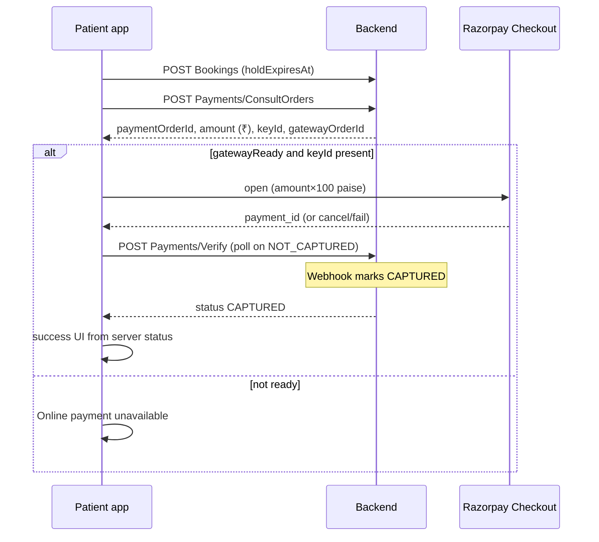

# Razorpay integration report — PATIENT

| Field | Value |
|---|---|
| Date | 2026-10-17 |
| Verdict | **PARTIAL** — consult + medicine wired in code; **READY FOR TEST-MODE QA** on a native rebuild once AppConfig has a test Key ID and the webhook is live. Medicine ONLINE may be **BLOCKED BY BACKEND** if `keyId` / `gatewayOrderId` are still omitted (B-PMT-002). |

## 1. Executive summary

**Before:** Booking opened a fake payment sheet; Pay set local pending/success; `SEED_PAYMENT_ID` on success; medicine Pay showed “not available yet”; `ConsultOrders` / `Verify` / `PayMedicine` hooks unused.

**After:** Shared `src/payments/` module; consult flow creates a server order, opens Razorpay Checkout, verifies/polls without trusting Checkout alone; hold countdown from `holdExpiresAt`; medicine Pay calls `Payments/MedicineOrders` then the same machine; Key ID only from AppConfig/order; Key Secret never in the app.

**Blocked / deferred:** Instant consult pay (needs Instant fee fields B-011); invoices (no route); device Checkout untested in this session.

## 2. Workflow

Pending path: Checkout success + Verify timeout → `PENDING_CONFIRMATION` (no re-charge prompt). Cancel → stay on payment sheet.

## 3. Endpoint table

| Route | Hook | File | Screen | Contract |
|---|---|---|---|---|
| GET /api/Public/AppConfig | useGetAppConfigQuery | appConfigApi | AppConfigProvider | BOUND_OK |
| POST …/Bookings | useCreateBookingMutation | bookingApi | Book appointment | BOUND_OK |
| POST /api/Payments/ConsultOrders | useCreateConsultOrderMutation | paymentsApi | BookingPayment | BOUND (wired) |
| POST /api/Payments/Verify | useVerifyPaymentMutation | paymentsApi | usePayment | BOUND (wired) |
| GET /api/Payments/Appointments/{id} | useGetAppointmentPaymentSummaryQuery | paymentsApi | (available) | PARTIAL |
| POST /api/Payments/MedicineOrders | usePayMedicineOrderMutation | medicinesApi | MedicineCheckout | BOUND if B-PMT-002 |
| GET /api/Patient/Payments | useGetPaymentsHistoryQuery | paymentsApi | Payments history | BOUND_OK |
| Invoices/ByPayment | — | — | — | NOT_IN_CONTRACT |

## 4. Screens / logic changed

| Screen | Change |
|---|---|
| Book appointment | Stores `patientAppId`, `bookingToken`, `holdExpiresAt`, fee from hold; opens payment without fake pending |
| Booking payment | Hold from `holdExpiresAt`; Pay → ConsultOrders → Checkout → Verify; pay-at-clinic option; local method mocks hidden |
| Payment status | Removes `SEED_PAYMENT_ID`; shows masked server order id; success only when parent sets success after CAPTURED |
| Medicine checkout | Pay → MedicineOrders → Checkout → Verify; blocks when gateway fields missing |
| Instant consult pay | Still blocked (null patientAppId); no invented Instant fees |

## 5. Security verification

| Check | Result |
|---|---|
| Secrets scan before | No Key Secret / Webhook Secret |
| Secrets scan after | Unchanged; no new `rzp_` in source |
| `.gitignore` | Now covers `.env` / `.env.*` |
| Bundle grep | Not run (no release bundle in this session) — document in QA |
| Git history | Only placeholder `rzp_test_XXXXXXXXXXXX` in docs |

## 6. Native setup

- Dependency: `react-native-razorpay@3.0.0`
- Plugin: `plugins/withRazorpay.js` (registered in `app.json`)
- Rebuild: `npx expo prebuild --clean` then `npx expo run:android` / `run:ios` or EAS development build
- Expo Go: **not supported**

## 7. Backend gaps (B-PMT-xxx)

| ID | Priority | Need | Unblocks |
|---|---|---|---|
| B-PMT-002 | P1 | Medicine ONLINE must return `keyId`, `gatewayOrderId`, `gatewayReady` | Medicine Checkout |
| B-PMT-003 | P1 | Set `Razorpay:WebhookSecret` (empty today) + dashboard webhook URL on the matching host; verify signature server-side | CAPTURED status after Checkout |
| B-PMT-004 | P2 | Document amount-0 / FEE_NOT_CONFIGURED | Free consult UX |
| B-PMT-005 | P2 | Invoice PDF if product needs download | Receipt button |
| B-PMT-006 | P2 | Hold release after `holdExpiresAt` | Slot reuse |
| B-PMT-007 | P3 | Refund policy messages for cancel | Cancel UI |

## 8. Remaining mobile / open questions

- Resume pending payment on cold start UI (SecureStore write is in place; surface a banner) — PM-008 partial.
- Visit detail “Pay now” for unpaid visits — needs product rule.
- Instant consult payment after Instant fee API (B-011).
- Confirm medicine amount unit is rupees (assumed same as consult).
- Device QA: C1–C11 on a rebuild.

## 9. Go-live checklist

1. Switch server to live Key ID / Secret / Webhook (secrets manager only).
2. Point Razorpay dashboard webhook at prod host; verify signature.
3. One small real payment; confirm visit `PAID` and ledger `CAPTURED`.
4. Grep release binary for secrets.
5. Rollback: disable `gatewayReady` / clear Key ID on AppConfig to block Checkout without an app release.
